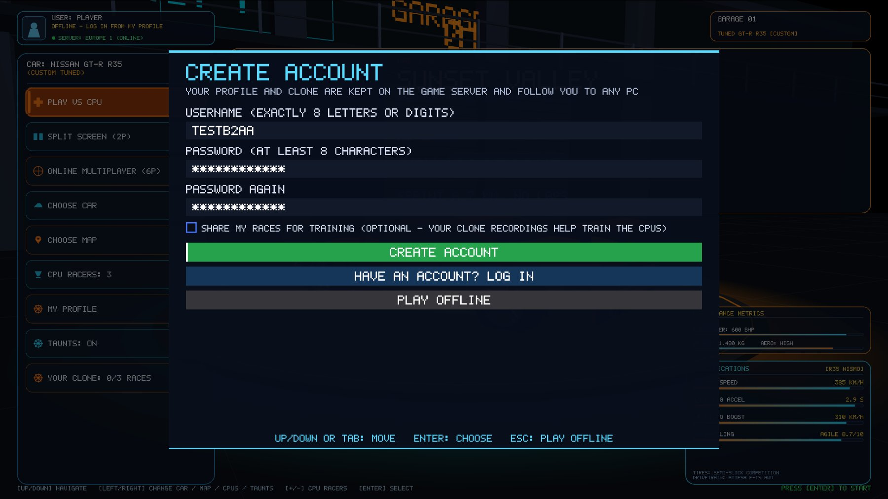
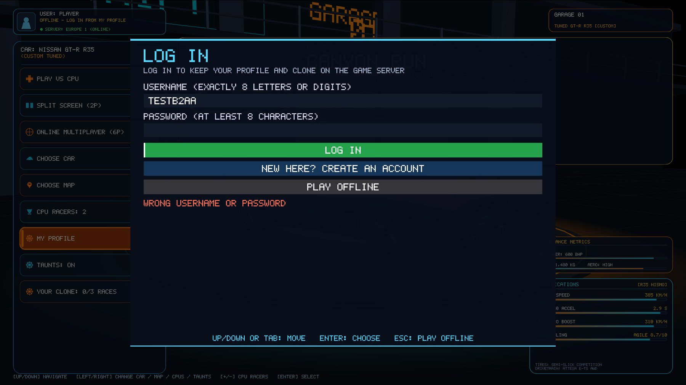
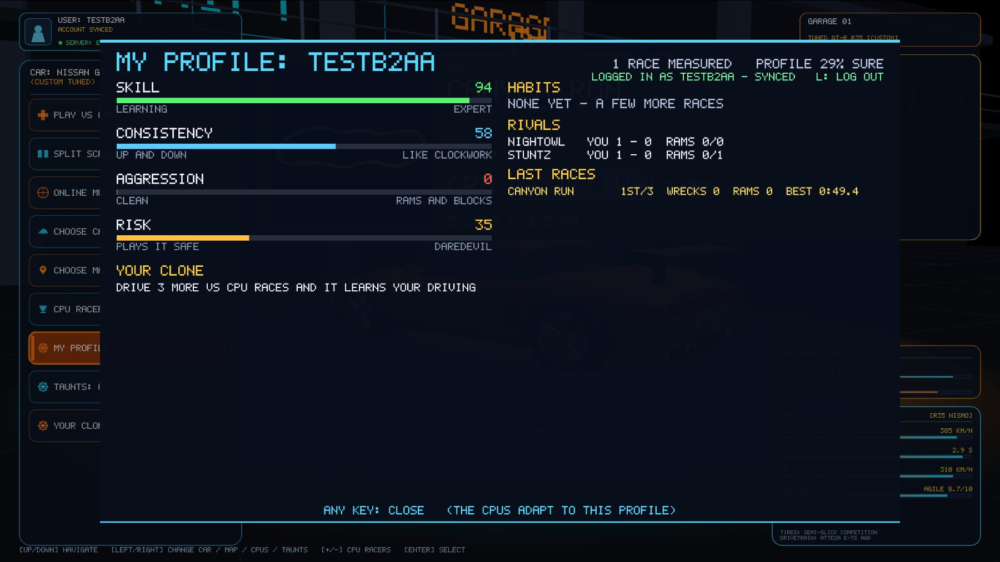
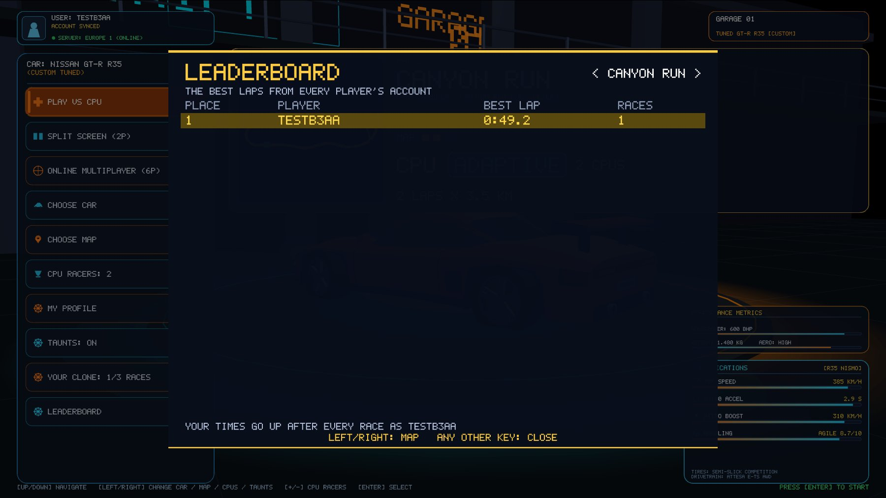

# Accounts and sync (Phase B)

The game works fully offline. With an account, your profile and your clone are kept on the
game server and follow you to any PC. Later they will also follow you to the online race server
and the browser version.

- **The server:** `car-racing-backend`, a separate repo (Node 24, Fastify, SQLite, argon2id),
  running on AWS EC2 under the free plan.
- **Address:** https://tppcarracing.duckdns.org (AWS Mumbai; before 1 Nov 2026: https://13-49-109-8.sslip.io, Stockholm)
- **The API:** documented in that repo's README.

## Milestone B1: the server

- **Accounts:**
  - username exactly 8 letters or digits, unique;
  - password at least 8 characters, stored only as an argon2id hash;
  - 30-day session tokens, stored only as hashes;
  - rate-limited logins.
- **Routes:** profile, clone, race uploads, leaderboard.
- **Running it:** HTTPS through Caddy (Let's Encrypt), a systemd service, daily backups, one-command deploy.
- **Checks:**
  - 15 automated tests;
  - 50 players at once on the t3.micro: 0 errors, ~50 ms a request;
  - an end-to-end check over the internet.

## Milestone B2: logging in from the game

- **The screen:** LOG IN, CREATE ACCOUNT and PLAY OFFLINE.
  - It comes up at the first start without an account.
  - Later, open it with **L** in MY PROFILE (L logs out too).
  - Keyboard: Up/Down or Tab to move, Enter to choose, Esc to play offline. The mouse works too.
  - Passwords are shown as stars, and dropped from memory once used.
- **What's kept on this PC:** only the username and the session token, in Qt settings. The
  password is never kept.
- **Logged in:**
  - your username is your profile name and your name in online lobbies;
  - the menu badge shows `USER: <name>` and the sync state;
  - MY PROFILE shows `LOGGED IN AS <name> – SYNCED`.
- **Sync:**
  - **On login:** whichever side has more races wins, for the profile and the clone
    separately. The PC's older profile is kept as `<name>.local-backup.json`.
  - **After every race and every newly trained clone:** both are uploaded.
  - **No internet:** marked "NOT SYNCED YET" and sent at the next start or race.
  - **A session that ran out (30 days):** the game asks you to log in again.
- **Error messages:**
  - "WRONG USERNAME OR PASSWORD";
  - "THAT USERNAME IS TAKEN";
  - "TOO MANY TRIES – WAIT 45 S";
  - "CAN'T REACH THE SERVER – CHECK THE INTERNET, OR PLAY OFFLINE".

### Checks

`CAR_RACING_AUTOSHOT_ACCOUNT` is a scripted test. It uses its own settings, so a real login is
never touched. It runs these steps:

1. Create the account TESTB2AA.
2. Race once; the profile goes up.
3. Log out and delete this PC's profile file.
4. Try a wrong password (refused).
5. Log in again; the profile comes back down from the server.

It passed against a server on this PC, and against the **live HTTPS server**, where the server
held the race and the profile came back with 1 race. The test account was deleted afterwards.

**Files:**

- `glwidget_account.cpp` (new): the screen, the API calls, sync
- `glwidget.h`, `glwidget.cpp`: keys, mouse, menu badge, the scripted test
- `glwidget_profile.cpp`: the profile name of an account, upload after races and clones,
  the MY PROFILE line
- `glwidget_online.cpp`: your username in lobbies

## Milestone B3: race uploads and the leaderboard

- **Uploads:** logged in, every race's summary goes up when it ends: map, place, cars, best
  lap (on a sprint, the race time), wrecks, rams, km and that race's measured skill.
- **The queue:** races wait in `<name>.pending-races.json` next to your profile and are sent
  oldest first. With no internet they stay there (the newest 50) and go up at the next start,
  login or race.
- **Sharing races for training:**
  - you choose at sign-up (off by default) or switch it with **S** in MY PROFILE, which shows
    "SHARING RACES (S)" or "NOT SHARING RACES (S)";
  - when it's on, that race's clone recording (about 80 KB) goes up with it, for training on
    everyone's data later (Phase E);
  - the server keeps a recording only when the player shares.
- **LEADERBOARD** (a new menu item):
  - the 10 best laps on each map from every player's account (on sprints, the best race
    times), one entry per player;
  - Left/Right switches the map, and your own row is highlighted;
  - it works without logging in; to appear on it you need to log in.

### Checks

`CAR_RACING_AUTOSHOT_BOARD` is a scripted test against a server on this PC. It runs these steps:

1. Create the account TESTB3AA, with sharing on.
2. Race Canyon Run once. The server stored the race (1st, best lap 49.2 s, 7.1 km) and its
   recording (78 KB).
3. Open the leaderboard: it shows TESTB3AA in 1st with 0:49.2.

The live server's leaderboard answers too, and is empty until real players race.
