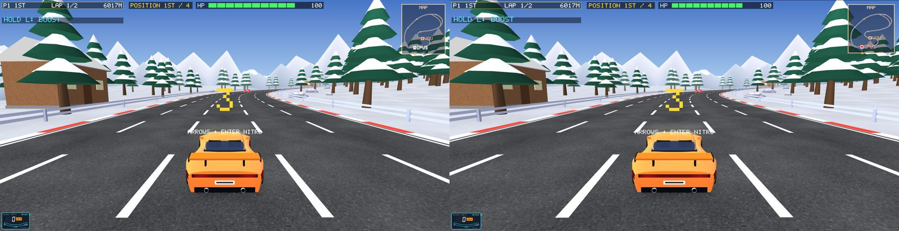
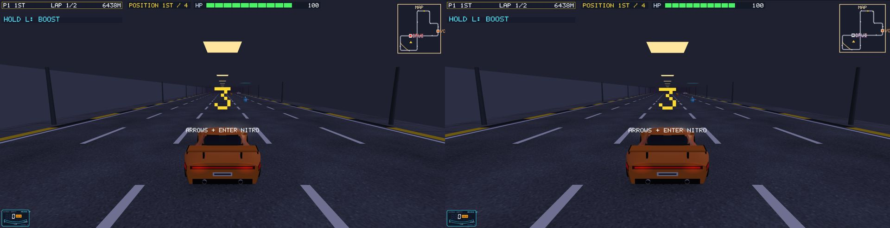

# The browser version (Phase D)

The goal: open the game's site in Chrome and play the real game (vs CPU, online against
desktop players, login, leaderboard). It's one codebase built with Qt for WebAssembly, still
raster OpenGL.

## D1: the renderer on OpenGL ES 2 / WebGL

The renderer was written for **OpenGL 1**:

- 126 `glBegin` blocks;
- fixed-function lighting and fog;
- 9 kinds of display lists;
- GLU cylinders, discs and spheres;
- sphere-mapped reflections on the cars;
- wide lines.

Browsers only have **WebGL**, which has none of that. Instead of rewriting about 400 drawing
calls, a small layer of our own does them: **`gl1shim.*`**. **`gl1redirect.h`** points the
game's `gl…`/`glu…` calls at it.

| OpenGL 1 feature | How the shim does it |
|---|---|
| `glBegin`/`glEnd`, all primitive kinds | collected into vertex batches (quads, quad strips and polygons become triangles); small batches with the same state are merged into one draw |
| matrix stacks, `glOrtho`, `gluPerspective`, `gluLookAt` | its own modelview and projection stacks |
| lighting (light 0, global ambient, colour material, specular and shininess) | in one shader, per vertex like OpenGL, including OpenGL's clamp of the lit colour |
| linear fog | in the shader, on the eye distance |
| textures, sphere-map texture coordinates | modulate; sphere mapping in the shader (the cars' reflections) |
| mipmaps | every level built on the CPU (a 2×2 average, as GLU does), the same everywhere |
| display lists | recorded once, replayed from static vertex buffers; a list with no colour of its own takes the colour current at the call (the car body is painted that way) |
| GLU shapes | generated by the shim, in GLU's own orientation |
| wide lines | drawn as thin quads (WebGL only draws 1-pixel lines) |

**The desktop game uses the shim too**, so the browser will draw exactly what the desktop
draws.




### Checks

- **Same pixels:** the full screenshot tour (63 images: menus, every map's grid and race,
  split screen, 33 fixed spots, every jump) ran with the old renderer and with the shim.
  - The menus match almost exactly (average difference 0.05–0.08 out of 255).
  - Over all 63 images the shim differs from the old renderer by **16.2** on average. The old
    renderer differs from **itself** between two runs by **16.7** (camera smoothing, random
    roster, particles, knocked cones). So the difference is at the noise level: 60 of 63 images
    are within it, and the other 3 are grids with a different random roster or cones a car had
    knocked over.
- **Speed** (the two-window online test, average drawing time per frame):

  | | Drawing time per frame |
  |---|---|
  | old renderer | 3.3–3.5 ms |
  | shim, first version | 7.5–8 ms |
  | shim, with a shader-value cache (values sent only when they change) | **4.7–4.9 ms** |

  Slow frames (over 25 ms) dropped from about 120 to 70–94.
- **Draw calls:** about 1,150 draws and 570,000 vertices a frame, about 90% from stored
  buffers (display lists). `CAR_RACING_GLSTATS=1` prints these numbers.

**Files:**

- `gl1shim.h`, `gl1shim.cpp`, `gl1redirect.h` (new)
- `glwidget*.cpp`, `carmodel.cpp`: include the redirect
- `glwidget.cpp`: `sgl::init()`, and `paintGL` → `paintFrame` + `sgl::endFrame()`

## D2: the WebAssembly build

The same code, built with **Qt 6.11.1 for WebAssembly** (`C:\Qt\6.11.1\wasm_singlethread`) and
**Emscripten 4.0.7** (the exact version this Qt needs, in `C:\Qt\emsdk`):

```
tools\wasm\build_wasm.bat
python -m http.server 8099 --directory C:\Qt\tpp-wasm
```

Then open http://localhost:8099/car_racing.html. The output is `car_racing.html`, `.js`,
`qtloader.js` and a 16 MB `car_racing.wasm`, written to `C:\Qt\tpp-wasm` (outside OneDrive).

What changes in the browser (all under `__EMSCRIPTEN__` / `wasm {}`; the desktop is unchanged):

| | Desktop | Browser |
|---|---|---|
| the window | `QOpenGLWidget` in `MainWindow` | `GLWidget` is a `QOpenGLWindow` that fills the page. WebGL can't share a widget's offscreen context with the window's, so a `QOpenGLWidget` breaks there. |
| OpenGL | 2.1 compatibility, 4× MSAA | WebGL 2 (OpenGL ES 3); `gl1shim` draws the same |
| sound | Qt Multimedia (`QAudioSink`) | the browser's Web Audio plays the same synthesizer (`audioweb.cpp`); it starts on the first key press or click (a browser rule) |
| online races | `net/link`: TCP or our own WebSocket | `net/link`: the browser's own WebSocket (`emscripten/websocket.h`), the same messages |
| Wi-Fi rooms | host on this PC, find rooms on the Wi-Fi | a web page can't be a server or see the network, so it says "host on the internet server", and a code goes straight to the internet server |
| training your clone | on a thread | in place (the browser build has no threads); it takes a second or two |

**Checked in Chrome:**

- the login screen, garage, story scene, and an offline race against CPUs, all drawn
  correctly;
- **HOST ON THE INTERNET SERVER**: room made on the AWS server at about 203 ms ping, and an
  online race started (the server runs the story scene for the room);
- a game frame takes about 5 ms of browser time (median), measured in a hidden tab;
- the desktop build still passes its screenshot tour.

(D3 below did login, the leaderboard, saving between visits and the page polish.)

## D3: login, the leaderboard and saving in the browser

**Our own page** (`tools/wasm/index.html`, copied to the build as `index.html`) replaces Qt's:

- a loading screen and the title "TPP Car Racing", with the game filling the tab;
- **saving between visits:**
  - before `main()` runs, the page mounts `/home/web_user` on the browser's IndexedDB (Emscripten's
    IDBFS, linked with `-lidbfs.js`) and waits for it to load;
  - changes are written back every 3 seconds, and when the tab is hidden or closed;
  - this covers profiles, clones (`.brain`) and races waiting to upload, all in
    `~/.local/share/this.program/profiles/`;
  - settings and the login token are `QSettings`, which Qt for WebAssembly already keeps in the
    browser's localStorage;
  - with no IndexedDB (some private windows), the game still runs, without saving;
- arrow keys, space, Tab and Backspace never scroll the page;
- a zoom or a move to another screen (the pixel ratio changes) makes Qt re-measure the window;
- `?mute`: no sound at all.

**In the game (browser build only):**

- **Which server:**
  - on the real site the API is the page's own address (`location.origin`), so the same site
    needs no CORS;
  - `?api=http://localhost:PORT` points at a server on this computer for tests, and is accepted
    **only** for localhost, so no link can send your login anywhere else;
  - `CAR_RACING_API` still works.
- **Sound:** a hidden tab is silent and plays again when you come back.
- **Login screen:** the password field says it's typed into the game, so the browser's password
  manager can't fill it in.

**The account server** (`car-racing-backend`) has `CORS_ORIGINS`: web pages at other addresses that
may call it, e.g. `http://localhost:8099`. It is empty by default, which is right for the real
site; a test in `test/api.test.js` covers it.

**Checked in the browser** (the page at `localhost:8099?mute&api=http://localhost:3007`, a local
account server with `CORS_ORIGINS=http://localhost:8099` and a fresh database, test account
`TESTD3AA` / `test-pass-d3`):

- created the account from the game: the browser's pre-check (`OPTIONS`), then register, profile
  and clone all went through;
- the leaderboard opened;
- after a reload: still logged in ("ACCOUNT SYNCED"), and a changed setting (TAUNTS OFF) kept;
- a file written into the save folder was still there after a reload;
- typing works with real key presses.

**Not checked in the browser:**

- a race upload (that needs a whole race driven by key presses; it uses the same API code as
  register and profile, which work, and was tested on the desktop in B3);
- the pixel-ratio fix (the test browser can't change its ratio on demand).

## D4: live at https://13-49-109-8.sslip.io

The same free AWS machine (t3.micro, eu-north-1) now serves everything on one address:

| Path | What |
|---|---|
| `/` | the browser game (`/var/www/tpp-game`) |
| `/api/...` | the accounts API (Node, port 3000) |
| `/race` | the online race server (WebSocket, port 47810), protocol 22 |

**How the game is served** (`car-racing-backend/deploy/Caddyfile`):

- Each file has a gzip copy beside it, made on this PC, so the server never compresses anything:
  the 19.7 MB game goes out as **9.4 MB** (the two MP3s inside don't compress).
- `Cache-Control: no-cache`: browsers keep the files but always ask whether there is a newer
  version, so an update reaches everyone at once.
- `application/wasm` is sent as the type (Caddy knows it).
- The free 100 GB a month of outgoing data covers about 10,000 visits.

**Updating:**

1. the game: `tools/wasm/build_wasm.bat`, then
   `tools/wasm/deploy_site.sh ubuntu@13.127.16.77 <key.pem>`. The new files replace the old ones in
   one step, and the previous version stays in `/var/www/tpp-game.old`;
2. the API and the Caddyfile: `car-racing-backend/deploy/deploy.sh ubuntu@13.127.16.77 <key.pem>
   tppcarracing.duckdns.org`. It now checks the new Caddyfile on the server before using it;
3. the race server: `server/deploy_race_server.sh ubuntu@13.127.16.77 <key.pem>`.

SSH only works from your own address (security group `car-racing-sg`, rule "SSH: My IP"). Your
connection changes address often, so set the rule to "My IP" again before a deploy.

Backups from before D4 are on the server in `/var/backups/d4-<date>/`: the old Caddyfile, race
server and API code.

**Checked live:**

- the site loads in Chrome (loading screen, then the game);
- online, protocol 22 against the AWS server: test bots raced with CPUs to the finish;
- **a browser player and desktop players in one room:**
  - the browser hosted the room and two desktop test bots joined;
  - their tracks matched (fingerprint);
  - the race ran, and ESC skipped the story scene for everyone;
- not tested live: an old desktop build (protocol 21). The server's first check turns it away with
  "Different game version - update the game" (`net/raceserver.cpp`), so anyone playing online on
  the desktop needs the new build.

**Fixed during D4:**

- **ESC in an online story scene left the race** instead of skipping the scene for everyone, as
  the screen says. The online keys were read before the story's (`glwidget_online.cpp`).
- **Sizes in the browser:**
  - the game now draws at the canvas's real size, and takes the pixel ratio from the page
    (`pixelRatio()`);
  - mouse clicks use the size of the last frame drawn;
  - Qt's own values can be stale.

  The test browser pane (hidden, resized behind the scenes) still showed the menus too big after a
  while. A normal Chrome tab was checked for 30 seconds and stayed right.

## Moved to AWS Mumbai: https://tppcarracing.duckdns.org

On 1 November 2026 everything moved from Stockholm (eu-north-1) to **Mumbai (ap-south-1)**, close to
the players.

- The server `car-racing-mumbai` (i-0158428abaa597c95) is the same as before: t3.micro, Ubuntu
  26.04, 8 GB, a 1 GB swap file (without it the race server can't be compiled there).
- Its fixed address is **13.127.16.77** (Elastic IP).
- Its name is **tppcarracing.duckdns.org**: a free DuckDNS name on your Google account. If the
  server ever changes address, only the IP on duckdns.org changes; the game's address stays the
  same.
- The firewall `launch-wizard-1` allows SSH from your IP only (set "My IP" again before a
  deploy), and the website ports to everyone.
- **The accounts database was copied unchanged**: the API was stopped on Stockholm, the file
  copied, its checksum compared, and the leaderboards checked to match.
- The desktop game now has `https://tppcarracing.duckdns.org` built in. The browser game uses the
  page's own address, as before.
- Connection time from India: about 85-100 ms, against about 195-380 ms to Stockholm.

The Stockholm server stays for about a day as a fallback, then it is deleted and its address
released (with the owner's OK).


## A stuck page: what guards against it

A report said the page sometimes stops at a story scene until it is reloaded. `car_racing.html?storytest&mute`
plays every scene of every map twice and prints each step, the slowest frame and the memory on the console:
it ran clean (slowest frame about 400 ms, the map being built; memory steady), so the report's cause is not
known yet. What now stands in its way:

- The clone trains in slices (`sim::CloneTrainer`, a few ms a frame). It took about 0.6 s natively in one go
  for a full history, so this was a smoothness fix rather than the proven cause.
- The page passes keys on to the game wherever the page's focus went.
- An error, lost WebGL graphics or 8 s without a frame in a visible tab shows a red notice with the reason in
  the console (`[game stopped]`), instead of a silent frozen picture.
