# Circuits (step 1): laps, hills, jumps, tunnels, bridges and shortcuts

Canyon Run, Alpine Pass and Neon City are **closed circuits of 3.3 to 3.6 km raced 1 to 5
laps** (3 by default), with hills, banked corners, jump ramps, tunnels, bridges and a
shortcut. Sunset Valley and Coastal Highway were circuits too until 1e; since then they are
**8.2 km sprints on the first game's road** (see the last section). These are milestones 1a
to 1e of step 1 in `docs/ROADMAP.md`; each has its own section below.

# Milestone 1a: flat loops with laps

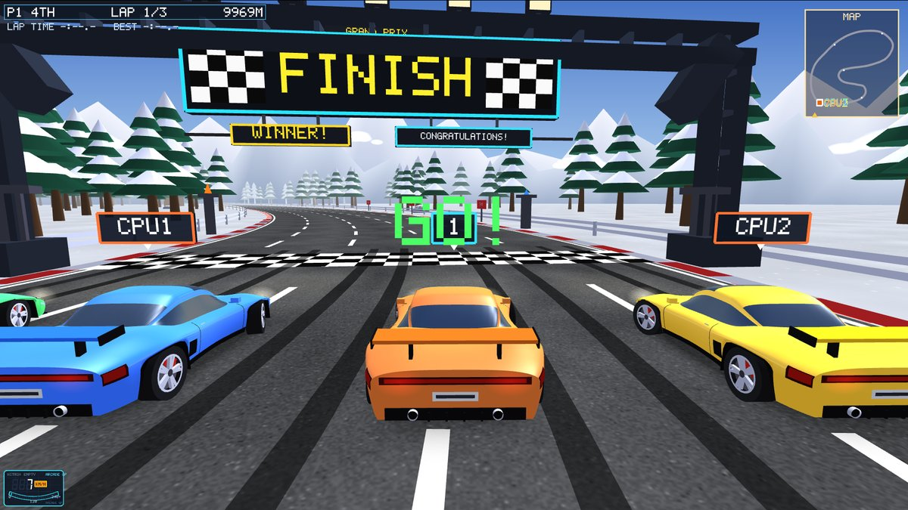

## What you see

- **Menu:** a new item **LAPS: 3** (Left/Right, or Enter, picks 1-5). The map card shows
  the whole circuit seen from above, with the start/finish line in green, and the race
  length, for example `3 LAPS X 3.2 KM`.
- **Start:** the cars line up behind the start/finish gantry (rows of 2, or of 4 for a pack).
  The gantry's scenery (kerbs, billboards, palms, hills, chevron signs) follows the bend
  the line is on.
- **HUD:** `LAP 2/3` and the distance left to the finish; under it the time of this lap
  and your best lap. Crossing the line shows **LAP 2/3**, then **FINAL LAP**, in the
  middle of the screen.
- **Minimap:** the whole loop, north up, with the start/finish line, the temple, traffic
  and every racer.
- **Results:** a new **BEST LAP** column.
- **Every lap has something in it:** knocked-over cones and barrels are put back after
  20 s and nitro cans come back after 15 s (only while no car is within 60 m, so nothing
  pops up in front of a driver). Traffic drives round the loop.
- **Online:** the host picks the laps with Up/Down in the lobby (`LAPS: 3 +/-`).

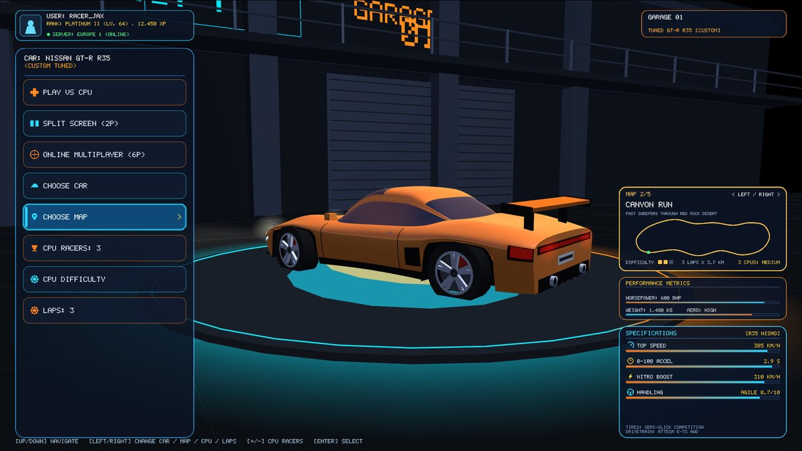
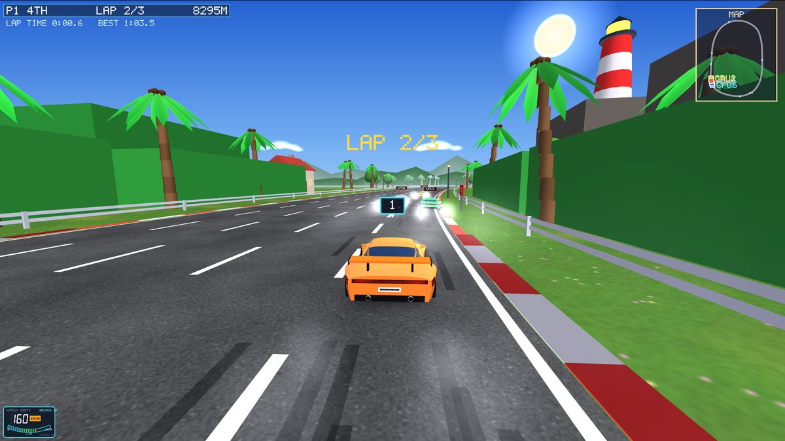
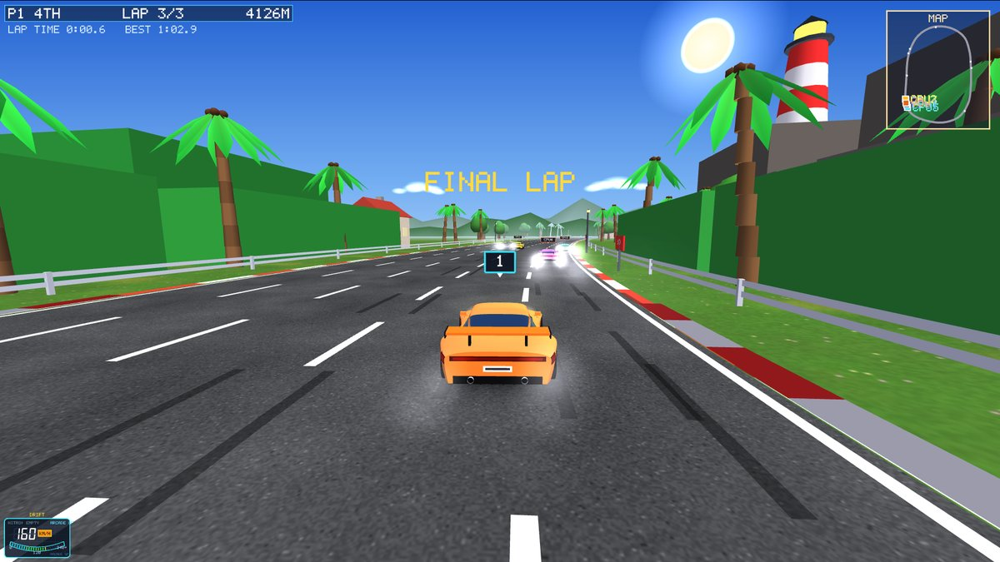
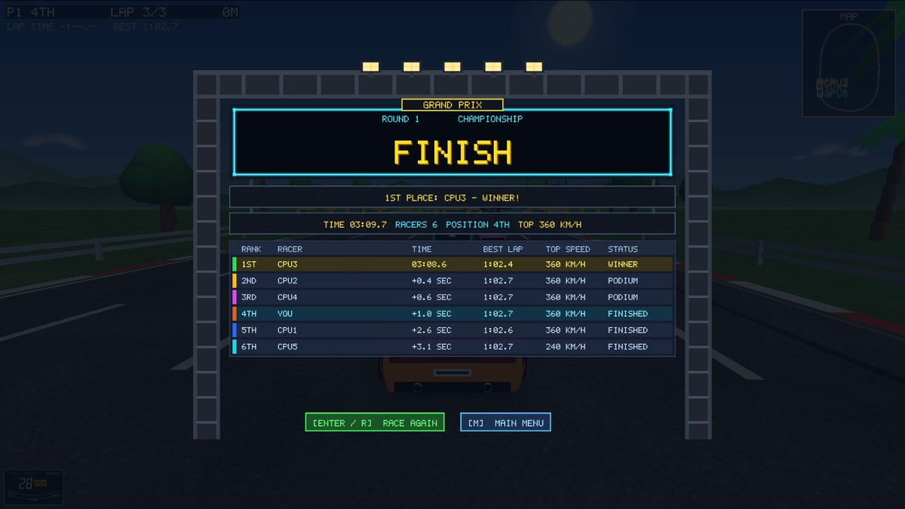
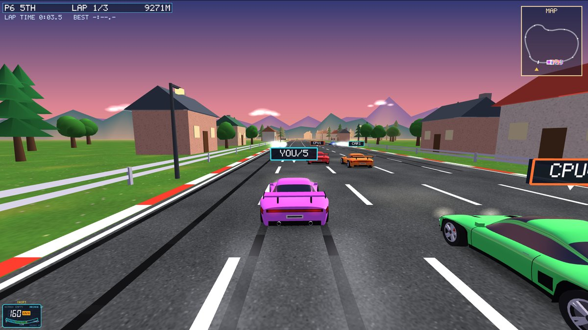

## How it works (for the viva)

**The curve.** `shared/circuits.cpp` lists each circuit as 30-40 control points (x east,
z north, plus height, banking, width and markers used from 1b on). `shared/track.cpp`
runs a smooth closed curve through them (centripetal Catmull-Rom: it never forms loops or
cusps between points) and cuts it into **1 m slices**. Each slice stores its position,
direction, width and markers. Only + - x / and square roots are used, so every PC builds
exactly the same circuit (needed online).

**s and d.** Everything on the circuit is placed by **s** (metres along the lap from the
start/finish line) and **d** (metres right of the centre line):
- `pointAt(s, d)` turns s/d into a world position (between two slices it blends them);
- `locate(car)` does the reverse after every move: it looks for the nearest point of the
  centre line **within 40 m of where the car was last time** (a full search only if the
  car is lost). So a part of the circuit that passes close by, or crosses, is never
  mistaken for the road the car is on.

**Laps.** When s jumps from the last quarter of the lap to the first quarter, the car has
crossed the line forwards: lap + 1 (and that lap's time is checked against the best).
Jumping the other way (reversing over the line) takes the lap away again. The race
position is **progress = lap x lap length + s**; finished cars are ordered by finish time.
The grid is behind the line, so everyone starts on lap -1 and the first crossing starts
lap 1 of the race. No checkpoints are needed: because of the local search the car can
only reach the line by driving the lap.

**Everything uses s/d.**
- *Placing:* grid, obstacles, nitro cans and traffic by s/d; scenery beside the road, but
  only where no part of the circuit comes too close (a 32 m grid of slices answers "how
  far is the nearest road?" quickly). The temple stands 150 m beside the road near the
  start, clear of every road.
- *Driving:* off-road and the guard rails compare d with the road's half width there.
- *Collisions:* traffic and other racers are boxes in the road's own frame (across = d,
  along = s), so they work whichever way the road runs.
- *CPU driver:* the same driver as before. Hazards are measured along the lap
  (`aheadOf(s1, s2)`), and it steers towards `pointAt(s + look ahead, chosen d)`.

**Drawing.** The road (asphalt, kerbs, lines, guard rails, posts) is built once per map
and road width into display lists of about 50 m. Each frame only the pieces within the
draw distance and not behind the camera are drawn. Where Neon City crosses itself (a
raised highway from milestone 1d on) the crossing is flat for now: no guard rails across
the other road, and the later road lies 2.5 cm lower without markings, so the two never
flicker.

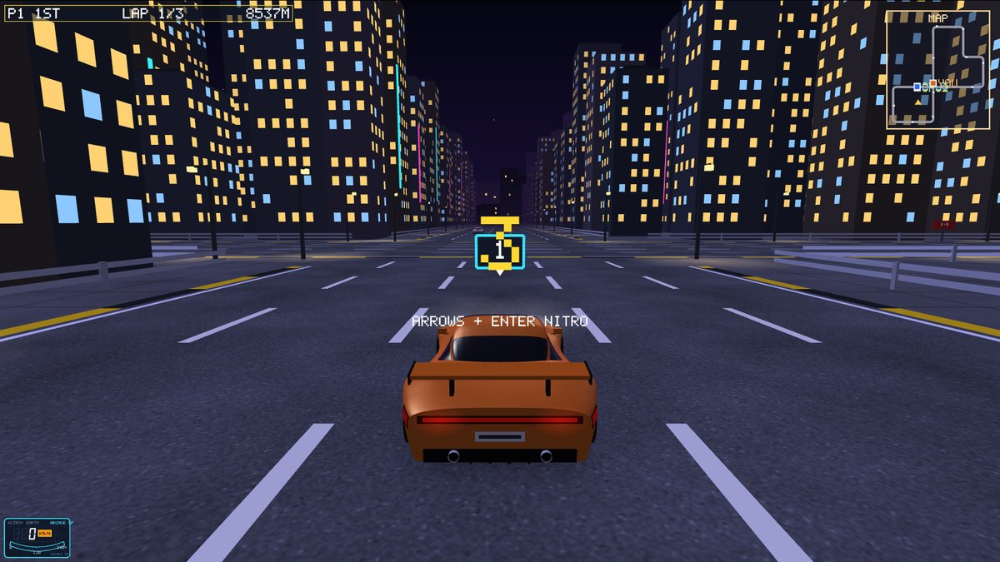

**Online (version 6).** Snapshots carry each car's s, d, lap, lap start and best lap, the
traffic's s, and obstacles that were knocked over *or put back*. The lobby and the race
start carry the number of laps. Other cars are smoothed by blending their progress
between snapshots.

## Checks

| Check | Result |
|---|---|
| Headless races (`tools/ai_bench.cpp`, 1 lap): full rooms of 6 on all 5 maps | 90 of 90 cars finish, 1.9 crashes per car |
| Headless: online CPU levels 1-5 with the reference driver, 25 races | every car finishes every race; average place level 1: 6.0 ... level 5: 1.2 |
| Online: 4 bots + 2 CPU racers, 1 lap, Sunset Valley and Neon City | every car finished, track fingerprint matches |
| Two game windows online (host + guest + 4 CPUs), twice | small corrections 16-30 (host) / 6-8 (guest), no big jumps, drawing 2 ms a frame |
| Full 3-lap race against 5 CPUs in the game (Coastal Highway) | LAP banners, lap times; all 6 cars finish within 3.1 s |
| Temple and scenery clearance (all maps) | temple 150 m from the nearest road, at least 76 m from any prop |

vs CPU on the circuits, 30 races each: how often "you" (the reference driver, which drives
like a good player) win, before (straight roads) and now:

| CPUs | Easy | Medium | Hard |
|---|---|---|---|
| 1 | 60% -> 100% | 40% -> 20% | 40% -> 20% |
| 3 | 100% -> 100% | 40% -> 30% | 17% -> 3% |
| 5 | 100% -> 100% | 30% -> 37% | 7% -> 0% |

Medium and Hard are a little harder on the circuits (more bends, where the CPU's catch-up
pace counts for more). Step 3 replaces the speed-based difficulty with skill, so it is left
as it is for now.

## Files changed

- `shared/track.cpp / .h`, `shared/circuits.cpp`: the curve and the five circuits
  (added before 1a with `tools/track_preview`)
- `shared/gamesim.cpp / .h`, `shared/simtypes.h`: s/d, laps, lap times, placement,
  collisions and the CPU driver on circuits; obstacles and nitro cans come back
- `shared/netsnapshot.cpp`, `net/*`: online version 6 (laps in the lobby)
- `glwidget.cpp / .h`, `glwidget_online.cpp`: road display lists, gantry, sea, temple,
  minimap, HUD, menu card, laps item, results column
- `tools/ai_bench.cpp`, `tools/net_bots/`: 1-lap test races

---

# Milestone 1b: hills, banking and the ground

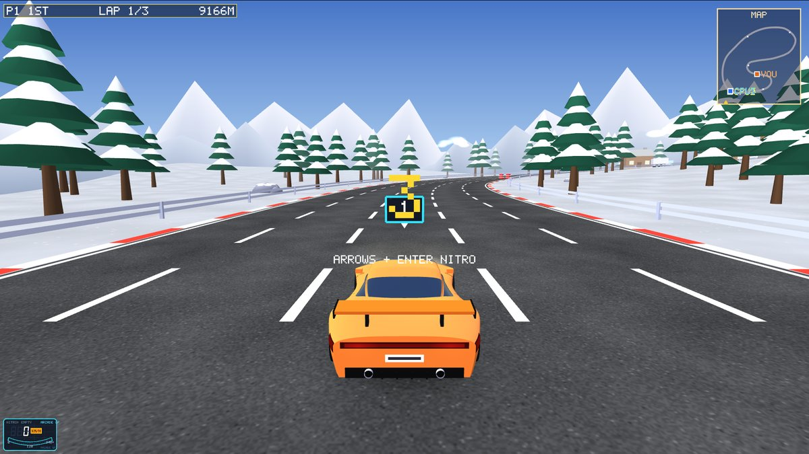

## What you see

- **Hills:** the roads climb and fall as in the approved layouts: Sunset Valley's crest
  (15 m), Canyon Run's climb to the plateau (25 m), Alpine Pass's switchbacks up to 60 m,
  Coastal Highway's cliff-top road (32 m) and Neon City's street dipping 4 m into a cutting.
- **Banked corners** lean towards the inside: Sunset Valley's first left (4 degrees),
  Canyon Run's hairpin (8 degrees) and Coastal Highway's cliff-top curves (6 degrees).
- **Everything stands on the road:** cars, traffic, cones, barriers, nitro cans, shadows and
  skid marks follow its height and tilt with its slope and banking. Name plates stay
  upright.
- **Driving:** going uphill costs up to about 8% of top speed and pulls less; going downhill
  gives up to about 6% more. When you lift off, a climb slows you a little more and a
  descent pushes you on. Turning towards the low side of a banked corner steers up to
  about 20% sharper. The CPUs drive by the same rules.
- **The ground** is shaped by the road: slopes, cuttings and embankments between parts of
  the circuit at different heights, then gentle hills further out (taller round Alpine
  Pass, none in the city). Coastal Highway's ground drops to a beach and under the sea; the
  temple stands on a level square. Houses and towers on sloping ground get a stone
  foundation.
- **Camera:** the chase camera follows your height smoothly, looks along the slope and never
  dips below the road behind you; the hood and bumper cameras lean with the banking. The
  sun, clouds and mountains rise with you, so the horizon looks right on a summit.

Left for milestone 1d: Neon City's raised highway stays at street level (its crossing stays
flat), tunnels are open cuttings and bridges are embankments. Ramps are driven as hills
until the jumps of milestone 1c.

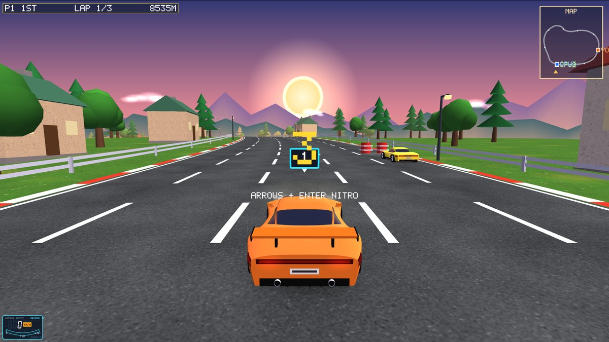
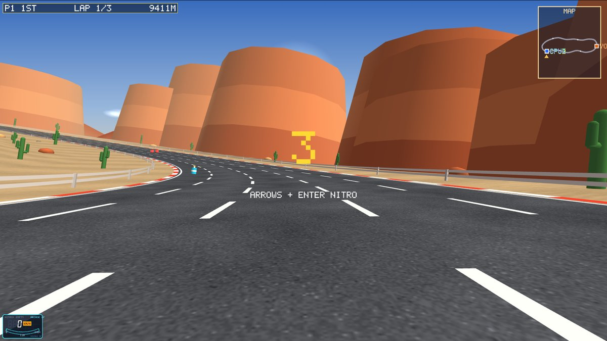
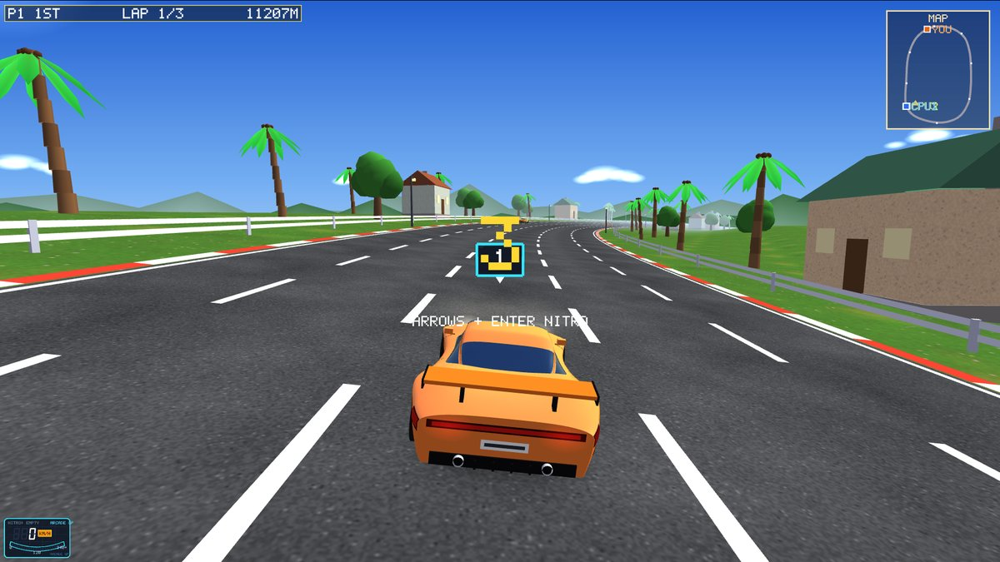
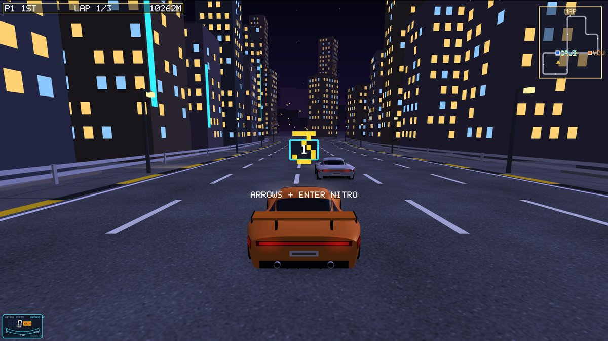

## How it works (for the viva)

- **Road height:** every slice has a height and a banking angle. The surface at (s, d) is
  `height(s) - d x sin(banking(s))` (+ banking = right edge lower), blended between
  slices; the verge up to the guard rail continues the same tilted surface. The sine is
  worked out from its series (x - x^3/6 + x^5/120), the same on every computer. A car's
  height comes from its s and d after every move.
- **Slope physics** (`GameSim::updateCar`): slope = rise per metre in the direction the car
  faces (the road's grade times how much the car points along the road).
  - Top speed x (1 - 1.1 x slope) uphill, x (1 + 0.8 x |slope|) downhill.
  - Pull x (1 - 2 x slope), kept between 0.7 and 1.3.
  - Coasting: speed - 0.03 x slope every tick.
  - Banking: steering x (1 + 1.5 x sin(banking)) when turning towards the low side. The
    CPU's braking for bends uses the same factor.
- **The ground** (`GLWidget::buildGround`): an 8 m grid reaching 400 m past the circuit.
  - Up to 12 m past the guard rails, a point lies 15 cm under the road's surface there.
  - Further out it blends (over 40 m) into a distance-weighted mix of the heights of all
    road within 160 m, plus hills of our own value noise.
  - It is stored in 64 m display lists and only the ones in view are drawn.
  - A check after building samples the road every 2 m at 5 places across and counts any
    place where the ground comes up through it.
- **Placing on it:** each prop stands on the lowest ground under its corners; houses and
  towers stand on the highest corner with a foundation down to the lowest.
- **Online (version 7):** heights are not sent; each computer works them out from s and d.
  The track fingerprint now includes the heights.

**Found and fixed on the way:**
- Two of my draft layouts banked their corners outwards: Canyon Run's hairpin and Coastal
  Highway's cliff-top curves. Their sign is corrected, and every banked metre now leans
  into its curve.
- The curve code made a one-metre banking spike where two segments meet
  (`shared/track.cpp`).
- Neon City's start street rose 0.3 m before the tunnel dip, just where the highway
  crosses it. One extra point on that straight keeps it level there.

## Checks (1b)

| Check | Result |
|---|---|
| Ground coming up through the road (every 2 m, 5 places across, both road widths) | 0 places on all 5 maps |
| Every banked slice leans into its curve | yes, on all maps |
| Headless full rooms of 6, 1 lap, all maps | 90 of 90 cars finish; 2.0 crashes per car (1.9 when flat) |
| Car-to-car contacts, 12 races per map | unchanged within noise except Coastal Highway: 1.0 -> 2.4 per car per race, side-by-side scrapes on the climb to the cliff-top curves where the pack bunches up |
| Online: 4 bots + 2 CPU racers on Alpine Pass, Coastal Highway and Canyon Run | every car finishes, track fingerprint matches |
| Two game windows online | corrections 6 / 5, no big jumps, drawing 1.3-1.6 ms a frame; one 46 ms frame at the start while road and ground are built |

vs CPU with hills (30 races each, how often the reference driver wins): 1 CPU 80% / 20% /
40%, 3 CPUs 100% / 30% / 7%, 5 CPUs 100% / 47% / 0% (Easy / Medium / Hard).

## Files changed (1b)

- `shared/gamesim.cpp / .h`, `shared/simtypes.h`: heights, slope and banking physics,
  effects at the car's height, the overpass kept level, the fingerprint
- `shared/track.cpp`: banking blend fixed; `shared/circuits.cpp`: banking signs, one Neon
  City point
- `shared/netsnapshot.cpp`, `net/protocol.h`, `glwidget_online.cpp`: version 7, heights of
  other cars
- `glwidget.cpp / .h`: road in 3D, ground height map, cars and objects standing on the road,
  foundations, temple, beach, cameras, backdrop, particles, skid marks, screenshot spots

---

# Milestone 1c: jumps

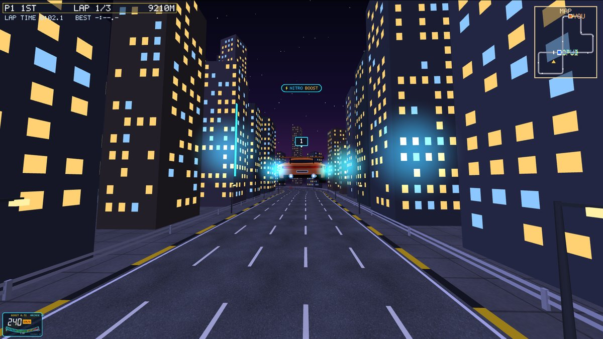

## What you see

- **Four ramps**, one per marked jump spot: Sunset Valley's crest, Canyon Run's dry
  riverbed, Alpine Pass's ski jump and Neon City's junction (Coastal Highway has none).
  Each ramp is yellow and black up to a steel lip, spans the road from rail to rail, and
  has JUMP boards on both sides 80 m before it. The minimap marks the ramps in yellow.
- **Flying:**
  - the throttle and brakes do nothing in the air;
  - steering works at a third of normal, enough to follow the road's bend and land on it;
  - nitro still pushes you;
  - the nose follows the flight path, and the shadow stays on the road below, getting
    smaller and fainter the higher you go;
  - the camera rises slowly while you fly, so you see the car soar.
- **Landing**, measured by how hard the car meets the slope under it (gravity is twice
  real gravity, for quick, high arcs):

  | Landing | Impact | What happens |
  |---|---|---|
  | Soft | under 12 m/s | nothing |
  | Medium | 12-16 m/s | 5% of your speed, a shake |
  | Hard | over 16 m/s | 15% of your speed, sparks, a crash shake |

  Landing crooked (more than 25 degrees off the road) costs another 15%. Dust flies, and
  after a flight of half a second or more **BIG AIR 1.2 S** shows on the screen. Nitro
  over a jump flies much further but lands hard: risk and reward.
- **Height matters:** a flying car passes over cones, barrels, barriers, traffic and nitro
  cans, and cars more than 1.4 m apart in height don't touch.
- **CPU drivers** line up near the middle of the road 120 m before a ramp and use the same
  steering in the air. There are no cones, barrels or nitro cans 150 m either side of a
  lip; traffic still drives over the ramps, slowly.

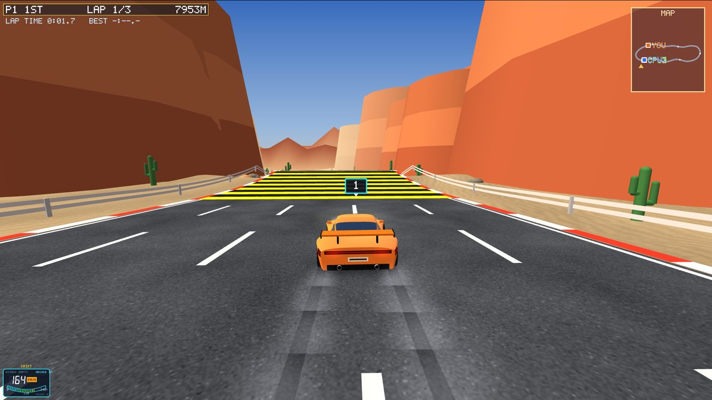
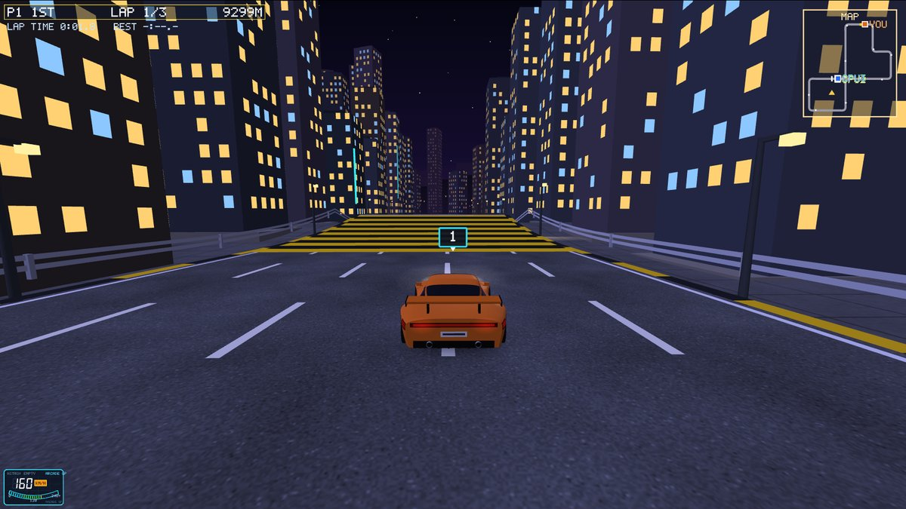
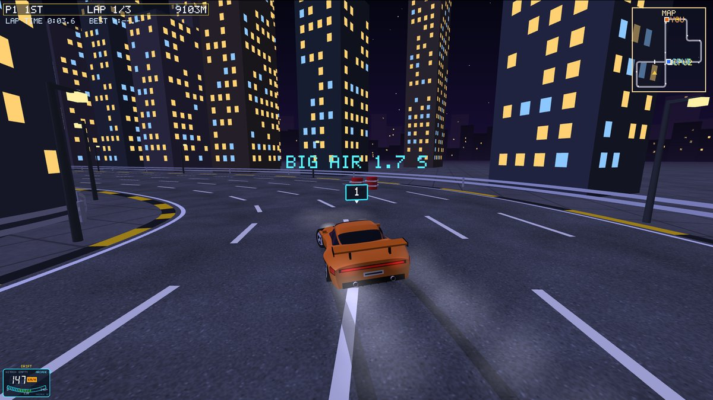

## How it works (for the viva)

- **The ramp** is a bump added to the road's height (`GameSim::setMap`).
  - Over 30 m it rises on a curve that steepens to the lip, which is a few degrees
    steeper than the road: Sunset Valley 5, Alpine Pass 7, Canyon Run and Neon City 9.
  - Behind the lip it drops back at 20%, so a slow car just rolls over it.
  - Because the bump is part of the road's height, everything that stands on the road
    (cars, traffic, the ground beside it) follows it.
- **Taking off** (`GameSim::fly`): on the road the car's height is the road's. Every tick
  the car looks at the road one tick behind and one tick ahead along its path. If the road
  ahead falls away faster than gravity could pull the car down, the car takes off with its
  climbing speed. That happens at a lip, or at any crest sharp enough for the speed; on
  the current layouts only the ramps are. Using the road's shape, not the car's last
  height, means a push in a collision never looks like a launch.
- **Flying:** height += vertical speed; vertical speed -= gravity (2 x 9.8 m/s2) every
  tick. The guard rails still hold the car, so nobody falls off the circuit.
- **Landing:** when the car comes down to the road, impact = the road's own climb along
  the car's path minus the car's vertical speed. A Landing event carries it (and the
  time in the air) to the game for dust, shake and the message.
- **Online (version 8):** snapshots carry each car's height, vertical speed and time in
  the air. Your own car's flight is predicted by the same code, and other cars' heights are
  blended between snapshots.

## Checks (1c)

Every ramp launched by `tools/ai_bench.cpp jumps`, at speeds from slow to full nitro, from
the middle and both edges, at both road widths:

| Ramp | At top speed (238 km/h) | With nitro (356 km/h) |
|---|---|---|
| Sunset Valley (5 degrees, 1.3 m) | 0.8 s, 46 m, soft (8.8 m/s) | 1.3 s, 126 m, medium (14.0) |
| Alpine Pass (7 degrees, 1.8 m) | 1.0 s, 58 m, soft (11.5) | 1.4 s, 140 m, hard (18.6) |
| Neon City (9 degrees, 2.4 m) | 1.1 s, 57 m, medium (12.9) | 1.7 s, 167 m, hard (17.9) |
| Canyon Run (9 degrees, 2.4 m) | 1.15 s, 62 m, medium (13.4) | 1.7 s, 169 m, hard (20.7) |

- **Landing place:** with the CPU's steering in the air, every launch lands on the asphalt
  (the closest is 2.3 m inside the edge, Canyon Run with nitro). Without steering in the air,
  the nitro launches on Sunset Valley, Canyon Run and Alpine Pass reach the guard rail,
  which is why a third of the steering is kept in the air.
- **Headless full rooms of 6, 1 lap:** 90 of 90 cars finish; 1.7 crashes per car (a hard
  landing counts as one).
- **Online, 4 bots + 2 CPU racers** on all four maps with a ramp: every car finishes, and
  the track fingerprint matches.
- **Ground:** the ground never comes up through the road on any map (0 places). The ramps
  bend too sharply for the 8 m grid, so the ground lies an extra 0.6 m lower around them.
- **Online with two game windows across a jump** (Sunset Valley, a 30 s race): both cars
  took the jump; 18 / 8 small corrections and no big ones; drawing 1.5-1.7 ms a frame.

## Files changed (1c)

- `shared/simtypes.h`: gravity, car height / vertical speed / time in the air, the
  Landing event
- `shared/gamesim.cpp / .h`: ramps, take-off, flight, landing, collisions by height, the CPU
  lining up, the ramps kept clear of cones and cans
- `shared/netsnapshot.cpp`, `net/protocol.h`, `glwidget_online.cpp`: version 8, flying
  cars online, longer scripted online races (`CAR_RACING_NETTEST_FRAMES`)
- `glwidget.cpp / .h`: ramp paint, lip and boards, flying cars and their shadows, landing
  dust and shake, BIG AIR, camera in the air, minimap marks, jump screenshots
- `tools/ai_bench.cpp`: the jump test (`ai_bench jumps`)

---

# Milestone 1d, part A: tunnels, bridges and the raised highway

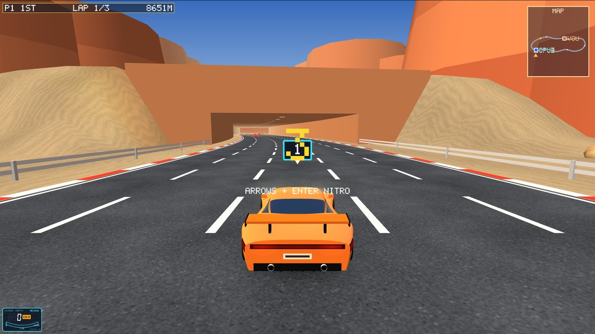

## What you see

- **Tunnels** on four maps. Inside: walls on the guard-rail lines (they stop cars like the
  rails), a ceiling with a row of lights, and darker light that fades in and out over
  about 30 m at the portals. Outside: a portal face set into the ground above.
  - Canyon Run: through a sandstone mesa about 15 m above the road.
  - Alpine Pass: an avalanche gallery, roofed, with a wall on the mountain side and columns
    open to the valley.
  - Coastal Highway: under a headland, with a lighthouse on top.
  - Neon City: an underground street tunnel whose roof is at street level.
- **Bridges** with a deck from rail to rail, parapets instead of guard rails and pillars
  every 28 m. The ground under the middle of the span drops into a valley: a river 6 m down
  at Sunset Valley (wooden parapets), a 25 m gorge at Alpine Pass (stone), the harbour at
  Coastal Highway (steel). A flat water plane fills the river and the harbour.
- **Neon City's raised highway** is back at its real height: about 10 m over the start
  street, on concrete pillars (none stands on the street). The two roads no longer meet at
  the crossing; each car stays on its own road, and cars on different levels cannot touch.

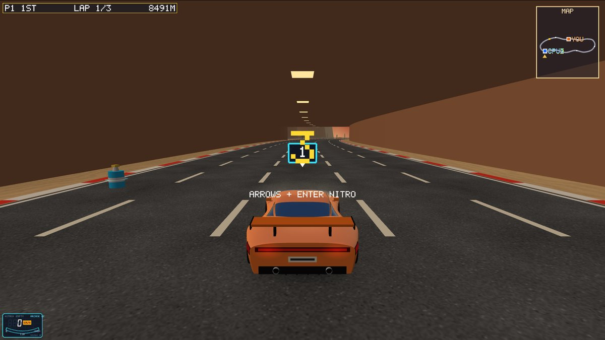
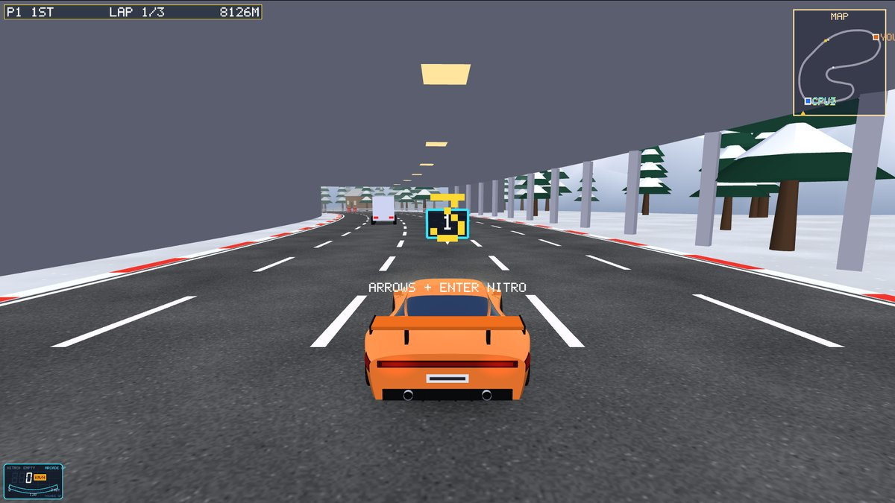
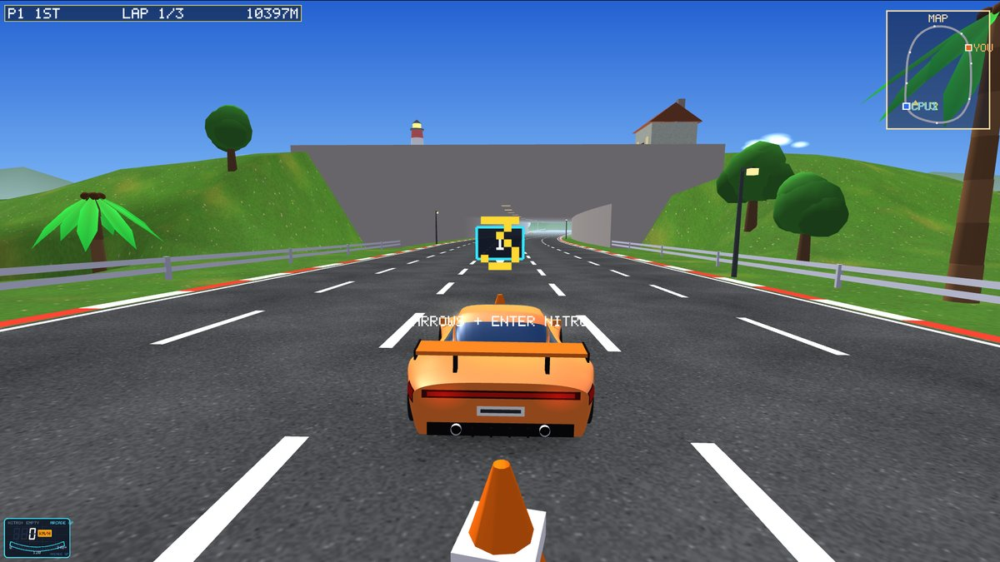
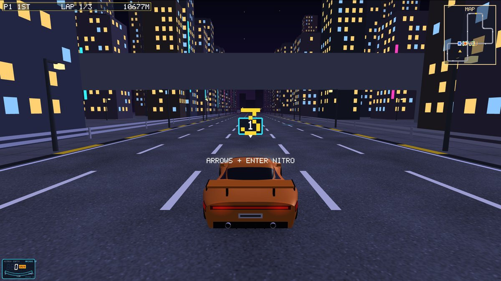
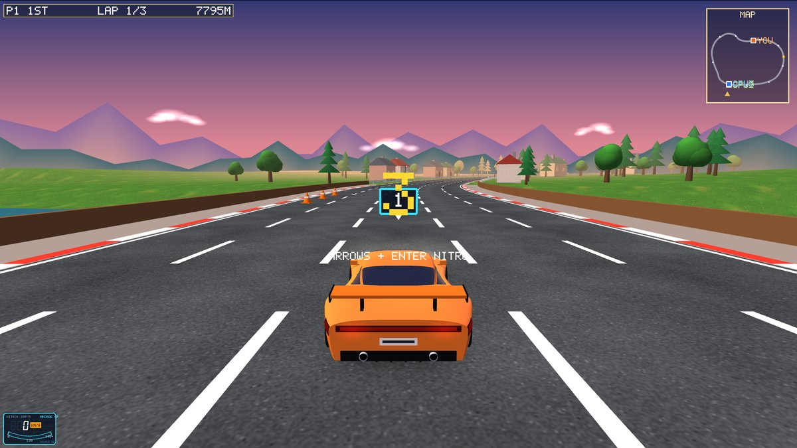

## How it works (for the viva)

- **Markers:** every control point of a layout can mark the stretch to the next point as
  tunnel, bridge or raised road. The slices keep these markers; the game turns runs of them
  into stretches (`GLWidget::findStretches`). A gallery's mountain side is the side where the
  other roads around are higher.
- **Physics** needed nothing new: tunnel walls stand on the guard-rail lines, so the rails
  already hold cars; collisions already compare heights (milestone 1c); the position
  search only looks near where the car was, so the street and the highway above it are
  never confused.
- **Drawing:** walls, ceilings, lights, portals, parapets, decks and pillars are built once
  into the same 50 m display lists as the road. Pillars skip places where another road
  passes underneath.
- **Ground:** over a tunnel the ground rises into a hill, but only beyond the band that
  follows the road, so the 8 m grid never slopes up across the road; the portal face hides
  the gap. Under a bridge the ground drops into a valley across the road (smoothly at both
  ends). The raised highway does not shape the ground under it.
- **Light:** how far inside a tunnel the camera's car is sets how much darker the sky light
  and fog are (less in the open gallery and in the night city).
- **Online version 9:** the raised highway changed the track, so older games can't join.

## Checks (part A)

| Check | Result |
|---|---|
| Ground coming up through the road, all maps, both widths | 0 places |
| Headless full rooms of 6, 1 lap, all maps | 90 of 90 finish, 2.0 crashes per car |
| Online bots on all five maps | every car finishes, track fingerprint matches |
| Two game windows online, 38 s race over a jump and a bridge | 22 / 8 small corrections, no big ones, drawing 1.4 ms a frame |

---

# Milestone 1d, part B: shortcuts

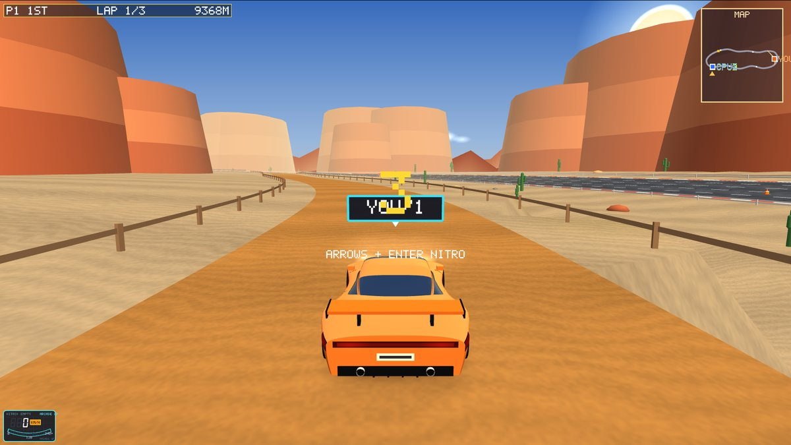

## What you see

- **One shortcut per map:** a dirt road at half the width, leaving the main road at a fork
  and joining it again further on. A green **SHORTCUT** board with an arrow stands 80 m
  before each fork; the minimap draws the shortcut as a thin sandy line.

  | Shortcut | Length | Main road it skips |
  |---|---|---|
  | Sunset Valley, farm dirt road | 451 m | 494 m |
  | Canyon Run, slot canyon (skips the banked hairpin) | 396 m | 516 m |
  | Alpine Pass, forest track (skips the gallery) | 445 m | 537 m |
  | Neon City, through a car park | 285 m | 387 m |
  | Coastal Highway, across the dunes (skips the harbour bridge) | 705 m | 779 m |

- **Dirt:** about 7% lower top speed, 90% steering, and dust behind the car. Wooden rails
  line the shortcut except where it runs alongside the main road; there the two roads are
  open to each other. **SHORTCUT** flashes on the screen as you enter.
- **Fair positions:** the race order and the distance left treat a car on the shortcut as
  being at the matching point of the main road it skips.
- **CPU drivers** decide once a lap, 300 m before the fork, whether to take it: about 20%
  of the time at level 1, up to 80% at level 5.
- There are no cones, barrels or nitro cans on the shortcuts or right around the forks and
  merges, and traffic stays on the main road.

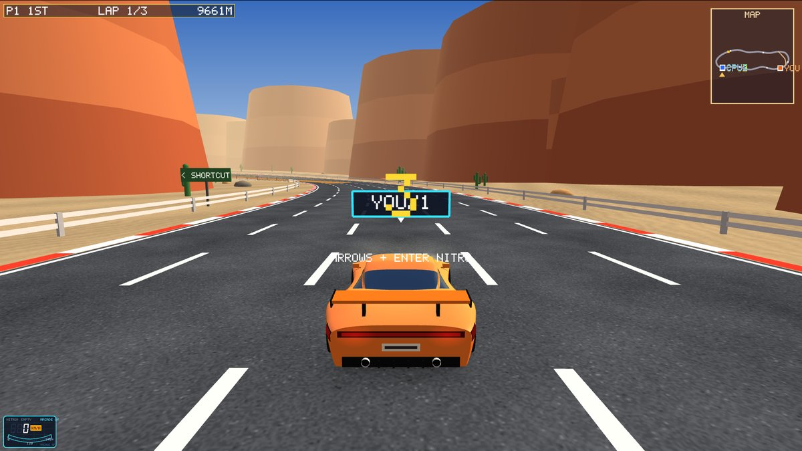

## How it works (for the viva)

- **Two roads:** the shortcut is its own curve of 1 m slices (built by `shared/track.cpp`
  since before milestone 1a). Every road function (position, height, slope, heading,
  width) takes the road: 0 the main loop, where s wraps round the lap, or 1 the shortcut,
  an open road whose s is clamped to its ends. Each car remembers which road it is on.
- **Changing road** (`GameSim::locate`): near a fork or merge the car is also found on the
  other road. It changes road once it has left its own road's asphalt and the other road's
  centre line is nearer by half a metre (so it does not flicker), or when it runs past
  either end of the shortcut. The guard rails let a car into either road where the two
  overlap.
- **Race progress on the shortcut** comes from a table built with the circuit: near the
  fork and the merge each shortcut metre counts as its nearest main-road point (only while
  that is within 30 m, so never a far part of a bend); in between evenly; never going
  backwards. A car's position therefore doesn't jump when it changes road (at most about
  5 m once, on the two forks that leave at a sharp angle).
- **Looking ahead:** the CPU's steering point and its view of bends follow the road it is
  on; past the shortcut's end they carry on along the main road, and a CPU that plans to
  take the shortcut looks along it from the fork (and for its first 100 m). On the last
  150 m of the shortcut it also sees obstacles and traffic on the main road past the merge.
- **Collisions:** two cars on the same road are boxes in that road's frame; on different
  roads (only possible near the fork or merge) they are two circles.
- **Ground and scenery** keep clear of the shortcut as of the main road; where both roads
  are near, the ground lies under the lower of the two.
- **Online version 10:** snapshots say which road each car is on.

## Checks (part B)

| Check | Result |
|---|---|
| Ground coming up through either road, all maps, both widths | 0 places |
| Headless full rooms of 6, 1 lap, all maps | 90 of 90 finish; 2.6 crashes per car |
| Cars taking the shortcut (of 18 per map) | Sunset Valley 7, Canyon Run 14, Alpine Pass 13, Neon City 11, Coastal Highway 10 |
| Biggest change of a car's race progress in one tick | 3.3-3.4 m on Canyon Run, Alpine Pass and Coastal Highway (nitro on the shortcut), 4.7-5.1 m once at Sunset Valley's and Neon City's sharp forks |
| Online bots on all five maps | every car finishes, track fingerprint matches |
| Two game windows online, 38 s race | 22 / 5 small corrections, no big ones, drawing 1.2-1.3 ms a frame |

Problems found by the checks and fixed: cars passing a fork were counted onto the
shortcut too early (their progress jumped up to 11 m); cars got wedged between the two
roads just past Canyon Run's fork; a CPU met a barrier just past a merge it could not see
from the shortcut; the ground under a fork followed the higher of the two roads.

## Files changed (part B)

- `shared/gamesim.cpp / .h`, `shared/simtypes.h`: both roads in every road function, changing
  road, the progress table, dirt, the CPU's choice and look-ahead, collisions across roads,
  the fork and merge kept clear
- `shared/netsnapshot.cpp`, `net/protocol.h`, `glwidget_online.cpp`: version 10, cars on the
  shortcut online
- `glwidget.cpp / .h`: the shortcut road and its rails, rails opening at the forks, the
  SHORTCUT board and message, dust, minimap, ground, screenshots
- `tools/ai_bench.cpp`: shortcut use and progress steps in the full-room check

---

# Milestone 1e: the finished circuits

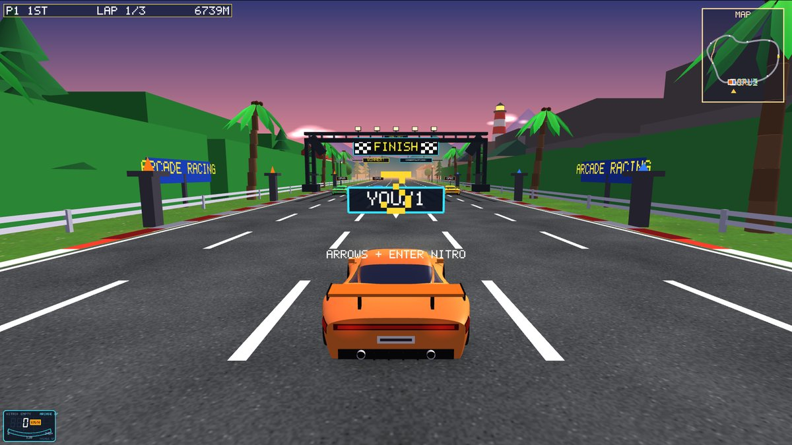

## What you see

- **Every start line stands on a straight** (at least 75 m of it behind the line for the
  grid, 109 to 584 m ahead). The grid, the temple and the start scenery move with it.
- **Sunset Valley:** hills up to 25 m; the crest jump is on a nearly straight stretch so you
  land on a straight (1.0 s and 67 m at full speed, 1.5 s and 145 m with nitro). On the west
  side the main road swings out over a hill and the farm track runs straight across it,
  leaving and joining at 12 and 8 degrees.
- **Canyon Run:** 4% smaller, a wider banked hairpin, and the slot-canyon shortcut is a
  straight run.
- **Alpine Pass:** the start moved onto the bottom straight; the forest track has its
  original gentle line.
- **Neon City:** the car-park lane is one long sweep across the corner, leaving and joining
  the street at 14 and 12 degrees; the corner up onto the raised highway leans in by 5 degrees.
- **Coastal Highway:** about 470 m shorter (the cliff top is lower), the start is on the west
  straight, the corner before it is wider (radius 72 m), and the harbour bend is wider.

| Circuit | Lap | Lap alone (no cones) | Shortcut saves | Highest |
|---|---|---|---|---|
| Sunset Valley | 3343 m | 51.9 s (47.5 s) | 1.24 s | 25 m |
| Canyon Run | 3537 m | 54.3 s (50.0 s) | 1.42 s | 25 m |
| Alpine Pass | 3334 m | 52.0 s (46.2 s) | 1.21 s | 60 m |
| Neon City | 3594 m | 56.0 s (50.6 s) | 1.20 s | 10 m |
| Coastal Highway | 3698 m | 57.7 s (53.1 s) | 0.89 s | 32 m |

Times: the CPU driver alone, no traffic, the average of 40 sets of cones and barrels (in
brackets: none). Three laps take 2.6 to 2.9 minutes.

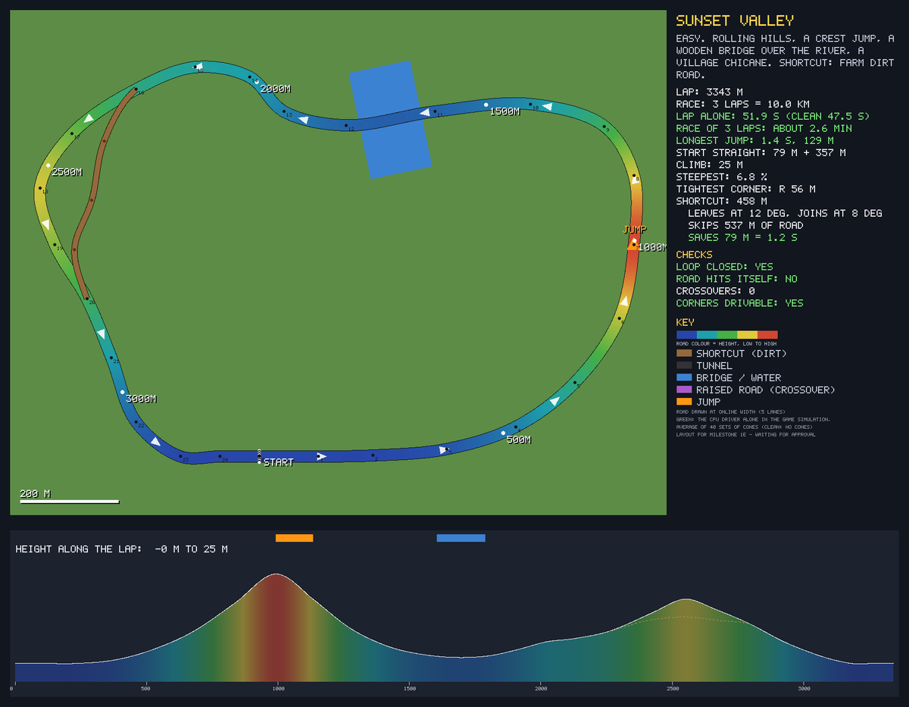

## How the layouts were tuned (for the viva)

- `tools/track_preview` now also drives every layout in the game's own simulation: one lap
  alone with and without the shortcut, over 40 different sets of cones and barrels (the
  CPU driver swerves round them, so a single set gives very noisy times), plus a clean lap.
  It prints the straight the start line stands on and the angles where the shortcut leaves
  and joins, and draws all of it on the pictures.
- Targets: a lap of 50 to 58 s, a shortcut worth 1.0 to 1.5 s, the start on a straight of
  at least 150 m, shallow forks (15 degrees or less) on Sunset Valley and Neon City.
- A straight through the start line: the two points before and after it lie on one line,
  and a Catmull-Rom segment between collinear neighbours is exactly straight.

## Problems found and fixed

- **A CPU car could get stuck for good** (about 2 laps in 100 with some sets of
  obstacles): it crawled up to a barrier aiming only 0.5 m past its edge, touched it, backed
  out and did the same again. When slow it now aims well inside the gap (up to 1.5 m from its
  edges).
- **Shallow forks:** where the shortcut runs beside the main road for a long way, cones and
  barriers are now kept off that whole stretch (it was 50 m after the fork), and an obstacle
  pattern must fit completely outside the ramp and fork zones.
- **Jump ramps:** the CPU no longer lines up in the middle for a ramp while a barrier row is
  less than 30 m ahead.
- **Neon City's raised highway:** cones, barriers and nitro cans on the highway could be hit
  from the street 9 m below. Things on another level are now out of reach.
- **Changing road near a merge:** the search for a car's place on the other road could run
  out of range and answer a place 56 m away, so the car's race position jumped 59 m. The
  search now starts where the car is, and its answer must lead back to the car. The table of
  where each shortcut metre counts along the main road is now found by a full search.

## Checks (1e)

| Check | Result |
|---|---|
| Curves: loop closed, road never runs into itself, corners at least 18 m radius | all five |
| Ground coming up through the road | 0 places on every map |
| CPU laps alone, 200 sets of obstacles per map, half of them on the shortcut | 1000 of 1000 finish (before: about 2 in 100 stuck on Alpine Pass and Neon City) |
| Full rooms of 6, all maps | 90 of 90 finish; 2.6 crashes per car; biggest step in race position 6.2 m |
| Jumps at every speed and both road widths, with air steering | every landing on the asphalt, except full nitro on Neon City's narrow road, which lands at the rail of the on-ramp corner (as before) |
| Online bots on all five maps | every car finishes, track fingerprint matches |
| Two game windows online | 25 / 12 small corrections, no big ones, drawing 1.6 ms a frame |

## Files changed (1e)

- `shared/circuits.cpp`: the five layouts
- `shared/gamesim.cpp / .h`: the CPU fixes, obstacles kept clear, height check, road changes
- `net/protocol.h`: version 11 (the track changed)
- `glwidget.cpp`: screenshot places on the new layouts
- `tools/track_preview`: lap times, shortcut gain, jumps, start straight and fork angles

---

# Sprints: Sunset Valley and Coastal Highway, and the big map card

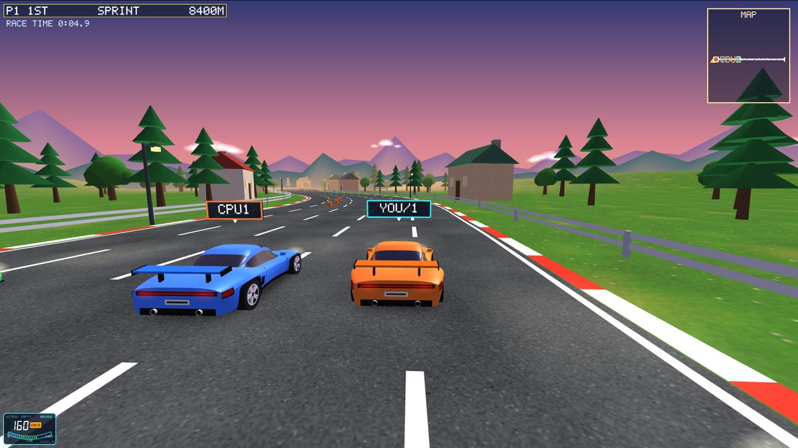

Asked for by the owner after 1e: two maps should be like the very first version of the game
(Soham's code on GitHub): one long road raced once, small obstacles, plenty of steady
traffic. Answers to the questions asked: 8 km long, the first game's road style, keep the
hills, jump, bridges and tunnel, obstacles that close one lane at most (a third of the road),
spaced further apart.

## What you see

- **Sunset Valley and Coastal Highway are sprints:** 8.2 km (8.7 km of road counting the
  bends) from a START gantry to a FINISH gantry, no laps. 150 m of road before the start
  line holds the grid; 300 m of run-off follows the finish, closed by red and white
  barriers. The HUD shows SPRINT and the distance to go, and the race time instead of lap
  times; the LAPS item reads "LAPS: SPRINT" and the online lobby "SPRINT" for these maps.
- **The first game's road:** a straight with gentle S-bends, exactly the first game's
  formula, `18 sin(0.012 d) + 8 sin(0.031 d + 1.3)` metres to the side, eased in after the
  start and out before the finish (bends no tighter than 80 m). Sunset Valley runs east
  with its hills up to 25 m, the crest jump (kept straight 120 m either side) and the river
  bridge; Coastal Highway runs north with the sea alongside, the cliff top, the lighthouse
  tunnel and the harbour bridge.
- **Small obstacles only:** three cones along one lane, two barrels side by side, or one
  barrier closing one lane, about one every 180 m. Nothing blocks more than a lane.
- **Steady traffic:** one car or truck every 200 m (43 of them). Each keeps its own steady
  speed, trucks slower than cars; it changes lane to pass slower traffic only when the lane
  next to it is clear (or waits behind it), and now and then (about every 30 s) moves over.
  Traffic that reaches the end comes back 400 m behind the last racer, out of sight.
- **The big map card in the menu** stands in the open space above the car: the map name in
  large letters, a big outline of the road (start in green, a sprint's finish in white, the
  shortcut in sand), the map's difficulty as big blocks, the CPU level in large coloured
  letters (green EASY, yellow MEDIUM, red HARD) with the number of CPUs, and the race length.
  The menu item now reads "DIFFICULTY: MEDIUM".

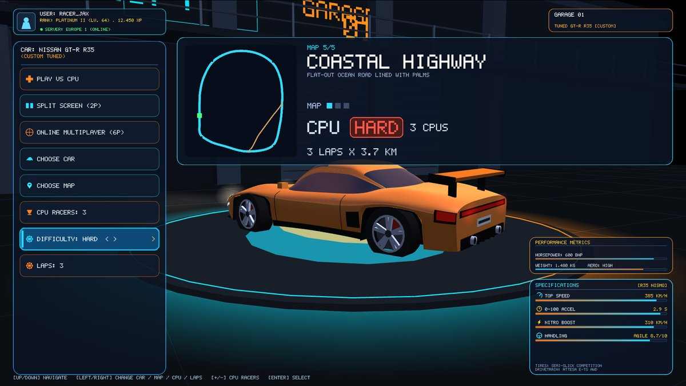

## How it works (for the viva)

- **An open road:** a circuit's control points form a loop; a sprint's form an open curve
  (`CircuitDef::sprint`): point 0 is the road's beginning, point 1 the start line, the
  second-to-last point the finish line, the last point the end of the run-off. Each end gets
  a mirrored extra point so the road starts and ends heading straight on.
- **The same s and d:** s is still metres along the road; on a sprint `wrapS` clamps instead
  of wrapping, `aheadOf` is a plain difference, race progress is s minus the start line, and
  the race distance is the finish line minus the start line. The search for a car's place
  never joins the road's last slice to its first. A car at either end of the road stops; a
  car past the finish brakes to a stop in the run-off.
- **The road profile** is a smooth curve (cubic Hermite) through a few height marks, so the
  slope never jumps.

## Checks (sprints)

| Check | Result |
|---|---|
| Curves: road never runs into itself, bends at least 18 m radius | both sprints (tightest 80 m) |
| Ground coming up through the road | 0 places (about 22,100 checks per sprint) |
| CPU races alone, 200 sets of obstacles per map | 1000 of 1000 finish |
| Race alone (no traffic, average of 40 obstacle sets) | Sunset Valley 117 s, Coastal Highway 116 s |
| Full rooms of 6 | every car still racing at full speed; on the sprints some are more than 20 s behind the winner when online's 20 s rule ends the race (the benchmark's circuits are raced for one lap only); biggest step in race position 1.9 m |
| Sunset Valley's jump at every speed, both widths, with air steering | every landing on the asphalt (0.8 s / 46 m at full speed, 1.2 s / 115 m with nitro) |
| Online bots on all five maps | every car finishes, track fingerprint matches |
| Two game windows online on Sunset Valley | 9 / 12 small corrections, no big ones, drawing 2.2 ms a frame |

## Files changed (sprints)

- `shared/track.h / .cpp`: open roads (sprints)
- `shared/circuits.cpp`: the two sprints, built from the first game's road
- `shared/gamesim.cpp / .h`: sprints (no laps, ends of the road, finish), small obstacles,
  steady traffic
- `glwidget.cpp / .h`, `glwidget_online.cpp`: START and FINISH gantries, road ends, HUD,
  minimap, the big map card, the lobby
- `net/protocol.h`: version 12
- `tools/track_preview`: draws and measures sprints
