# CPU psychology, milestone 1: the player profile

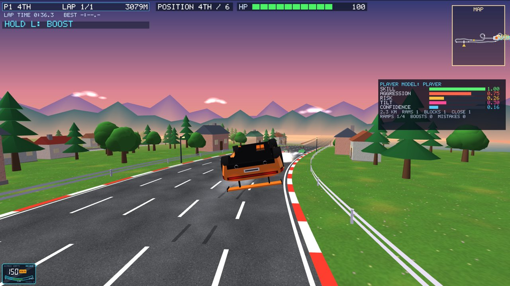

This is the first step of the plan agreed in chat. The goal is unpredictable CPU drivers,
offline and online, that react to how each person drives:

1. **The player profile** (this milestone): the game measures how you drive and keeps a
   profile.
2. Personalities, moods, weighted-random tactics and human mistakes; the difficulty choice
   goes.
3. Bots react to the player: they keep races exciting and counter your habits.
4. Named drivers, grudges, taunts, a rival bot for every person online.
5. Evolved neural "brains", trained offline in the headless race simulator.
6. A clone of your own driving.

Accounts, the player database on AWS, the race server on AWS and the browser version come
after these steps.

Milestone 1 **only measures and shows**. The CPUs don't use the profile yet, and races are
exactly as before: the same results in every test race.

Also in this update, asked for by the owner:

- **No elimination:** a wreck always ends with "BACK IN 3, 2, 1".
- **Place and health moved** to the empty space along the top of the screen, beside the
  race badge.

Both changes were also made in the saved copy `college_labs/game-qt`.

## What is measured

The race simulation measures **every car** while it races. The game keeps profiles for the
people. Because it is the shared simulation, the online server measures its players exactly
as your own game does offline.

| Area | Measured |
|---|---|
| Pace | every tenth of a lap (or of a sprint) against the CPU's clean time for that tenth of that map. A tenth with a wreck in it doesn't count. |
| Mistakes | rail scrapes, leaving the asphalt, barrier / barrel / cone / ramp-side hits, traffic hits that were your fault, rough and crash landings, flying off the road, wrecks |
| Aggression | rams that were your fault, revenge rams (within 10 s of being hit by that car), close passes (less than 1.5 m between the cars), blocking (moving into the lane of a car right behind), tailgating (within 10 m behind, in its lane) |
| Risk | side ramps taken out of those passed, twisted and red ramps, nitro into a ramp, the L boost (how often, how long, past 3 s, past 10 s), landing damage |
| Habits | shortcut taken out of passed, which side you overtake on, where on the lap you boost, ramps taken (per map) |
| Mood (live) | **tilt**: rises with a wreck (more for a second one within a minute), mistakes in a row, damage and places lost, and fades by half in 30 s. **Confidence**: leading (more with a big gap) or near the front; tilt takes it away. |

**The clean reference:** the CPU driver alone on the map, with no obstacles, traffic, ramps
or nitro. The time of each tenth is worked out once per map, the first time the map is
used (a fraction of a second).

## From measurements to traits

Each trait is a number from 0 to 1:

| Trait | Comes from |
|---|---|
| Skill | average pace against the reference (0.70 → 0, 0.98 → 1), minus up to 0.35 for mistakes per km |
| Consistency | how much the same tenth varies from lap to lap (circuits only) |
| Aggression | (rams + revenge + ½ blocks + 0.15 × close passes + tailgating) per km |
| Risk | 45% share of ramps taken, 15% big ramps, 10% nitro jumps, 30% how you boost |

The per-km rates count at least 3 km, so one bump in the first metres isn't "one ram a km".

**After each finished race** (vs CPU and split screen; online the server keeps it), the race
is blended into the profile:

- the first races count most (all of the first, half of the second, and so on);
- from the fifth race each one counts 20%;
- "sure" grows with the number of races: 29% after one, 55% after three, 80% after ten.

Habits add up per map. The last 10 races are kept.

## Where it is kept

- **Offline:** a small readable JSON file per player name. The name is the one you use
  online (press N in the lobby), PLAYER until you set one; player 2 in split screen is
  PLAYER 2. The file lives in the game's own folder on your PC (`profiles/NAME.json`).
  Phase B will upload the same file to the player database. A damaged file starts a fresh
  profile.
- **Online:** the server builds each person's profile from their races in its rooms and
  keeps it while it runs. It never trusts a profile sent from a player's own game. Nothing
  new is sent over the network.

## What you see

- **MY PROFILE** in the main menu, where CPU DIFFICULTY was. It shows:
  - your four traits as bars;
  - your habits in words ("TAKES THE SHORTCUT 80% OF THE TIME ON CANYON RUN", "AVOIDS SIDE
    RAMPS", "RAMS AND BLOCKS A LOT");
  - your last 10 races;
  - how sure the profile is.
- **F3 during a race:** what the player model sees of you right now, which is useful for
  testing and for the viva. It shows skill, aggression and risk so far, tilt, confidence,
  km, rams, blocks, close passes, ramps, boosts and mistakes. Online it says the server
  measures you.
- **The top bar:** POSITION 3RD / 6 and your health, beside the race badge.

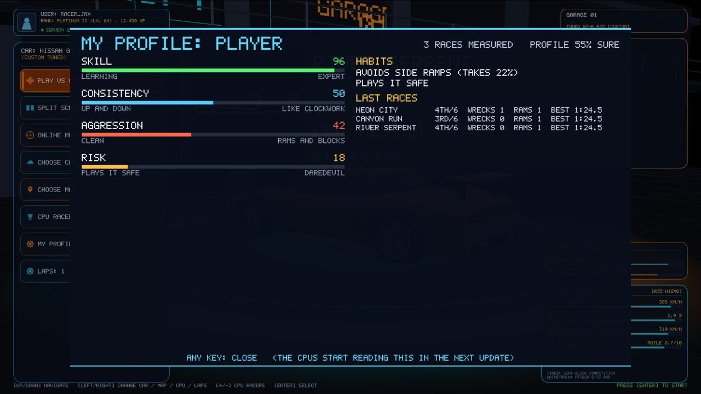

## Checks

| Check | Result |
|---|---|
| Simulated players of known styles, 3 maps each (`ai_bench profile`) | see the table below |
| Race results with the measuring added (`ai_bench lives`) | the same as before. After removing elimination: 108 of 108 finish. |
| Profile saved and read back | identical (scripted test) |
| Online bots, two maps | the track fingerprint matches, every race finishes, and the server logs each person's profile after each race |
| Two game windows online | small corrections only (7 / 8), none large |
| The saved copy `game-qt` | builds and runs, with the top bar and no elimination |

How the simulated players came out:

| Simulated player | Skill | Consistency | Aggression | Risk | Tilt (average / highest) |
|---|---|---|---|---|---|
| Expert: the CPU at full pace | 0.97 | 0.56 | 0.15 | 0.30 | 0.15–0.20 / about 0.4 |
| Timid: slow, no boost, avoids ramps | 0.32 | 0.82 | 0.00 | 0.00 | low |
| Rammer: drives into the car in front | 0.09 | 0.00 | **1.00** | 0.29 | — |
| Risky: every ramp, nitro, long boosts | 0.87 | 0.70 | 0.26 | **0.83** | high (its crashes) |
| Tilter: wilder after each wreck | 0.96 | 0.66 | 0.10 | 0.26 | above the expert's |

## Files

- `shared/playermodel.h / .cpp` (new): measurements, traits, mood, profile, habits
- `shared/gamesim.cpp / .h`: hooks that report events to the model, the per-tick
  measurements (`observeStep`), the clean reference (`referenceSectors`); elimination removed
- `glwidget_profile.cpp` (new): saving and loading, MY PROFILE, the F3 overlay
- `glwidget.cpp / .h`: the MY PROFILE menu item, F3, saving after a race, the top bar
- `glwidget_story.cpp`: rules cards without elimination
- `net/raceserver.*`: the server's profiles of its players
- `tools/ai_bench.cpp`: `ai_bench profile`

---

# Milestone 2: personalities, moods, tactics and human mistakes

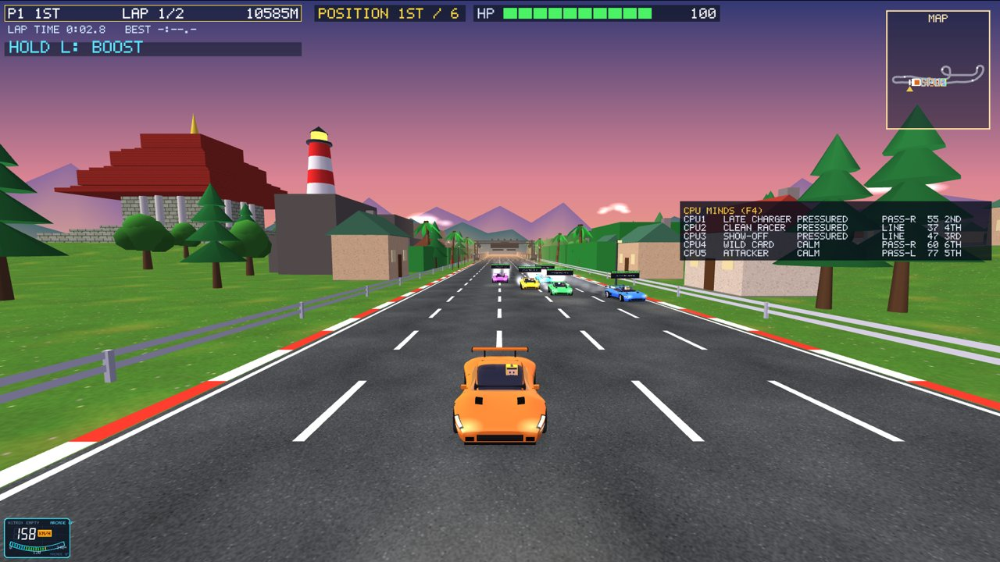

The CPUs no longer have a difficulty level, and no CPU gets speed help: every car has the
same top speed. What makes them different now (`shared/aidriver.*`):

**Skill means precision** (0 to 1):

| Skill controls | Weak (0) | Strong (1) |
|---|---|---|
| Line | wanders up to 2.4 m off the best line | on the line |
| Braking for bends | brakes early | at the limit |
| Share of top speed held on the straights | 60% | 100% |
| Looking ahead for hazards | 60% as far | the full distance |
| Finishing a barrel roll | sloppy | exact |
| Mistakes | more often | rare |

**Where a CPU's skill comes from:** the CPUs spread their skill around a centre, ±0.18 each,
plus ±0.05 "form of the day".

- **Offline:** the centre is your profile's skill, trusted as far as the profile is sure.
  With no profile, it is an average driver.
- **Online:** the centre is the average of the people in the room, as the server measured
  them.
- The profile's skill is pace, and the CPUs' is precision. A calibration table turns one
  into the other: `ai_bench calib` measured the pace of CPUs at every precision.

**Seven personalities**, picked fresh every race from a new random seed:

| Personality | How it drives |
|---|---|
| Attacker | overtakes hard, accepts contact, rams |
| Blocker | moves across to block the car behind |
| Late charger | saves nitro and the L boost for the last third |
| Show-off | every ramp, long boosts |
| Clean racer | waits for a safe gap, never attacks |
| Grudge holder | goes after whoever hit it |
| Wild card | loose choices, more mistakes, sometimes far too long a boost |

Story rivals have their own personalities:

| Rival | Personality |
|---|---|
| Dusty Dan | clean |
| Viper Vex | blocker |
| Frost Nova | late charger |
| Kai Volt | attacker |
| The Iron Baron | grudge holder |

**Moods**, checked four times a second:

| Mood | When |
|---|---|
| Shaken | 20 s after a wreck |
| Revenge | on a car that hit it, for 30 s; how often depends on its grudge |
| Desperate | in the last third, behind, 80 m off the lead |
| Pressured | a car sitting close behind for 4 s |
| Confident | leading by 120 m |
| Calm | otherwise |

Moods move the braking point, the share of top speed, ramp choices, boosting and the
mistake rate.

**Tactics:**

- Ten times a second a CPU scores: follow the line, pass left, pass right, wait behind,
  defend against the car behind, attack the car ahead.
- It picks with weighted randomness: a loose personality picks the second best more often.
- It keeps that choice for 1 to 3 s.

**Mistakes:** once a second, a small chance of braking too late, running wide, seeing a
hazard late, or holding the boost too long. The chance is higher under pressure, when
shaken or desperate, and with low skill; lower when confident.

All of it comes from hashes of the race's AI seed, the tick and the car. Online the server
runs the CPUs; snapshots carry each CPU's personality, mood, tactic and skill for the F4
view (version 15).

**F4 during a race** shows the CPU MINDS panel: each CPU's name, personality, mood (REVENGE
shows on whom), what it is doing, its skill and its place.

## Also in this update (asked for by the owner)

- **Three music tracks**, all synthesized by the game's own code like before:
  - the menu's chill groove (unchanged);
  - a racing track: 132 BPM, A minor, kick on every beat, driving bass, a bright arpeggio;
  - a results theme: 92 BPM, C major, a bell melody.

  A change fades over 0.6 s.
- **The race ends once the top 4 are home:** 2 seconds after the 4th car crosses the line.
  Whoever is still on the road doesn't finish (DNF, with the metres left).
- **Every circuit race is 2 laps.** The LAPS menu item and the lobby's laps choice are gone.
- **No difficulty anywhere:**
  - the menu card says CPU ADAPTIVE;
  - the online lobby shows a bot as BOT (ADAPTS);
  - the host still adds and removes bots.

## Checks

**Calibration** (`ai_bench calib`), six CPUs all at one precision, every map:

| Precision | 0.0 | 0.2 | 0.4 | 0.5 | 0.6 | 0.8 | 1.0 |
|---|---|---|---|---|---|---|---|
| Measured skill | 0.04 | 0.17 | 0.39 | 0.46 | 0.63 | 0.87 | 0.95 |

**Fairness and variety** (`ai_bench fair`): a test driver of fixed skill against 5 CPUs
centred on it, 6 maps × 4 races, new minds every race.

| Test driver | Wins | Average place (of 6) | Podiums | Lead changes a race | Different winners |
|---|---|---|---|---|---|
| Beginner (0.35) | 21% | 3.33 | 54% | 1.5 | all 6 cars won at least once |
| Average (0.55) | 4% | 3.75 | 38% | 1.2 | all 6 |
| Good (0.75) | 17% | 3.50 | 46% | 1.2 | all 6 |
| Expert (0.95) | 8% | 3.33 | 50% | 0.9 | 4 |

- Every test driver finishes mid-field on average. That is what it should be against CPUs
  of its own level, whatever that level is. Before, the same reference driver won 100% of
  races on Easy and 0% on Hard.
- **Not reached yet:** lead changes (about 1 a race) and close finishes (0–17% within 2 s)
  are low. Races spread out. Milestone 3 (bots reacting to the race and to you) is meant to
  fix that.

**Personalities**, measured by the player model (per car and race):

| Personality | Aggression | Risk | Rams | Blocks | Boosts | Place |
|---|---|---|---|---|---|---|
| Attacker | 0.20 | 0.49 | **1.01** | 1.15 | 2.88 | 3.64 |
| Blocker | 0.17 | 0.47 | 0.55 | **1.61** | 3.15 | 3.67 |
| Late charger | 0.16 | 0.51 | 0.62 | 1.46 | **1.09** | 3.67 |
| Show-off | 0.16 | **0.75** | 0.62 | 1.23 | **3.23** | 2.95 |
| Clean racer | 0.15 | 0.48 | 0.67 | 1.22 | 2.86 | 3.72 |
| Grudge holder | **0.26** | 0.47 | **1.24** | 1.55 | 2.38 | 3.55 |
| Wild card | 0.24 | 0.60 | 1.18 | 1.50 | 2.68 | 3.25 |

**Other checks:**

| Check | Result |
|---|---|
| The player model's simulated players | still come out right: expert 0.98, timid 0.35, rammer's aggression 1.00, risky's risk 0.88 |
| Laps alone with 200 obstacle sets per map | 1200 of 1200 finish, none stuck |
| Online bots on two maps | the track fingerprint matches, races end after the top 4 |
| Online CPUs adapting | the server spread the CPUs around each person's measured skill |
| Two game windows online | small corrections only, none large |

**A bug found on the way:** with races fixed at 2 laps, the clean reference was timed over
both laps, so every pace looked twice as fast. The reference now always times one lap.

**Files:**

- `shared/aidriver.h / .cpp` (new)
- `shared/gamesim.*`: the CPU driving uses the mind; the rubber band and the levels are gone;
  2 laps; the top-4 finish
- `audioengine.h`: the race and results music
- `glwidget*.cpp`: skill from your profile, F4, no difficulty or laps choice, story rivals
- `net/*`: version 15, bots without levels
- `tools/ai_bench.cpp`: `calib` and `fair`

---

# Between milestones 2 and 3: nitro cans, jumps, boost, race music

Asked for by the owner:

- **Nitro cans** come back 1 second after being taken, in the same place, so others can take
  them too. A car that already holds a charge drives through without taking it. Each next
  car to take the same can gets a longer boost: 2.0 s, then 2.3, 2.5, 2.8, and 3.0 s for
  every taker after that.
- **Jumps** throw every car a little higher than before (x1.08). Each next car over the same
  ramp goes higher still: x1.14, x1.20, and x1.26 for the 4th car and every one after.
  Landings stayed on the road in the jump test, apart from Neon City at full nitro, which
  already landed off the road before this change.
- **The L boost** gives 14% more top speed (was 10%) and pulls harder.
- **Race music:** a new track of our own in the high-energy arcade style. It runs at
  140 BPM, F minor, with a pumping bass, wide detuned chords, a lead hook, and a build with a
  snare roll into the drop. Like all the game's sound it is synthesized by our own code.

Online version 16 sends each car's charge length, how often each can was taken and the
jump counters, so every computer predicts the same flights.

---

# Milestone 3: the CPUs react to the people in the race

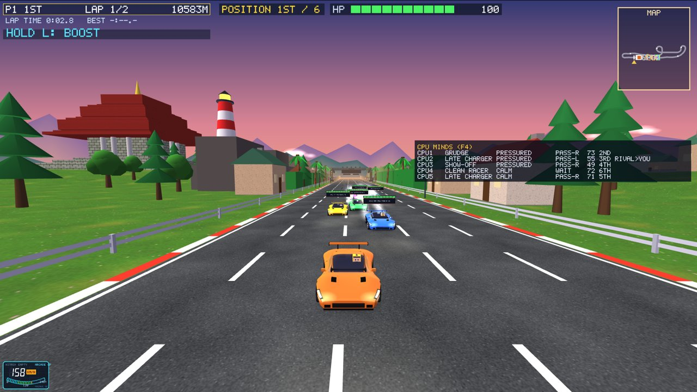

`shared/director.cpp`. Every person gets a **rival**: the CPU closest to their skill (online
each person gets their own). Once a second the **race director** looks at every CPU and the
person it is racing (its own as a rival, otherwise the nearest one) and sets its levers.
The levers are behaviour only, never speed beyond the top speed every car has:

| Lever | What it changes |
|---|---|
| Effort | ± a few percent of the share of top speed it commits to |
| Mistakes | how often it slips |
| Risk | side ramps, boost length and frequency |
| Tactics | hunt, pressure (tailgate), cover a side, surprise attack |

**Excitement:**

| Situation | What happens |
|---|---|
| A person leads by 80 m or more | their rival **hunts**: more effort, fewer mistakes, more ramps, long boosts |
| A person is far behind or tilted | CPUs far ahead of them **ease** a little: less effort, more mistakes |
| A CPU runs away at the front (120 m clear) | it eases a little |
| A CPU is far behind a CPU leader | it pushes a little (not when a person leads: then only their rival hunts) |
| A CPU is close behind any car | it pushes to get past: more overtakes, more lead changes |
| A confident person | once a race, in the middle third, a CPU close behind makes a **surprise attack** for 12 s |
| A timid person (low risk and aggression in the profile) | **pressure**: a CPU sits right behind them |
| A close battle (within 15 m) | the director stays out |
| **The last half lap** (a sprint: its last 15%) | **pure**: the director is off |

**Countering habits:** from the person's profile, and only once it is at least 30% sure:

- **The favourite shortcut:** a CPU near them takes it too.
- **The favourite passing side:** a CPU just ahead covers that side.
- **A ramp lover:** CPUs just ahead take the side ramps first.
- **The favourite boosting spot:** the CPU ahead boosts just before it.
- **A rammer:** the clean racers give room.

The game hands the director your profile (and player 2's in split screen). Online the server
hands it each person's profile as the server measured it.

**F4** shows each CPU's role and what the director has it doing, for example
"RIVAL>YOU HUNT", "EASE", "SURPRISE", "PRESSURE" or "COUNTER". Online version 17 carries
these.

## Checks

**Excitement and fairness** (`ai_bench excite`): a test driver that counts as a person,
6 maps × 6 races per skill, with the director off and then on.

| Test driver | Wins (off → on) | Average place (off → on) | Lead changes a race (off → on) | Close finishes (off → on) |
|---|---|---|---|---|
| Beginner | 14% → 8% | 3.53 → 3.42 | 2.2 → **3.1** | 22% → **33%** |
| Average | 8% → 6% | 3.72 → 3.81 | 1.8 → **2.2** | 28% → 28% |
| Good | 11% → 6% | 3.61 → 3.69 | 1.7 → **2.6** | 17% → **42%** |
| Expert | 25% → 19% | 2.92 → 3.22 | 1.1 → **1.6** | 33% → **36%** |

- **More lead changes:** about 40% more on average, close to the target of 3 for the
  beginner, below it for the others.
- **More close finishes:** they rise for most drivers, and the "good" driver reaches 42%.
- **The person still finishes mid-field on average**, but wins a little less often.
- **Every car can win:** all six grid slots won races.

**An earlier version** helped the CPUs too much: several hunted at once, and the beginner
and average test drivers won none of 24 races. It was cut back to one hunter (the rival),
and to pushing only when a CPU leads.

**Habits** (`ai_bench habits`): a test driver with a habit, with its profile known
(80% sure) or unknown.

| Habit | Unknown | Known |
|---|---|---|
| Always takes the shortcut: a CPU on the shortcut with it (within 60 m) | 78% of races | **89%** |
| Passes on the left: a CPU just ahead sitting on its left side | 49% of the time | **61%** |

**Other checks:**

| Check | Result |
|---|---|
| Laps alone with 200 obstacle sets per map | 1200 of 1200 finish, none stuck |
| Player model test | unchanged (rammer's aggression 0.99, risky's risk 0.89) |
| Online bots on two maps | the track fingerprint matches |
| Two game windows online | small corrections only, none large |

**Files:**

- `shared/director.cpp` (new)
- `shared/aidriver.*`: the director's levers in the mind; `PlayerHints`
- `shared/gamesim.*`: the director once a second; covering and pressuring when driving
- `glwidget*.cpp`: profile hints to the director, F4 roles
- `net/*`: version 17; the server hands it its people's profiles
- `tools/ai_bench.cpp`: `excite` and `habits`

---

# Crash damage by position

Asked for by the owner, since there is no elimination any more. Crashes into **barriers,
obstacles** (barrels, cones, a side ramp's side) **and other racers** cost more the further
ahead a car is, and less the further back (`GameSim::positionDamage`):

| Place (of 6) | 1st | 2nd | 3rd | 4th | 5th | 6th |
|---|---|---|---|---|---|---|
| Crash damage | x1.25 | x1.16 | x1.07 | x0.98 | x0.89 | x0.80 |

With fewer cars it runs from x1.25 for the leader to x0.80 for the last car.

- Not affected: traffic hits, rail scrapes, landings, falls and the L boost.
- The leader has to drive cleanly to stay there.
- The story's crash rules card says so.

---

# Milestone 4: named drivers, memory across races, taunts

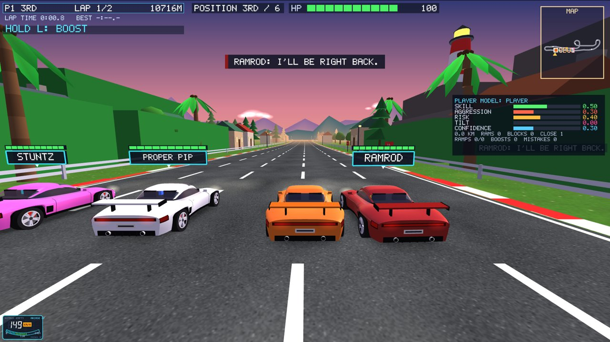

## The roster

Twelve named drivers (`shared/roster.*`). The names and characters are our own. Each has a
personality, a car and helmet colour, a home map where they are 0.05 sharper, and a small
skill lean:

| Personality | Drivers |
|---|---|
| Attacker | BLITZ, RAMROD |
| Blocker | BULWARK, GATEKEEP |
| Late charger | SUNDOWN, NIGHTOWL |
| Show-off | STUNTZ, LOOPY |
| Clean racer | PROPER PIP, SILK |
| Grudge holder | GRUDGE GUS |
| Wild card | WILDCAT |

- **vs CPU:** draws different drivers every race.
- **Online:** the host's bots are named drivers too.
- **Names everywhere:** plates, the feed, results (your rival marked "(RIVAL)"), the F4 panel.
- **The story** keeps its own cast.

## Memory

Your profile keeps a record for every named driver: races, rams each way, who finished
ahead, and close battles (within 3 s or 100 m). Each driver's attitude to you comes from it:

| Attitude | When | What the driver does |
|---|---|---|
| Grudge | you rammed them 3+ times, and more often than they rammed you | always takes revenge when you hit them; attacks and defends harder against you |
| Determined | you beat them 2+ times more than they beat you | picked as your rival first; hunts you sooner (when you lead by 40 m, not 80); pushes when near |
| Cocky | they beat you 3+ times more | slips more often when you sit right behind them |
| Nemesis | most close battles (at least 2) | picked as your rival before anyone |

Online, the server keeps the same records for its people.

**MY PROFILE** gains a **RIVALS** list. **The results screen** shows "YOUR RIVAL X: YOU 4 – 2"
with NEMESIS, GRUDGE, DETERMINED or COCKY next to it.

## Taunts

Short pre-written lines, two per moment for each personality: 126 in all, nothing generated.
The moments:

- the start (your rival);
- they pass you, or you pass them;
- you ram them, or they ram you;
- you get wrecked;
- they swear revenge;
- they win, or you beat your rival home.

How they appear:

- in a bubble under the top bar, edged in the driver's colour, plus a line in the feed;
- **at most one every 20 s per person**, never two in a row from the same driver (the start
  and the finish always get through);
- online, each line goes only to the person it is aimed at;
- **the TAUNTS menu item** switches them off (saved; on by default).

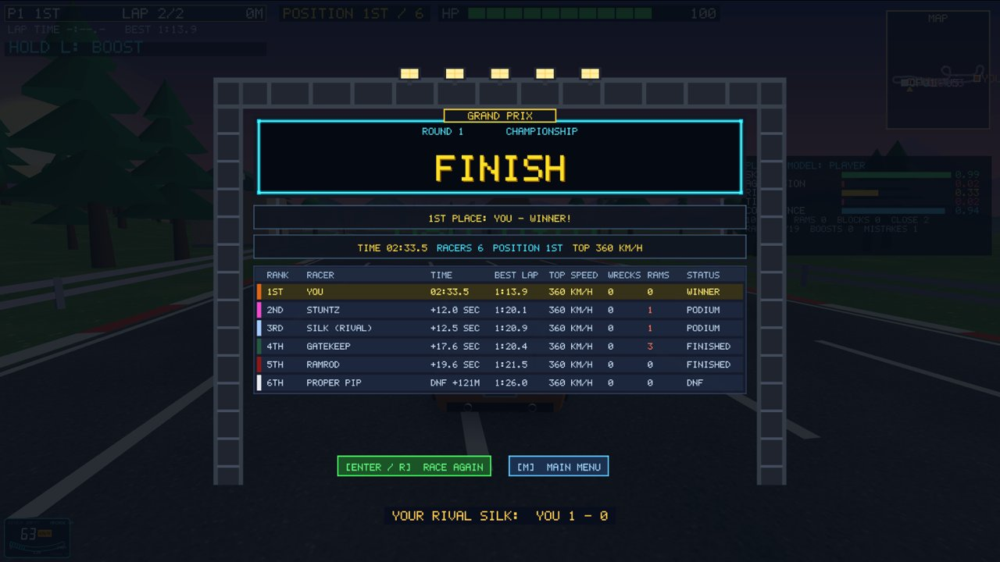
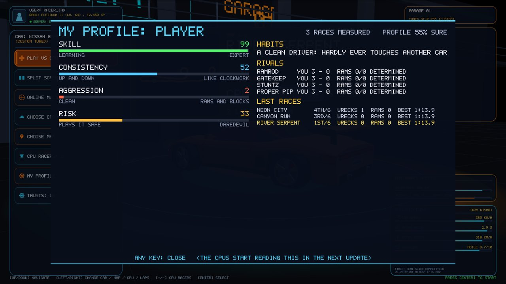

## Checks

`ai_bench named`: a person against 5 named drivers, 36 races.

| Check | Result |
|---|---|
| Roster | every driver raced (14–16 races each). Show-offs and attackers win most, the late chargers least, which matches what milestone 2 measured for the personalities. With about 15 races per driver, the win numbers are rough. |
| Taunts | 5.1 a race. None closer than 20 s. Spread over start, passes, rams, wins, losses. |
| Grudge | the driver goes after the person (attack, defend or revenge against them, when within 40 m) **16%** of the time, against 9% with no attitude |
| Determined | the driver is picked as the person's rival in **36 of 36** races, against 9 of 36 with no attitude |
| Saving and loading | the rivals record comes back unchanged (scripted test) |
| Online bots | named drivers in the lobby and the results; the track fingerprint matches |
| Two game windows online | small corrections only |
| Laps alone with 200 obstacle sets per map | 1200 of 1200 finish |

Online version 18.

**Files:**

- `shared/roster.*` (new)
- `shared/playermodel.*`: the rivals record and attitudes
- `shared/director.cpp`, `shared/aidriver.cpp`: taunts, attitudes, choosing the rival, named
  drivers' skill
- `glwidget*.cpp`: names, helmets, the taunt bubble, the TAUNTS item, RIVALS, the rival line
- `net/*`: named bots, version 18
- `tools/ai_bench.cpp`: `named`

# Milestone 5: evolved neural brains

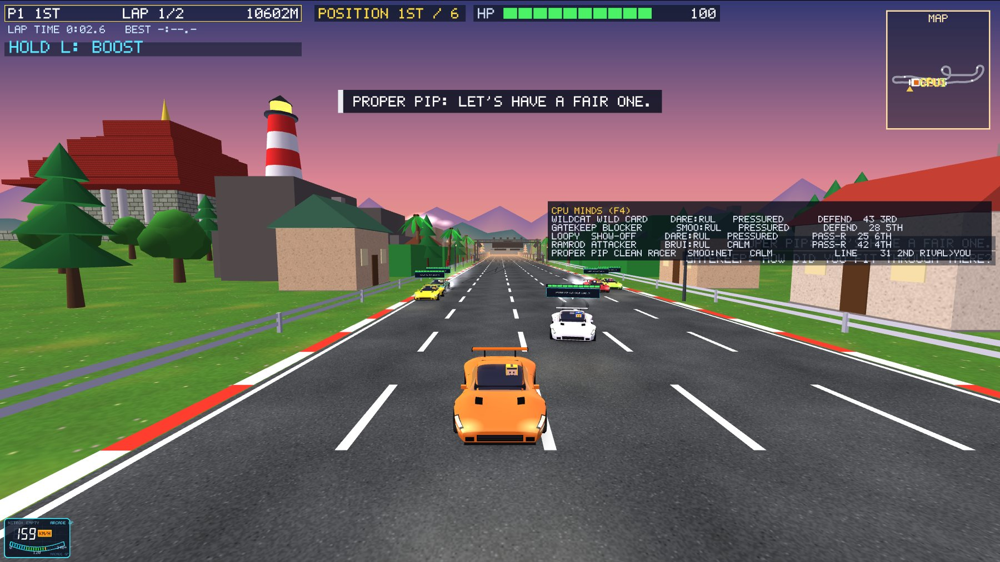

The CPUs now drive with real neural networks. We trained them ourselves, by **evolution**,
inside our own headless race sim. There is no internet and no AI service: the trained
numbers are built into the game (`shared/brains.inc`).

## What a brain is

A small neural network (`shared/brain.*`):

- **28 inputs:** speed; angle to the road and place across it; how the road bends 10, 25, 50,
  80 and 120 m ahead; banking and hills; road width; the nearest racer ahead (distance, side,
  speed) and behind; nitro, boost and health; how much of the race is left; the nearest
  hazard and side ramp; its own last steering; drift.
- **16 hidden neurons**, then **5 outputs:** steer, throttle/brake, nitro, L boost, and how
  keen it is on side ramps.
- 549 numbers in all. Running it costs almost nothing, and it gives the same output for the
  same input on every run.

## How it learned: neuroevolution

`tools/evolve` (a console program that uses all CPU cores):

1. Start with 96 random brains.
2. Each one races on all 6 maps, six brains to a race, with obstacles, traffic and ramps.
3. Score each brain: distance driven, minus wrecks, damage and safety-net takeovers, plus
   the extras of its species (below).
4. The best eighth survive unchanged. The rest are children of two good parents, mixed
   and slightly mutated. That's one generation.

The first ~150 generations used 75-second test races. The last ~120 used the **whole
2-lap race**, so the brains also learned the extra obstacles on the last lap. About 2–5 s a
generation; under an hour for all four brains on a 12-thread PC.

Four species, scored differently, so each really drives its own way:

| Brain | Extra scoring | Used by |
|---|---|---|
| RACER | pure pace | late chargers |
| DAREDEVIL | + clean side-ramp landings, air time, L boost; crashes cost it less | show-offs, wild cards |
| BRUISER | + hits on others and places gained; it ignores racers ahead | attackers, grudge holders |
| SMOOTH | − jerky steering and time near the edge; crashes cost it more | clean racers, blockers |

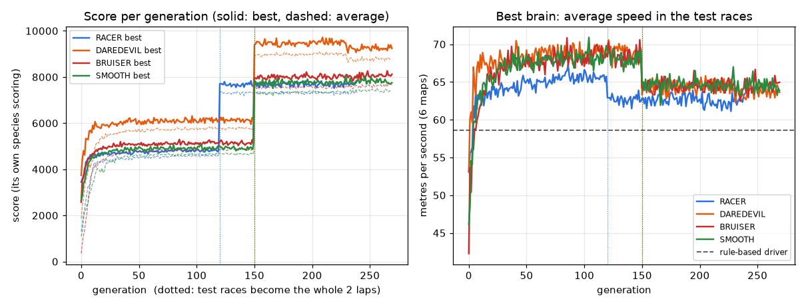

The raw logs are in `m5_training/` (one CSV per species). The speed panel shows the best
brain of each generation on that generation's training races. The fair comparison, on races
the brains never saw, is in the checks below.

## Brain and rules together (the hybrid)

- **The brain drives the open road:** its line, braking points, corner speed, nitro, the
  boost, its taste for ramps.
- **The rule-based driver keeps the tricky moments:** obstacles or traffic close ahead (the
  hand-over comes while the rules still have room to dodge into the gap), anything
  alongside, battles the mind picked (attack, defend, tailgate), lining up with a ramp,
  flying, backing out.
- **The safety net:** if a brain is off the road, pointing the wrong way or stopped for 1 s
  (or badly wrong at once), the rules drive for 3 s. After a reverse-out, the rules also keep
  driving for 2 s.
- **Limits on the brain:** nitro only with 150 m of clear road and no ramp within 250 m
  (nitro can't be braked off). The boost only with 100 m clear, no ramp near, and health
  above 80 to start (it stops at 60).
- **Everything from milestones 2–4 still applies on top:** skill (a weaker driver steers
  later and wanders a little, holds less speed, and corners like the rules' weaker
  driver), personality, mood, the director, memory, taunts.
- **Online:** only the server runs the brains, as with all CPU logic. Snapshots carry which
  brain each CPU has and who drives (online version 19).
- **F4** shows it per CPU: `SMOO:NET` (the network drives), `DARE:RUL` (the rules, in a
  tricky moment), `RACE:SAFE` (the safety net took over).

## Checks

**Brain against rules, on unseen races** (`evolve baseline`: six cars, 125 s, 6 maps × 4 seeds,
same personality for both):

| Brain | Rules: metres | Brain: metres | Wrecks (rules → brain) | Brain drives |
|---|---|---|---|---|
| RACER | 7,320 | 7,430 (+1.5%) | 0.01 → 0.02 | 32% |
| DAREDEVIL | 7,698 | 7,656 (−0.5%) | 0.06 → 0.05 | 27% |
| BRUISER | 7,658 | 7,711 (+0.7%) | 0.04 → 0.04 | 38% |
| SMOOTH | 7,678 | 7,708 (+0.4%) | 0.03 → 0.06 | 33% |

The brains match or slightly beat the rules' pace with the same wreck rate. Before the
limits above, they were up to 7% faster, but wrecked 3–5 times more. Safety was chosen
over speed.

**Styles really differ** (`ai_bench brains`: whole races, 6 maps × 3 seeds):

| Driver | Ramp landings | Air s/min | Boost | Steering flips/min | Hits | Near edge |
|---|---|---|---|---|---|---|
| RULES | 6.1 | 5.6 | 4.9% | 1,224 | 1.22 | 20.9% |
| RACER | 3.9 | 3.3 | 13.6% | 1,193 | 1.02 | 9.1% |
| DAREDEVIL | **8.5** | **7.8** | 16.2% | 802 | 1.63 | 9.6% |
| BRUISER | 4.4 | 4.0 | 15.3% | 989 | **1.73** | 7.0% |
| SMOOTH | 3.0 | 2.5 | 13.5% | 879 | **0.86** | 7.7% |

The Daredevil jumps and flies the most, the Bruiser hits the most, and the Smooth brain hits
the least. All brains steer more calmly and keep further from the edge than the rules.

**Safety:**

| Check | Result |
|---|---|
| Laps alone with brains, 200 obstacle sets per map | **1200 of 1200 finish** (one had looped against a wall: fixed with the 2 s after reversing) |
| Wrecks in those laps | 192 (the rules alone: 135; River Serpent's ramps make most of both) |
| Safety-net takeovers | 0.02–0.06 a minute |
| Online bots (server runs the brains) | named drivers race; track fingerprint matches |

**Fairness:** the calibration table (`cpuPrecisionFor`) was measured again with the brains on.
A weak brain gets an extra straight-line handicap, so the slowest CPU (measured 0.19) is as
slow as the rules' slowest (0.17). `ai_bench excite` (a person at four skills against five
CPUs centred on them, 24 races a row): wins 0–25%, average places 2.9–4.0, about the same
as with the rules alone. **Lead changes went up:** 1.5–3.7 a race, against 1.1–3.5.

**Honest limits:**

- The brain drives about a third of the time; obstacle-heavy maps leave the rest to the
  rules.
- In whole races the late-charger RACER is the slowest, because it keeps its nitro for the
  last third.
- `ai_bench brains` counted 4 short stalls (5 s under 10 m) for RACER cars in packs, out of
  108 car-races, all recovered.

**Files:**

- `shared/brain.*`, `shared/brains.inc` (new): the network and the trained weights
- `shared/gamesim.*`: the hybrid, the brain's inputs, the safety net and limits
- `shared/aidriver.cpp`: the new calibration table
- `shared/simtypes.h`, `shared/netsnapshot.cpp`, `net/protocol.h`: brain fields, version 19
- `glwidget_profile.cpp`: the brain column in F4
- `tools/evolve/` (new): `evolve.cpp` (train, baseline, pack), `train_all.sh`, `plot_curves.py`
- `tools/ai_bench.cpp`: `brains`, and `nobrains` before any mode to switch them off
- `*.pro`: brain.cpp added

# Milestone 6: a clone of your driving

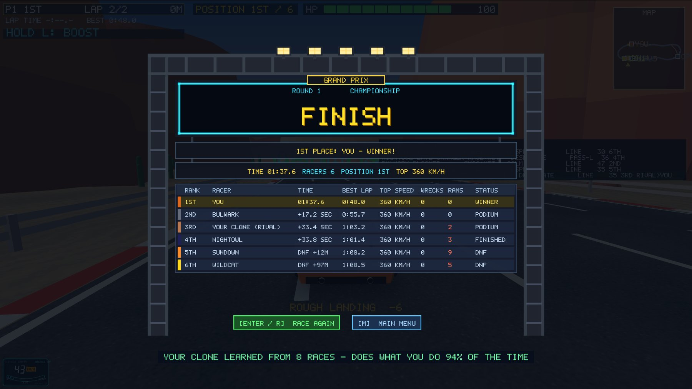

After a few races, one CPU drives the way **you** do. It learns by watching you
(imitation learning, also called behavioural cloning). It runs offline on your PC, with no
AI service.

## Recording

- **When:** in every vs CPU race, 20 times a second, but only on the open road (no hazard
  close ahead, nothing alongside, not flying). Those are the moments the clone will drive
  itself; the rules handle the rest, as for the brains.
- **What you saw:** the same 28 inputs the evolved brains see.
- **What you did:** the intent, not single key taps. People (and the rule-based driver) tap
  the steering keys on and off many times a second, and no network can copy that tap by
  tap; the first try agreed only 53–65% and wandered off the road. So the recording notes
  **how much you steer and accelerate over the next 0.13 s** (−1..+1), plus nitro and boost
  presses.
- **Where:** in the profiles folder, next to your profile: `<name>.clone` (your last 20
  races, about 140 KB each) and `<name>.brain` (the clone, 2 KB). Nothing leaves your PC.
- **Deleting it:** MY PROFILE, then press **R twice**.

## Training

- **The network:** the same shape as the brains (28 inputs, 16 hidden neurons, 5 outputs).
- **How:** this time it's **supervised learning**, not evolution. It's trained with
  backpropagation and Adam, written in our own C++ (`shared/clone.cpp`), to predict your
  intent from what you saw. It starts from the RACER brain, so it can already drive before
  it has learned you.
- **The check:** the newest race is held out, and the **agreement** is how often the clone
  means the same steering and the same throttle, coast or brake as you did on it.
- **When:** automatically after every vs CPU race from the 3rd on. It runs in the
  background (about 1–3 s); the results screen says "YOUR CLONE IS LEARNING THIS RACE...",
  then "YOUR CLONE LEARNED FROM 8 RACES – DOES WHAT YOU DO 94% OF THE TIME".

## Racing your clone

- With a trained clone and **YOUR CLONE: ON** (a new menu item, which shows the agreement), the
  last CPU in every vs CPU race is **YOUR CLONE**, in a paler version of your car's colour.
- **Driving:** it turns its intent back into key taps at the same rate (error diffusion).
  It drives with no skill handicap, because it should be exactly as good as you. In the
  tricky moments it's the rule-based driver at your profile's skill, and the milestone 5
  safety net keeps it on the road.
- **Personality** comes from your profile (aggressive, risky or clean), so the director and
  moods treat it like the others. It can even become your rival.
- **It talks back:** lines of its own, such as *"I learned from the best. Then I got better."*
  and *"You taught me that one."*
- **F4** shows `CLON:NET` when the clone drives and `CLON:RUL` / `CLON:SAFE` otherwise.

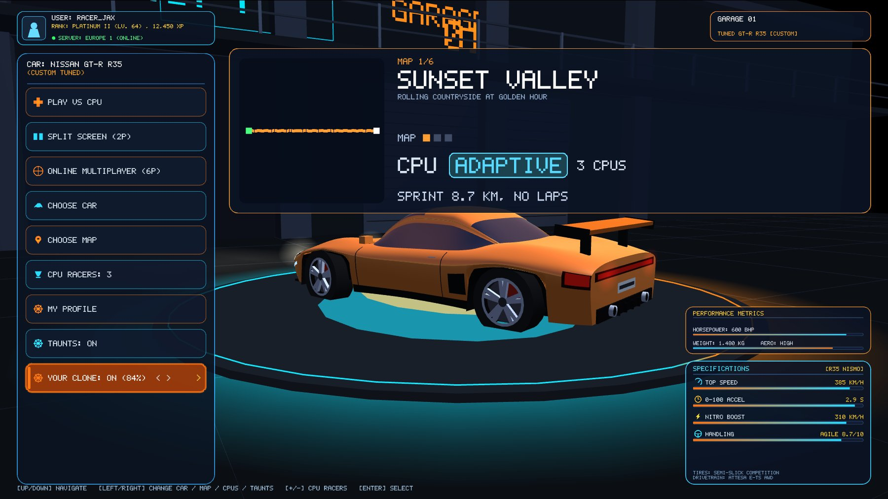
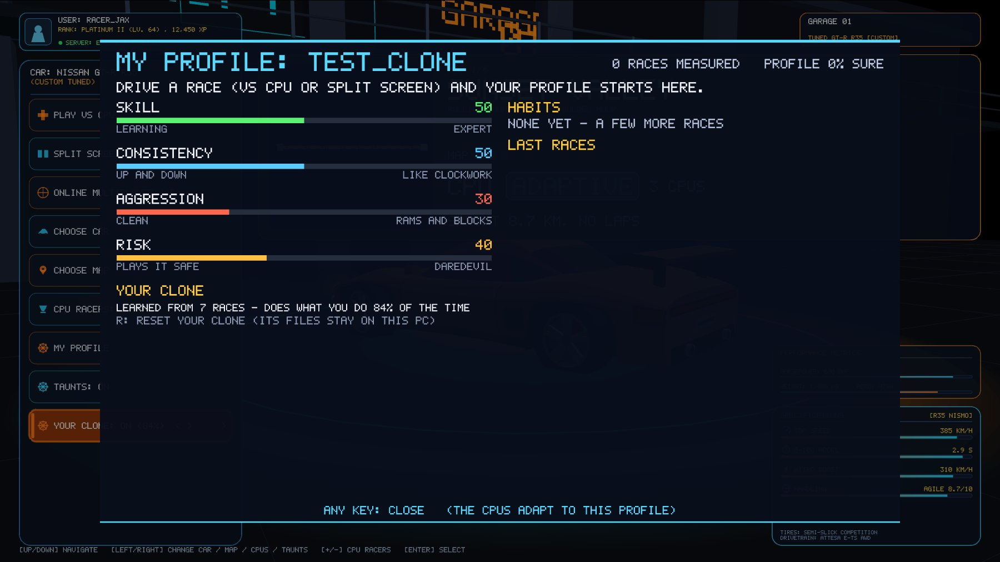
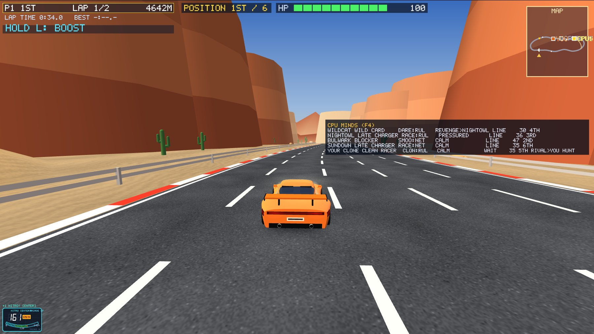

## Checks

**Proof without a human** (`ai_bench clone`): three test drivers stand in for people. Each is
recorded for 7 races exactly as the game records you, a clone is trained, then original and
clone race the same 6 new races:

| Driver | Agreement (steer / pedal) | Skill orig → clone | Boost orig → clone | Ramps orig → clone | Finish orig → clone |
|---|---|---|---|---|---|
| rules, skill 0.4 | **81%** (74 / 88) | 0.49 → 0.39 | 2.8% → 0.6% | 37% → 42% | 150.1 s → 146.4 s |
| rules, skill 0.9 | **84%** (76 / 92) | 0.92 → 0.93 | 1.8% → 1.7% | 52% → 53% | 120.0 s → 119.5 s |
| DAREDEVIL brain | **80%** (70 / 89) | 0.95 → 0.91 | 15.9% → 12.1% | 67% → 62% | 124.1 s → 131.8 s |

- Every clone is above the 75% target.
- Each clone drives at its own original's pace, and the Daredevil's clone is the only heavy
  booster. So the clones copy each driver, and differ from each other the same way.
- The weakest match is the slow driver's skill (0.49 → 0.39). Its clone also needs the safety
  net more (1.5 takeovers a race, against 0–0.5 for the others).

**In the game** (`CAR_RACING_AUTOSHOT_CLONE`, with a test profile):

- The menu item, MY PROFILE and F4 work.
- In the race, the clone finished 3rd of 6, ahead of two named drivers, and the director
  picked it as the rival.
- After the race the recording grew and the clone retrained in the background (8 races,
  94%).

**Nothing else changed:**

- `ai_bench brains` gives the same numbers as milestone 5.
- All 1,200 laps with brains finish.
- Online bots race; the fingerprint matches.

**Not in this milestone:** clones online. The server would need your clone (2 KB); that comes
with accounts in Phase B.

**Files:**

- `shared/clone.*` (new): recording, backpropagation training, the files
- `shared/gamesim.*`: a car can drive with a clone; `cloneView` (what a person sees)
- `shared/brain.*`: the CLONE kind
- `shared/roster.*`: the clone's lines
- `shared/director.cpp`: the clone may taunt
- `glwidget*.cpp`: recording, the YOUR CLONE item, MY PROFILE, results, the scripted test
- `tools/ai_bench.cpp`: `clone`, `clonefiles`
- `*.pro`: clone.cpp added
