# Crashes, block-figure drivers and story mode

> **Changed since (see `docs/jumps-boost-story/README.md`):** every hit now costs 60% of the
> numbers below. A car wrecked twice within 12.8 km is eliminated. The story is no longer a
> menu item: its scenes play before every race in every mode. Your own car has no name
> plate; your place and health are in the bottom-left corner.

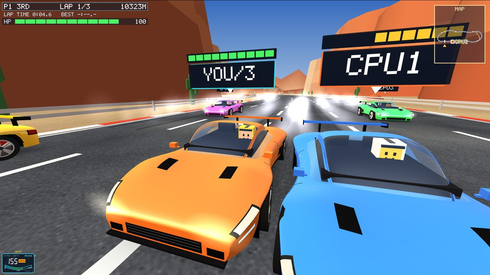

Asked for by the owner, with the professor's ideas: crashes between cars should matter -
every car has a life bar over its name plate and in the corner, the car that rams takes
much more damage than the car it hits, and sometimes the driver falls out of the car and
then carries on; drivers in a toy-brick style; a story after the menu like the big racing
games; and anything else worth improving. All of it is raster graphics like the rest of the
game (OpenGL triangles and the game's own pixel font).

## What other racing games do (research)

| Game | What happens in a crash, or how the story works | What we took |
|---|---|---|
| FlatOut | A hard enough hit throws the driver out through the windscreen (ragdoll, slow motion); you wait to reset the car ([Wikipedia](https://en.wikipedia.org/wiki/FlatOut_(video_game)), [TV Tropes](https://tvtropes.org/pmwiki/pmwiki.php/VideoGame/FlatOut)). FlatOut 2 has stunt events built on it ([Wikipedia](https://en.wikipedia.org/wiki/FlatOut_2)). | The driver thrown out on big hits, slow motion for your own wreck |
| Burnout 3 | Crashes are big events; a wrecked car comes back after a moment; takedowns reward the attacker ([Burnout Wiki](https://burnout.fandom.com/wiki/Takedown), [Wikipedia](https://en.wikipedia.org/wiki/Burnout_3:_Takedown)) | The wreck, coming back in place - but the professor's rule instead of rewards for ramming |
| Blur | A health meter on every car; at zero the car explodes and respawns, losing time, with a few seconds of invincibility ([TV Tropes](https://www.tvtropes.org/pmwiki/pmwiki.php/VideoGame/Blur), [Giant Bomb](https://giantbomb.com/blur/3030-25961/)) | Health on every car, a short "ghost" time after coming back |
| Gran Turismo Sport, iRacing | Fairness online: GT judges who caused a collision and turns rammers into ghosts ([GTPlanet](https://gtplanet.net/improve-maintain-good-sportsmanship-rating-gt-sport), [Kotaku](https://kotaku.com/gran-turismo-sport-will-turn-you-into-a-ghost-car-if-yo-1819719751)); iRacing counts incidents ([iRacing](https://support.iracing.com/support/solutions/articles/31000173709-incident-points)) | Blame from who drove into whom; wrecks and rams on the results screen |
| Crash Team Racing, Need for Speed Most Wanted | A story of areas, each closed by a boss race; a list of rivals to beat one by one ([Activision](https://support.activision.com/crash-team-racing/articles/adventure-mode-in-crash-team-racing-nitro-fueled), [StrategyWiki](https://www.strategywiki.org/wiki/Need_for_Speed:_Most_Wanted/Game_modes)) | Five chapters, each with its own rival, the crew boss last |
| Forza Horizon | The game opens with a short show of the world and its cars before you race ([GamesRadar](https://www.gamesradar.com/why-the-stunning-forza-horizon-5-intro-sequence-took-six-months-to-create)) | The prologue: the temple, the road, a crash |
| LEGO 2K Drive | Toy-brick drivers and a rookie-to-champion story ([Epic Games](https://store.epicgames.com/news/explore-bricklandia-open-world-behind-the-wheel-in-lego-2k-drive)) | The idea of toy figures - ours are our own design |

Our characters, names, story and models are our own; only the ideas above were taken.

## What you see

**Health.** Every car has 100 health: ten blocks over its name plate and, for you, an HP bar
under the race badge (green, then yellow below 60, red and blinking below 30). Hits take
health off and a damage number rises from the car (red when it was that car's fault).
What it costs:

| Hit | Damage |
|---|---|
| Two racers | 110 x how fast they closed in + 4; the car at fault takes 85%, the car it hit 15% (both at fault: half each) |
| Traffic | 80 x how fast you ran into it + 4 (30% if it changed lanes into you) |
| Barrier | 45 x your speed (head-on at full speed: about 50) |
| Guard rail | 30 x how fast you met it + 0.5 (a glancing scrape costs 2-6) |
| Barrel / cone | 9 / 1.5 x your speed |
| Hard / medium landing | 10 / 4 |

After 4 s without a hit a car mends itself, 3 health a second. Messages tell you what
happened ("YOU RAMMED CPU2 -31", "CPU2 HIT YOU -5", "HIT A BARRIER -45"), and a feed on the
right shows everyone's wrecks ("CPU3 WRECKED BY CPU1").

**Wrecks.** At 0 health the car is wrecked: it tumbles one or two rolls with a couple of
hops while it slides to the side of the road, burning and smoking, and loses its nitro.
About every other wreck - and always after a big hit - the driver is thrown out: they fly
through the air tumbling, bounce, lie still for a moment, get up, run back to the car and
hop in. The car is back in the race 2 s after the crash (3 s when the driver was thrown
out) in a lane near where it stopped, and blinks for 1.5 s while it drives through other
cars. Your own wreck shows WRECKED!, YOUR DRIVER FLEW OUT! and BACK IN 3, 2, 1; against
CPUs its first moments run in slow motion and the camera pulls back to show your driver.

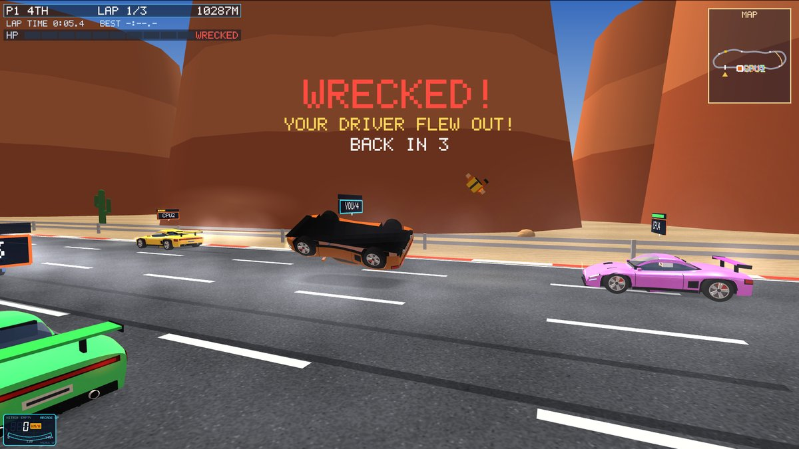
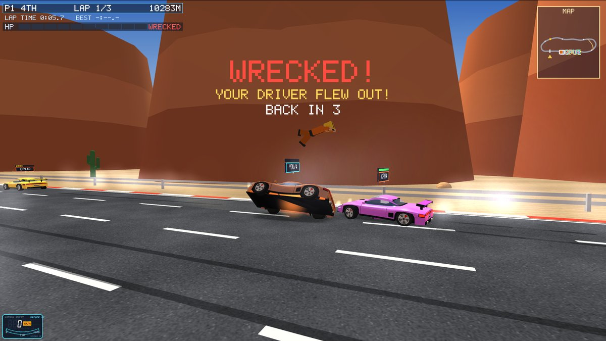
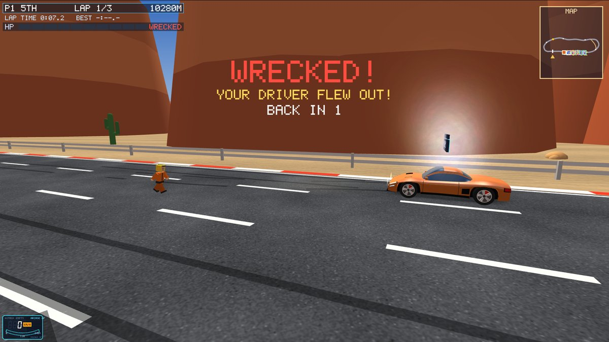
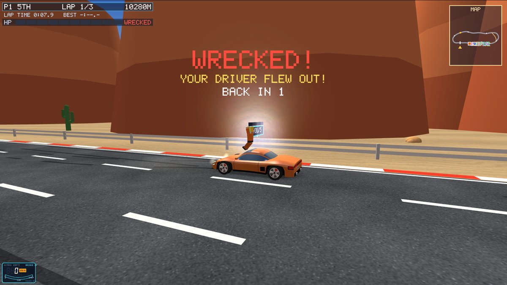
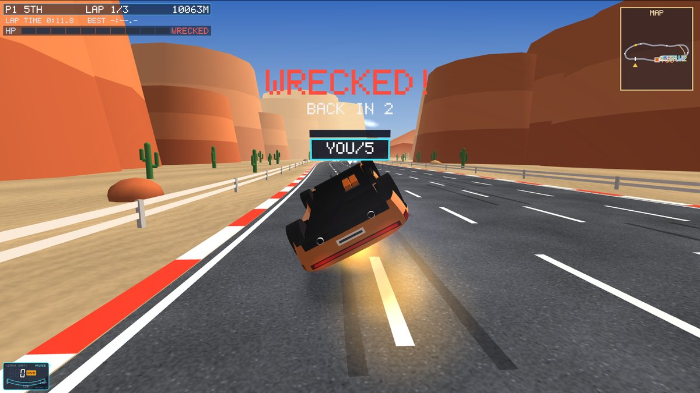
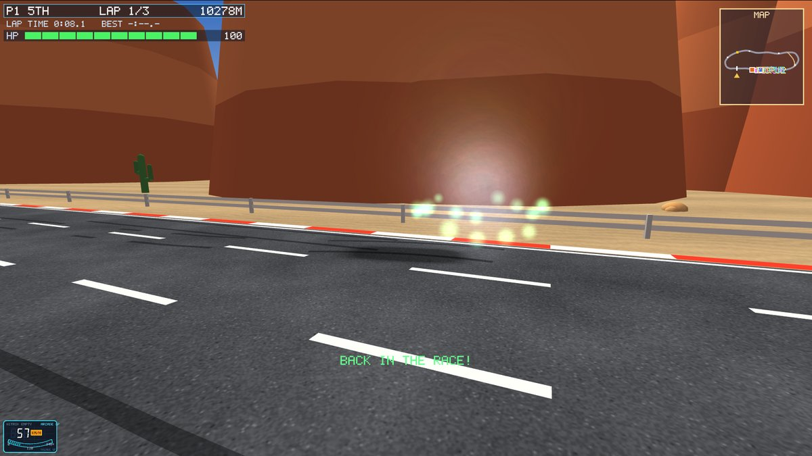

**Block-figure drivers.** Every car has a driver you can see through the glass: a square
head with pixel eyes and mouth, C-shaped hands, overalls in the car's colour, an open-face
helmet (yours is gold) - or, in everyday traffic, plain clothes and hair. The same figures
fly out of wrecks and are the characters of the story.

**Story mode** (the first item in the menu): THE GOLDEN WHEEL. Five roads lead to the old
temple, and the fastest driver lifts its Golden Wheel - but the Brick Barons crew has taken
every road. With Granny Gears' old car you win them back one by one:

| Chapter | Map | Rival | Goal |
|---|---|---|---|
| Prologue | - | the Iron Baron | (a scene) |
| 1 The Valley | Sunset Valley | Dusty Dan | finish in the top 3 |
| 2 The Canyon | Canyon Run | Viper Vex | beat Viper Vex |
| 3 The Mountain | Alpine Pass | Frost Nova | win |
| 4 The City | Neon City | Kai Volt | win without being wrecked |
| 5 The Coast | Coastal Highway | the Iron Baron | win |

Before every race a scene plays at the start grid: the characters stand in front of their
cars and talk, the camera cutting to whoever speaks, the lines typing out ([ENTER] next,
[ESC] skip). The prologue shows the temple, flies along the road and runs a live crash in
which a crew car is wrecked and throws its driver out. After the race the rival and Granny
Gears react; winning opens the next chapter (saved on this computer), and the last one
ends the story at the temple. Story races are against five CPUs, two laps on a circuit,
with your rival in car 2 under their own name and colours; your own menu choices (map, CPU
racers, difficulty, laps) come back when you leave.

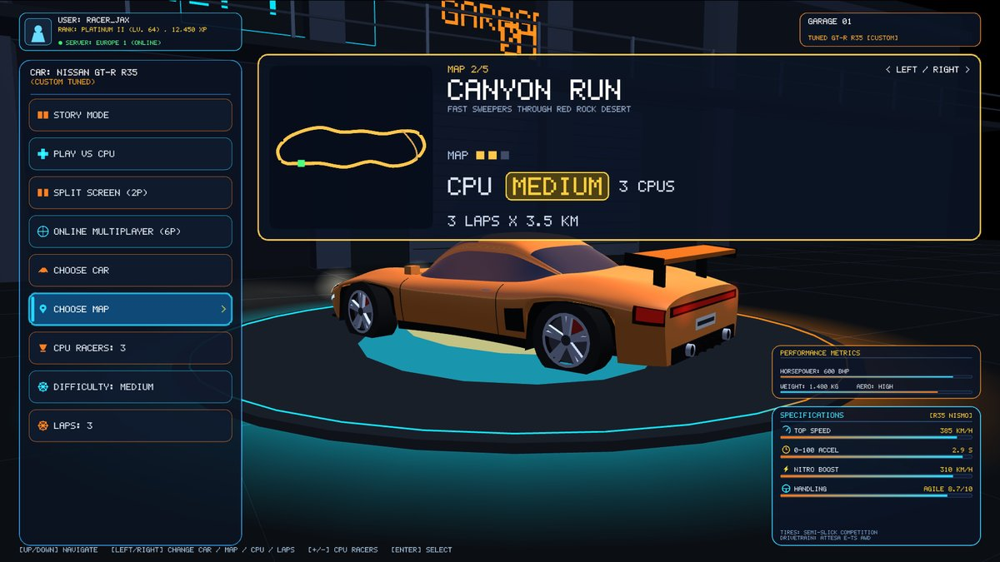
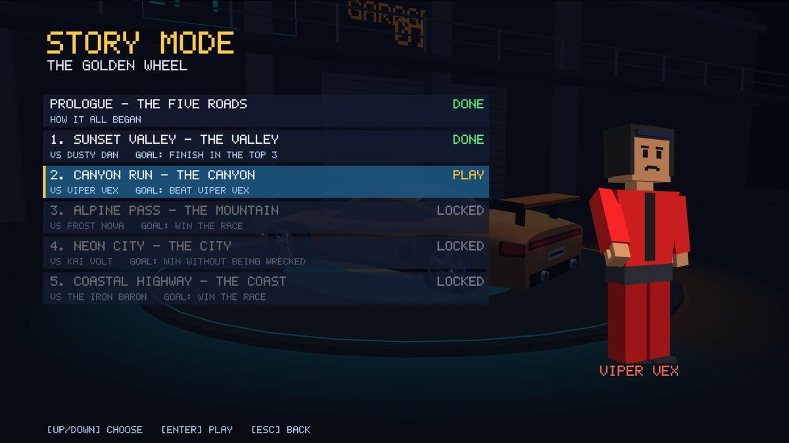
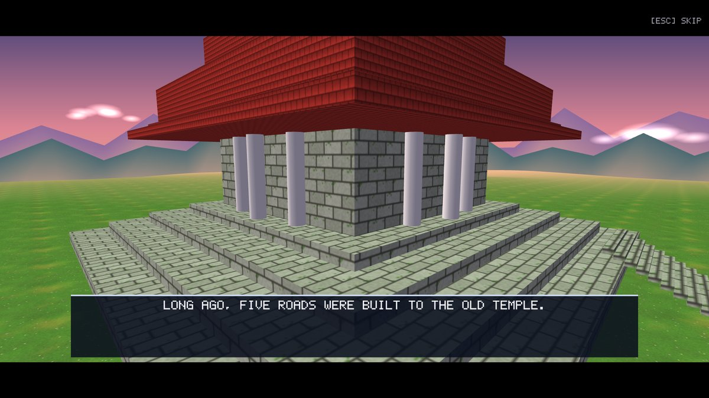
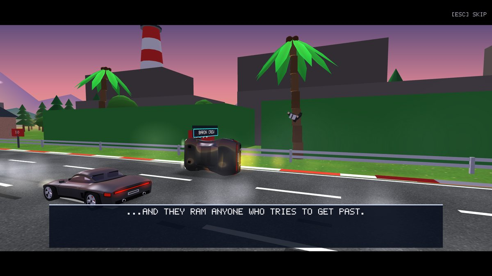
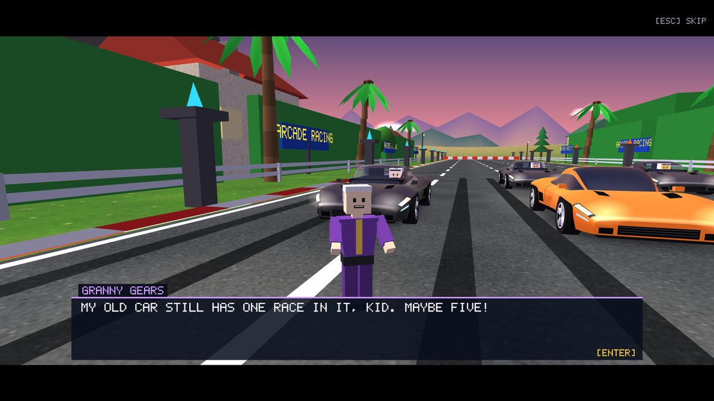
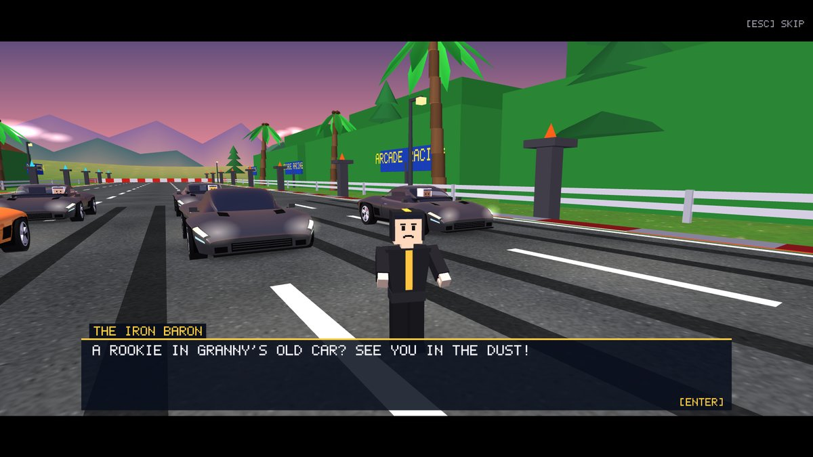
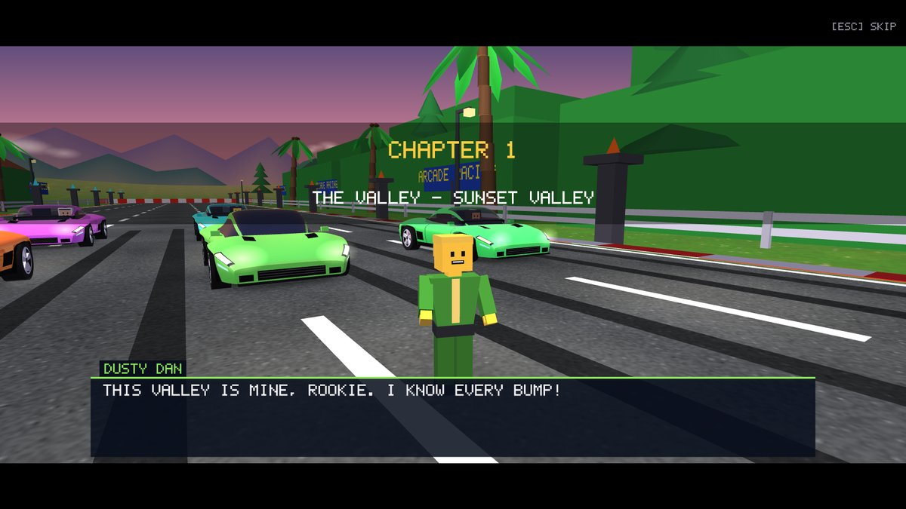

**Other improvements found on the way:**

- Online, the race now waits a quarter of the winner's time for the others (20 to 45 s;
  it was always 20 s, too short for three laps of Neon City).
- The results screen shows each car's wrecks and its rams (hits that were its fault).
- The LAPS item at the bottom of the menu could not be reached with the arrow keys or the
  mouse; now every item can.
- A sprint's start gantry wishes GOOD LUCK instead of CONGRATULATIONS.
- The pixel font has an apostrophe.

## How it works (for the viva)

- **Blame** (`GameSim::collideCars`): when two cars touch, each one's speed towards the
  other is measured along the line between them (the front of one driving into the back or
  side of the other gives a large value, the car that is hit a small one). Their sum is how
  hard the hit was; the share of each one decides the split of the damage. A pair can hurt
  each other again only after half a second, so a long scrape doesn't drain health every
  frame.
- **Damage and wrecks** (`GameSim::damage`, `startWreck`, `wreckStep`): health below zero
  starts a wreck. Whether the driver is thrown out comes from a hash of the tick and the
  car, so every computer online agrees without sending it. A wreck only uses the car's own
  state, so your computer predicts your own wreck exactly like the server.
- **The thrown-out driver** (`GLWidget::ejectedDriver`) is worked out from where the wreck
  began and how fast it was going: a flight under the game's gravity, one bounce, a slide,
  then lying, standing up, running to the car's door and hopping in, all by the tick of the
  wreck - so it needs nothing extra online either.
- **Online version 13**: snapshots carry each car's health, wreck tick, ghost time, where
  and how fast the wreck began, and its wrecks and rams; damage, wreck and comeback events
  travel like the other effects.
- **Drivers in the cars**: a dark cabin is drawn first, then the tinted glass without
  hiding what is behind it, then the driver, so the figure shows clearly through the glass.
- **Story scenes** (`glwidget_story.cpp`): the chapter's grid is set up and frozen; the
  characters are block figures placed in front of the cars; each line chooses a camera (the
  speaker's face, the temple, a flight along the road, the grid, or the live race) that the
  camera eases to. Lines are typed out letter by letter in the pixel font.

## Checks

| Check | Result |
|---|---|
| Whole races of 6 CPU and reference drivers, all maps (15 races) | 90 of 90 finish; CPU drivers drive clean: 0 to 0.17 wrecks a car per race |
| Laps alone with 200 sets of obstacles per map | 1000 of 1000 finish |
| vs CPU and online levels (same as before the crashes) | unchanged results |
| Jumps at every speed, both road widths, with air steering | as before: every landing on the asphalt except full nitro on Neon City's narrow road |
| Ground coming up through the road | 0 places on every map |
| Online bots on all five maps | every car finishes, track fingerprint matches |
| Two game windows online | 16 / 12 small corrections, no big ones, drawing 2.2 ms a frame |
| Scripted screenshots | a wreck with the driver thrown out, frame by frame; every line of the prologue and of chapter 1 |

## Files

- `shared/simtypes.h`, `shared/gamesim.cpp / .h`: health, blame, wrecks, coming back,
  online grace
- `shared/netsnapshot.cpp`, `net/protocol.h`: version 13
- `glwidget.cpp / .h`: block figures, drivers in the cars, wrecks, thrown-out drivers, health
  bars, messages, smoke, slow motion, results, the menu
- `glwidget_story.cpp` (new): story mode
- `pixelfont.h`: the apostrophe
- `tools/ai_bench.cpp`: the crash test (`ai_bench crash`)
