# Side ramps, the L boost, elimination, reckless CPUs and the story in every mode

> **Changed since:** there is no elimination any more. A wreck always ends with
> "BACK IN 3, 2, 1", because the owner found elimination too harsh. Your place and health
> moved from the bottom-left corner to the bar along the top of the screen, beside the race
> badge. See `docs/cpu-psychology/README.md`.

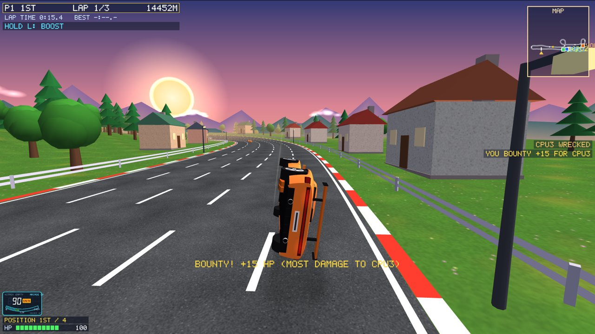

Asked for by the owner:

- Side jumps like the big arcade racers' ramps. How the driver takes them and lands them
  decides the damage: a clean landing costs next to nothing, a bad one a lot, and the car
  can fly off the road or into the river.
- More ramps and obstacles near the finish, so the climax is unpredictable.
- An L key boost that costs health; none in split screen.
- Elimination for reckless driving.
- A bounty for the car that did the most damage.
- Longer and twistier maps with hairpins, a 360° turn and bridges over a river.
- Then, after trying it:
  - gentler damage everywhere;
  - a boost that costs more the longer it is held;
  - elimination measured in distance instead of time;
  - CPUs that also crash and get eliminated;
  - no separate story mode: the story plays inside every mode and can be skipped;
  - no name plate over your own car (place and health in the corner);
  - rule cards in the story that explain all of this.

All of it is raster graphics like the rest of the game (OpenGL triangles and the game's own
pixel font).

## What other games do (research)

Most of these sources are fan wikis and guides, not official documentation.

| Source | What it says | What we took |
|---|---|---|
| [Gameloft help: barrel rolls and 360s](https://gameloft.helpshift.com/hc/en/15-asphalt-9/faq/605-what-are-barrel-rolls-and-360s) | A barrel roll comes from launching off a curved ramp at speed | Twisted ramps roll the car |
| [Asphalt Wiki: air time / star requirements](https://asphalt.fandom.com/wiki/Bonus_Star_Requirements) | Low rolls cost little speed; tricks come from ramps | The roll's size depends on speed and air time |
| [Barrel roll guide](https://sophiecress.com/blog/asphalt-9-barrel-roll-mastery) | Hitting a ramp at a sharp angle gives a flat spin that is hard to control | Hitting a ramp at an angle starts a flat spin |
| [Barrel rolls explained](https://oembed.org/blog/asphalt-9-barrel-rolls-explained), [nitro bottles](https://cyberpost.co/what-does-nitro-bottle-mean-in-asphalt-9/) | A clean, level landing keeps the speed and refills nitro | A clean barrel roll fills the nitro |
| [Asphalt Legends Unite beginner's guide](https://www.levelwinner.com/?p=112382) | You can knock yourself down by taking ramps too slowly or at a bad angle | Too slow at a twisted ramp: the car only tips over and lands on its side |

Our ramps, maps, numbers and look are our own; only these ideas were taken.

## What you see

**Side ramps.** These are pink kickers in the outer lane at the road's edge, with white
chevrons pointing up them:

- **Normal** ramps are pink.
- **Twisted** ramps are purple and orange, with one side higher. They roll the car over in
  the air.
- **Dangerous** ramps have red edges. They come in the last third of the road, are higher,
  and every landing off them costs 1.5 times as much.

How many there are:

| Part of the road | Side ramps |
|---|---|
| First two thirds | about one every 600 m |
| Last third | one every 230–320 m |
| A circuit's last lap | more appear in the last third |

| Ramp | Where you see it |
|---|---|
| 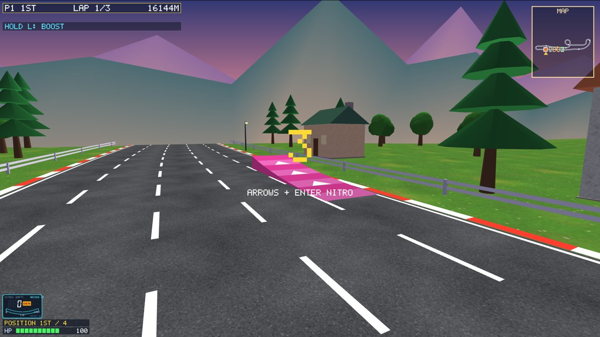 | a normal side ramp in the outer lane |
| 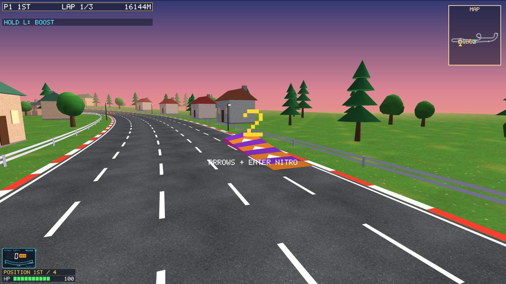 | a twisted ramp |
| 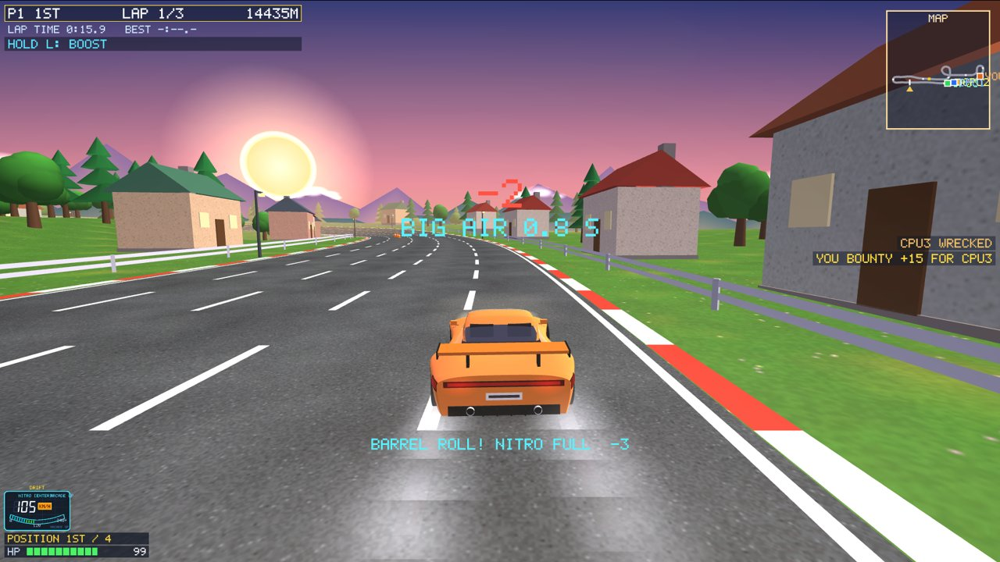 | after the landing: the landing word, how much it cost, BIG AIR |

**Landing: the driver's skill decides the damage.** Off a side ramp the car flies 50–100 m
(up to 240 m with nitro). How it lands:

| Landing | Cost (red ramp: x1.5) |
|---|---|
| Pointing along the road, roll finished | 0.6: PERFECT LANDING |
| Crooked (pointing off the road) | up to 9 more |
| Roll not finished / overdone | up to 15 more |
| On the roof or side | a crash landing: a wreck (health kept, time lost) |
| Off the asphalt | 2.4 more |
| Very hard (full nitro off a high ramp) | a little more |
| Over the guard rail: off the road / into the river / down a gorge | 12 / 18 / 24, put back at the roadside |

Controls in the air:

- **Steering** lines the car up with the road and catches a flat spin.
- On a twisted ramp the roll goes a little too far (115% of one roll in the time in the
  air). **Down (the brake)** slows the roll so the car lands upright. That gives BARREL
  ROLL! and a full nitro.

The road may bend after a ramp, up to 0.7 rad within 120 m, so a careless driver lands
crooked or flies off at the bend.

**More danger near the finish.** The last third of every road has:

- side ramps more than twice as often;
- obstacle groups 40% closer together.

On a circuit's last lap a second set of obstacles and ramps appears there. The HUD warns:
FINAL LAP: MORE OBSTACLES AND RAMPS AHEAD!

**Gentler damage.** Every hit costs 60% of what it did before, for example:

| Hit | Damage now |
|---|---|
| Barrier head-on | up to 30 |
| Traffic | up to 25 |
| Rail scrape | 1–4 |
| Barrel | 6 |

**The L boost** (vs CPU and online; not in split screen):

- Hold L for 10% more top speed, for as long as it is held.
- Health drains while you hold it:

  | Held without a break | Cost |
  |---|---|
  | First 3 s | 1.5 a second |
  | 3–10 s | 4 a second |
  | From 10 s | 25 a second (the engine burns out and the car is wrecked) |

- The HUD line shows how long you have held it, in green, then yellow, then red and
  blinking: OVERHEAT!
- When you let go, the heat cools twice as fast as it built up.
- No mending while boosting.

| Boost | |
|---|---|
| 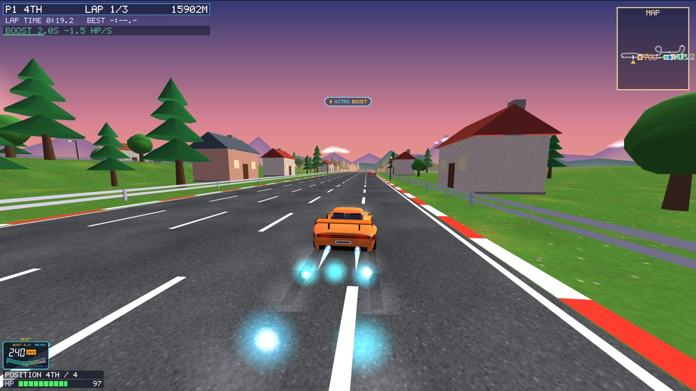 | 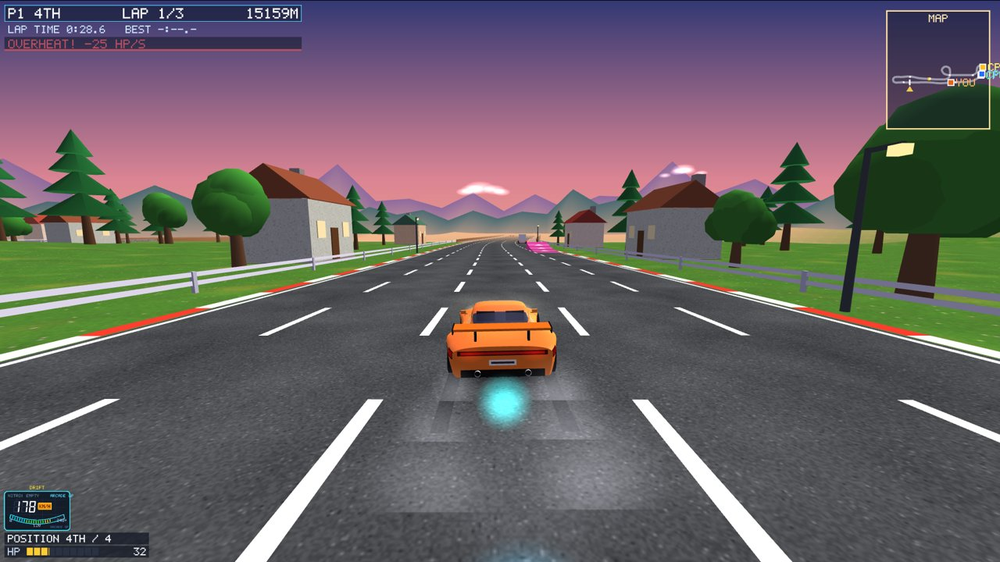 |

**Elimination: a distance, not a time.**

- A car wrecked twice within **12.8 km** is out of the race.
- 12.8 km is how far an average driver (average crashes and speed) goes while losing 70% of
  a life. It was measured with `ai_bench damage`: 5.5 health a km over every map.
- After a wreck the HUD counts it down: LAST CHANCE 9.4 KM.
- When you are eliminated: ELIMINATED! WRECKED TWICE IN 12.8 KM.
- The results show OUT.

**The bounty.** When a car is wrecked, the car that did it the most damage since its last
wreck gets +15 health: BOUNTY! +15 HP.

| Elimination | |
|---|---|
| 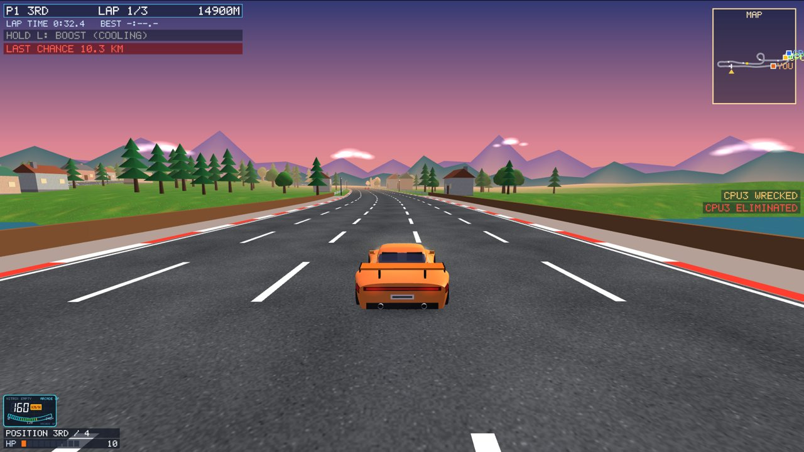 | 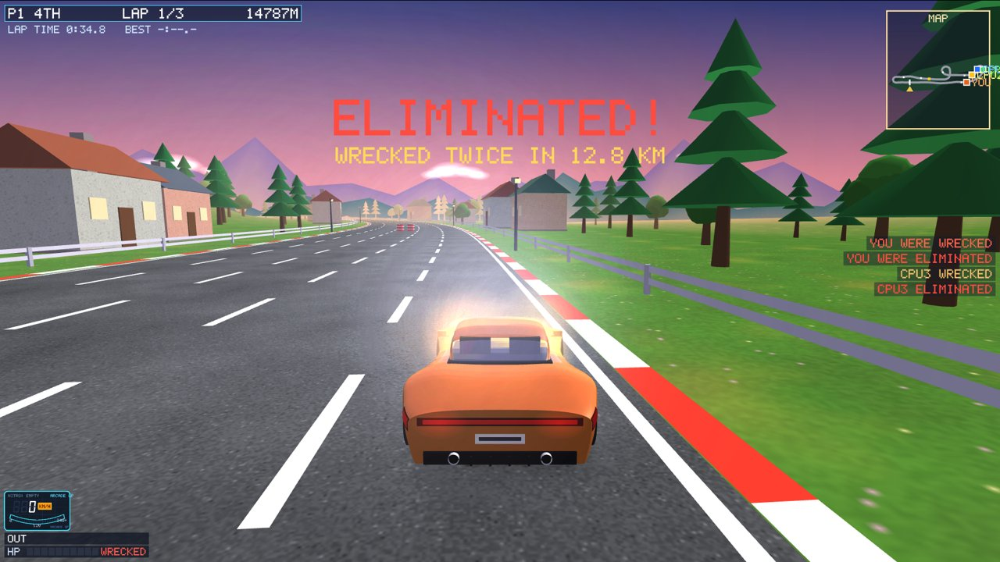 |

**Reckless CPUs (offline and online).** Every CPU has a temper for the race, from a hash of
the race, the map and the car, so every computer agrees. About 30% are calm, 35% normal and
35% reckless. A reckless CPU:

- drives at the car in front three seconds out of four instead of going round it;
- brakes late for corners;
- takes almost every ramp and lands its rolls carelessly;
- holds the L boost for 4–9 s whatever the road does. One long boost in four goes past
  10 s and burns its engine out.

Reckless CPUs crash, wreck and sometimes get eliminated: about 12% of all CPUs over a test
of 108 cars.

**River Serpent, a sixth map.**

- A 5.4 km lap that crosses its river twice on low bridges.
- It climbs to a banked hairpin and winds once right round a spiral that climbs 10 m over
  its own entry.
- It comes home down long hills to a second hairpin before the start, with a ramp jump on
  the way.
- Its long straights carry most of the side ramps.

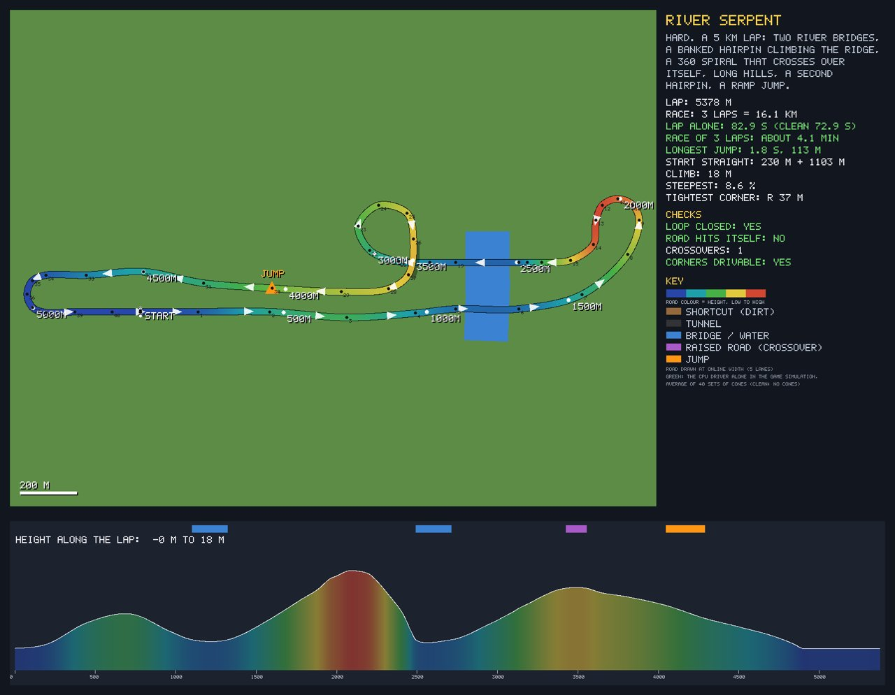

**Your car has no name plate.** Your place and health are in the bottom-left corner, under
the speedometer: POSITION 3RD / 6 and the HP bar. The other cars keep their plates.

**The story is inside every mode.** STORY MODE is no longer a menu item.

1. Before every race the scene of the map's chapter plays at the grid: vs CPU, split
   screen and online. The very first time, the prologue plays before it.
2. Then a rules card explains a part of the rules:
   - crashes and elimination;
   - side ramps and landings;
   - twisted ramps;
   - the L boost;
   - the last third;
   - a summary.
3. Keys: [ENTER] goes on, [ESC] skips the scene and the card.
4. **vs CPU:** your rival from the chapter races in car 2 under their name. After the race
   they react, and winning the chapter's goal is saved.
5. **Online:** the server holds the race until every person in the room has watched the
   scene. As soon as **one real player** presses [ESC] it is skipped for everyone. CPU
   racers and test bots never hold it up, and after 75 s it ends anyway.

| Story | |
|---|---|
| 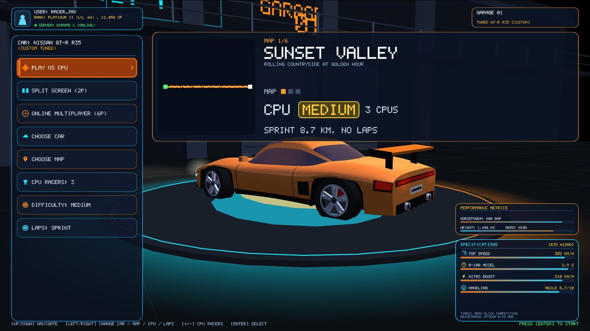 | 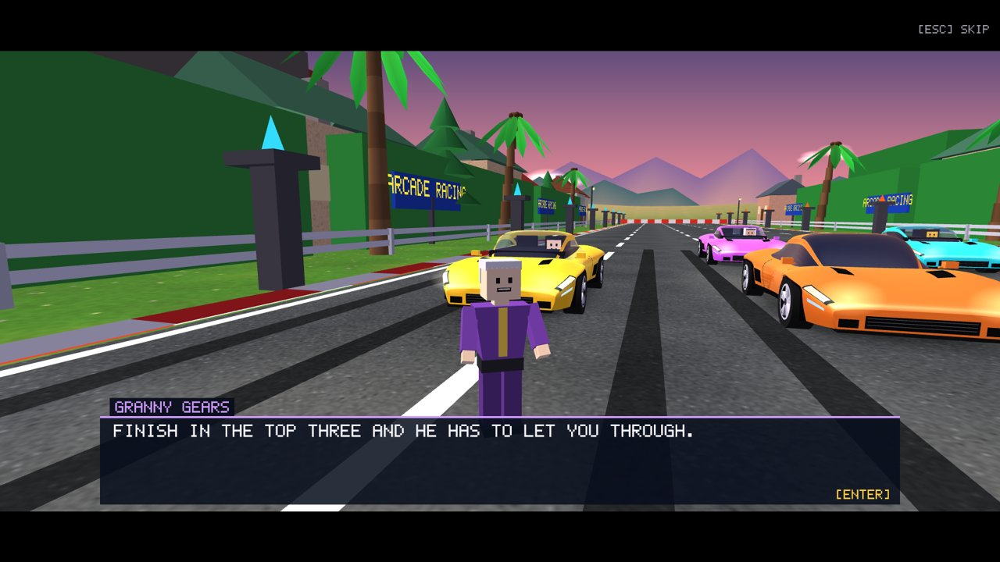 |
| 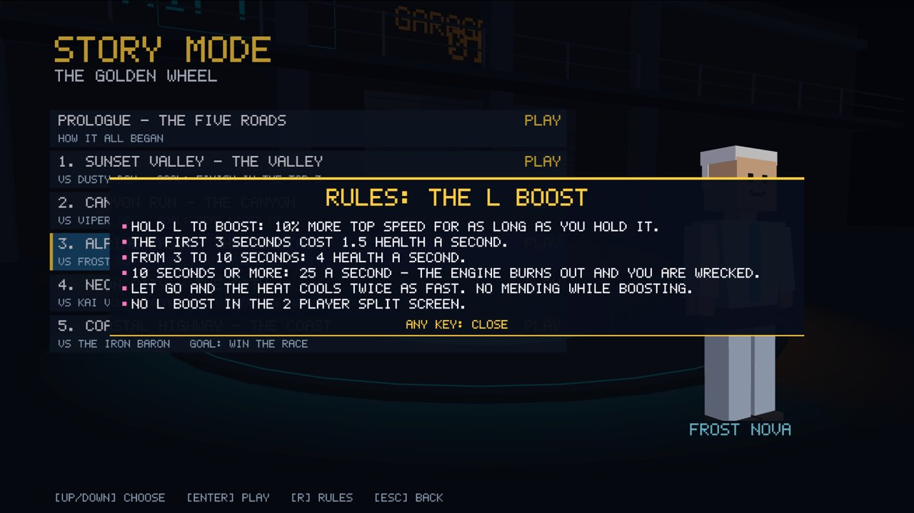 | 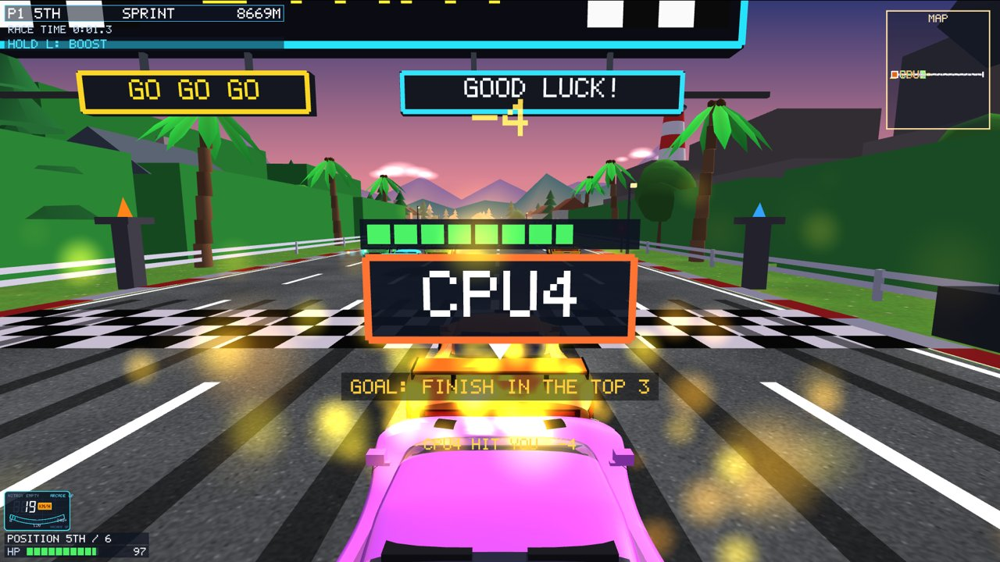 |

## How it works (for the viva)

**Side ramps** (`GameSim::placeSideRamps`, `sideLift`, `surfaceAt`):

- Each ramp is a lane-wide wedge: the height rises as u² over 16 m to its lip, then drops
  straight back down. A twisted ramp is 40% higher on one side.
- `surfaceAt` is the road plus the ramp. Only the car's physics uses it; the road mesh does
  not change.
- A car meeting the side or the drop of a ramp is pushed back and loses health.
- Ramps are placed from their own random generator, so obstacles, nitro and traffic stay
  where they were. They stay clear of tunnels, roads overhead, the big ramps, the shortcut
  and the start.

**The flight** (`GameSim::fly`):

- At take-off a twisted ramp sets the roll rate from the flight time worked out along the
  road ahead (`airTimeLeft`).
- Hitting a ramp at an angle sets a flat-spin rate that keeps turning the car until it is
  steered out of.
- At landing, the angle to the road, the unfinished roll, the asphalt and the vertical
  speed make up the damage, times the ramp's danger.
- Beyond the guard rail (`landOutside`): water, ground or gorge, then the car is put back
  at the roadside.

**Last lap extras:** obstacles and side ramps carry `fromLap`. They are only there once the
leader has started that lap (`present`). Every computer knows the leader's lap from the
snapshots.

**L boost and elimination** (`updateCar`, `healthGone`):

- `boostHold` counts the ticks L is held. The cost per tick comes from its stage.
- When health runs out, `healthGone` pays the bounty (the largest entry in `dmgFrom`), then
  either wrecks the car or eliminates it. It eliminates when the race progress since the
  last wreck is under `ELIM_DIST`.

**Tempers** (`GameSim::aiTemper`) change only the CPU's decisions: hazards, braking, ramp
choice, roll braking, boosting. The car's physics is the same for everyone.

**Online version 14:**

- The input byte carries L (bit 32).
- Snapshots carry: eliminated, the progress of the last wreck, the boost, the bounties,
  the barrel roll, the spin and the flight.
- New messages:
  - `C_STORY`: the client tells the server it watched the scene (0) or skips it for
    everyone (1).
  - `S_STORY_END`: the server tells every client the countdown starts.

## Checks

| Check | Result |
|---|---|
| Whole races, 6 cars, every map (`ai_bench lives`) | CPU drivers land most side jumps cleanly; reckless ones crash and about 12% are eliminated |
| Damage per km of average drivers (`ai_bench damage`) | 5.5 a km → elimination distance 12.8 km |
| Laps alone with 200 obstacle sets per map, 2 laps | 1199 of 1200 finish; none stuck (one eliminated) |
| Every side ramp at 0.9 / 1.1 / 1.3 / nitro speed, CPU steering | clean or small landings; twisted ramps land with 2–6 damage |
| Ground coming up through River Serpent's road | 0 of 13445 checks |
| Online bots on all six maps | every race finishes, track fingerprint matches |
| Two game windows online | small corrections only (14 / 8), no large ones |
| Scripted screenshots | ramps, a barrel roll, the boost at 2 / 5 / 11 s, last chance, elimination, the story scenes and cards |

A bug found on the way: a circuit's last-lap obstacles could land on top of the first set
and close every lane. Lone drivers then hit the same barrier again and again, and about
40% of them were eliminated. Every obstacle group now keeps 45 m from the others.

## Files

- `shared/simtypes.h`, `shared/gamesim.cpp / .h`: side ramps, flights and landings, L
  boost, elimination, bounty, CPU tempers, last-lap extras
- `shared/circuits.cpp`: River Serpent
- `shared/netsnapshot.cpp`, `net/protocol.h`, `net/raceclient.*`, `net/raceserver.*`: version 14,
  the online story scene
- `glwidget.cpp / .h`: ramps, the barrel roll, landing words, splashes, the boost and
  last-chance lines, place and health in the corner, no story menu item
- `glwidget_story.cpp`: the story in every mode, River Serpent's chapter, the rules cards
- `glwidget_online.cpp`: L online, the story hold
- `tools/ai_bench.cpp`: `lives` and `damage`
- `tools/net_bots/main.cpp`: bots never hold up the story
