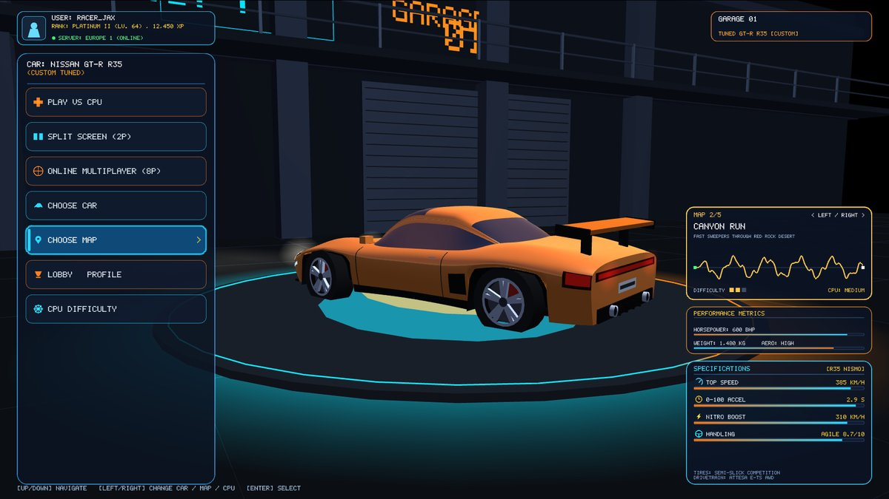
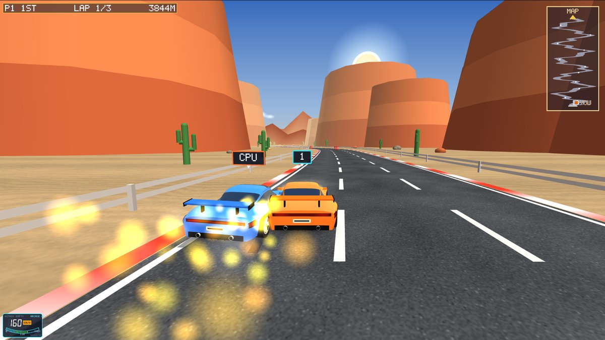
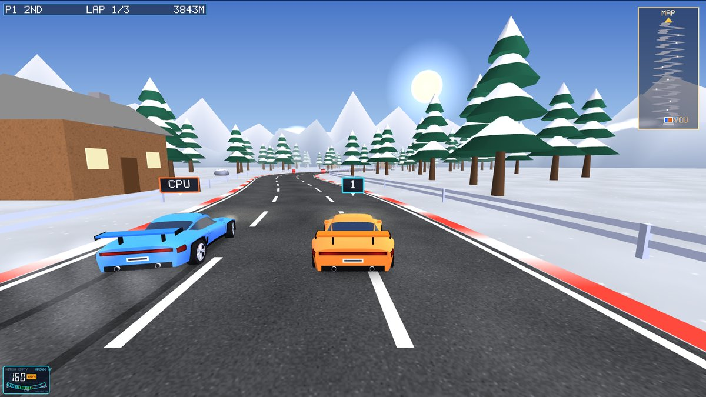
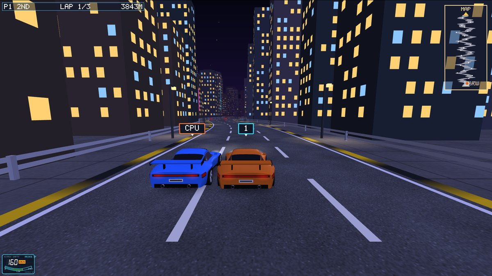
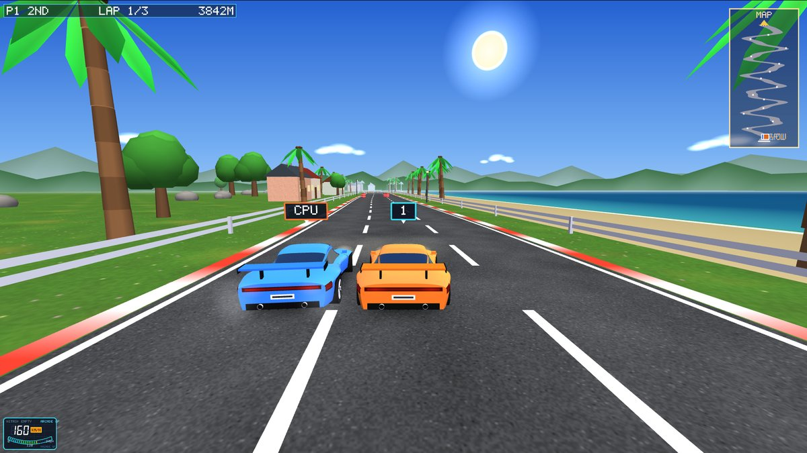

# Five maps and a CPU that really races

## 1. Pick a map in the menu

In the garage menu, highlight **CHOOSE MAP** and press **Left/Right** (or Enter, or click).
The card on the right shows the map name, a one-line description, its difficulty and a
preview of the road's shape from start to finish. **CHOOSE CAR** and **CPU DIFFICULTY**
work the same way: the car colour and spec sheet change with the car, and the CPU can be
set to Easy, Medium or Hard.

| Map | Look | Road |
|---|---|---|
| **Sunset Valley** | Countryside at golden hour: houses, pines, mountains | Rolling bends (the original track) |
| **Canyon Run** | Desert afternoon: cacti, boulders, giant red mesas, sand | Long fast sweepers |
| **Alpine Pass** | Snow: snowy pines, chalets, white Alps, cold blue sky | Tight switchbacks, brake early |
| **Neon City** | Night: lit skyscrapers, skyline, stars, moon, street lights on the road | Chicanes and heavy traffic |
| **Coastal Highway** | Bright midday: beach, surf and ocean, palms, lighthouses | Smooth and flat-out |

**How maps work (for the viva).** A map is one entry in the `MAPS` table in
`shared/gamesim.cpp`:
- The road's centre line is the sum of three sine waves (amplitude, frequency, phase).
  The tightest bend is kept wider than the car's turning circle at full speed (~37 m),
  so every map can be driven flat-out by a perfect driver.
- The map also sets its scenery theme, the amount of traffic and the obstacle spacing.

The simulation places the props for the theme. The renderer (`THEMES` in `glwidget.cpp`)
sets the sky gradient, fog, sun or moon, light colours, ground texture, mountains or
skyline, kerb colours and the reflection map for the car paint.

## 2. A CPU that gives real competition

**Why it always lost before:**
1. The old CPU aimed for a speed above the game's speed limit, so its "catch-up" boost
   never did anything.
2. When it met a barrier wall it couldn't steer around, it stopped dead. With no speed it
   couldn't turn, and it never reversed, so it stayed stuck there.

In a headless test (`tools/ai_bench.cpp`) the old CPU never finished a race.

**The new CPU driver** (`GameSim::computeAIInput` in `shared/gamesim.cpp`):
1. **Sees hazards:** barriers, barrels, cones, traffic it is catching, and the other
   racer. Each one is stored as the band of road it blocks.
2. **Finds the gap:** for the next row of hazards it works out the free gaps across the
   road and aims for the nearest one, preferring a gap that lines up with the row after.
   Cones count as "soft": avoid them if possible, but never brake for them.
3. **Steers with pure pursuit:** it aims at a point further down the road on its chosen
   line, closer when changing lanes and further when settled.
4. **Brakes** for bends tighter than the car can take at its speed, and when it is too
   fast to slide into the gap in time.
5. **Gets unstuck:** if it barely moves for 1.5 s it reverses straight back out, then tries
   again.
6. **Overtakes you** instead of ramming you, and uses nitro on clear straights.
7. **Difficulty and catch-up:** Easy/Medium/Hard set its top speed (95% / 100% / 104%).
   When it falls behind it gets up to +4% / +9% / +14% extra pace, so races stay close.

**Benchmark** (`g++ -O2 -std=c++17 -Ishared tools/ai_bench.cpp shared/gamesim.cpp`):
the CPU races a reference driver that uses the same driving logic at normal speed, with
no catch-up help. Before: the CPU never finished. Now it finishes every race and wins
**10 of 15** (5 maps x 3 difficulties), usually by a few seconds.

## Files changed
- `shared/simtypes.h`: map table types, new prop types, CPU memory in `Car`
- `shared/gamesim.cpp / .h`: 5 maps, theme scenery, new CPU driver, speed scale
- `glwidget.cpp / .h`: themes, sea, skyline, stars, new props, menu pickers, map card
- `carmodel.cpp / .h`: reflection map uses the current map's sky
- `tools/ai_bench.cpp`: **new**, headless CPU benchmark
