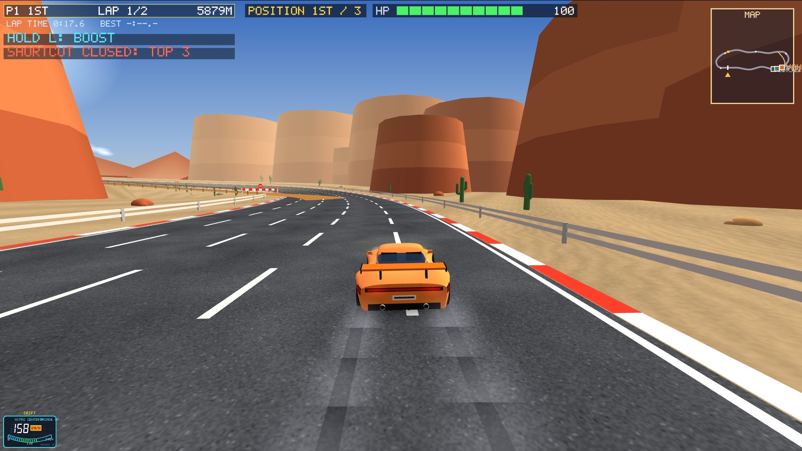

# Maps: the shortcut rule, and adding new maps

## The shortcut is closed to the top 3

The dirt shortcut (Canyon Run, Alpine Pass and Neon City have one) can't be taken by the
cars in **1st, 2nd or 3rd place**. From 4th place back it is open. It's a catch-up chance for
the cars behind, not an extra edge for the leaders.

- **One constant for every map:** `GameSim::SHORTCUT_CLOSED_TOP = 3` in `shared/gamesim.h`.
  Every map with a shortcut follows it, including maps added later.
- **Small races:** with 3 cars or fewer, everyone but the last car is shut out.
- **When it's decided:** until **60 m before the fork**, by the current places. From there to
  110 m past the fork it is kept, so a gate never slams shut on a car already turning in. A
  car already on the shortcut stays on it.
- **The rule in the simulation (so online and offline behave the same):**
  - a car it's closed to never crosses onto the shortcut;
  - the guard rail runs across the fork for that car.
- **What you see:**
  - a red and white barrier with a no-entry sign across the shortcut's mouth, placed where the
    shortcut leaves the main road (found automatically for every map);
  - a HUD line `SHORTCUT CLOSED: TOP 3` or `SHORTCUT OPEN` from 300 m before the fork;
  - the rules cards mention it.
- **CPUs** never plan the shortcut while it's closed to them. The player model doesn't count a
  closed shortcut as one you "chose not to take".
- **Online** version 20 (the flag is in snapshots).

**Checks** (a test program; online with the server and bots):

| Check | Result |
|---|---|
| 18 CPU races on the 3 shortcut maps | 59 entries, **0 by a car it was closed to**; entries by 4th–6th: 56 |
| a leader that tries to take it | **0 of 12** get in (the rail stops them) |
| the last car trying | 8 of 12 get in (it stays open for them) |
| whole races, every map: cars stuck | 0, race times as before |
| laps alone with brains, 200 obstacle sets a map | 1200 of 1200 finish |
| online race on Neon City (server and bots) | finishes; the track fingerprint matches |

## Adding a new map

The code is set up so a new map needs only these steps:

1. **The road:** in `shared/circuits.cpp`, write a function returning a `CircuitDef`. It needs:
   - the control points (heights, banking, flags for jumps, bridges and tunnels);
   - optionally a `shortcut`;
   - `sprint = true` for a one-way road;
   - `rampLipDeg` for its jump ramps.

   Add the function to the list in `draftCircuits()`.
2. **Its look:** in `shared/gamesim.cpp`, add a line to `MAPS[]`: name, tagline, theme
   (scenery and sky), traffic count, obstacle spacing, stars. Then raise `NUM_MAPS` in
   `shared/simtypes.h`.
3. **That's all the game needs.** These follow by themselves:
   - the shortcut rule and its barrier;
   - the player model's clean reference times;
   - CPU brains and the clone (they see the road, not the map);
   - online play;
   - the menu and lobby map pickers.
4. **Optional:**
   - a story chapter for it (`glwidget_story.cpp`);
   - checking it with `tools/track_preview` (top view, heights) and `tools/ai_bench`
     (`calib`, `brains`, the stuck test).
5. **Limits that are already big enough:**
   - profiles keep habits for 16 maps (`PM_MAPS`); a check stops the build if `NUM_MAPS` grows
     past it;
   - the server accepts map numbers 0–31.
6. **If you change a map's road,** raise `PROTOCOL_VERSION` (`net/protocol.h`) so old and new
   games don't meet online on different tracks.

## Jumps, obstacles and damage (every map, new ones included)

All of this is worked out from the track itself when a race starts (`shared/gamesim.cpp`), so a
new map gets it without extra work. The knobs are in `shared/gamesim.h`:

| Knob | Value | What it does |
|---|---|---|
| `LANDING_DAMAGE` | 0.35 | landings (jumps and flips) cost about a third of what they used to; a clean landing or roll costs nothing. A landing only wrecks the car when a roll is about 130° short (was 110°) or the car comes down sideways |
| `EXTRA_RAMPS` | 2 | big ramps added on top of a map's own (`TF_JUMP` points): on a stretch with under 0.3 rad of turn over the 150 m after the lip, no bend tighter than 120 m, flat (slope under 6%), no tunnel, bridge or overpass; 500 m from other ramps, 300 m from the start and finish, 250 m from the shortcut |
| side ramps | about twice as many | every 260–350 m early in the race, 150–200 m in the last third, at least 80 m apart |
| `OBSTACLE_GAP` | 0.6 | obstacle groups come this much closer together (a map's own `obstacleGapMin/Max` still set its pace); a blocked spot slides up to 150 m on instead of being skipped |
| `OBSTACLE_DAMAGE` | 1.5 | hits on obstacles and barriers cost this much more. **Crashes between cars are unchanged** |

The obstacles, with roughly what a full-speed hit costs (before the leader/last-place scaling):

| Obstacle | Hit | Notes |
|---|---|---|
| cone | ~1 | knocked away |
| tyre stack (new) | ~6 | knocked away, the car keeps 65% of its speed |
| barrel | ~8 | knocked away |
| barrier | ~40 (was ~27) | stays put; one lane |
| concrete block (new) | ~45 | stays put; one lane. **Road block:** a row across every lane but one, with cones in front as a warning |

Every road block leaves at least one lane open, and obstacles stay clear of ramps, the shortcut's
fork and merge. More appear in the last third and on the last lap.

**Checked** (CPU benchmark, 15 races of 6 cars per map, before → after): landing damage per car
and race 5–18 → 3–8; damage from barriers and blocks 0–15 → 0–54; wrecks per car and race
0–0.06 → 0–0.11; finishing rates and difficulty levels the same. Every launch off the new
ramps with steering lands on the road (`ai_bench jumps`). `CAR_RACING_AUTOSHOT_OBST=1` takes a
screenshot before the first concrete block, tyre stack and last ramp on every map.

## Longer jumps, gentler steering, mines and stones

| Knob (`shared/gamesim.h`) | Value | What it does |
|---|---|---|
| `STEER_RATE` | 0.024 (was 0.030) | radians a tick at full lock |
| `STEER_TAP` | 0.6 | a key just pressed turns this much of full lock; full after a few ticks |
| `jumpMulFor` | 1.25-1.46 (was 1.08-1.26) | each next car over a ramp is still thrown higher, every case stronger |
| `JUMP_CARRY` | 1.16 | in the air a car covers this much more ground |

Together a jump covers about 25-32% more road (`ai_bench jumps`). Steering in the air went from 0.33 to 0.55 of normal,
and a side ramp needs a fairly straight road for 170 m (was 120 m), so a longer flight still lands on the road.

Every map gets, automatically and with their own random numbers (`GameSim::startRace` obstacles section):

- **Mines:** a black mine under a red skull sign, with a red cross on the road, in one lane. Hitting one takes all your
  health at once and throws the driver out; flying over it is safe. The placement aims for 2-4 plus one in the last
  third, but only places what fits (`keepClear`, not soon after a bend), so a map can have fewer (1-3 at last count).
- **Stones and road blocks:** one extra pattern every 150-230 m where there is room, always leaving a lane open.

CPUs steer out of a mine's way in good time and miss about one time in twelve (`computeAIInput`).
Screenshots: `CAR_RACING_AUTOSHOT_OBST=1`. Wreck causes per map changed from the first version after CPUs were flying over
the rails: at last check 0-0.33 wrecks per car and race.

## The challenge: CPUs follow your results

No level to choose. `PlayerProfile::challenge` (-0.4 to 1.0, saved with the profile) moves after each race: 1st +0.06,
2nd +0.025, last -0.03, other places -0.015. It moves the CPUs' skill centre, and above 0 they also make fewer mistakes and
take more jumps, shortcuts and boosts. No rubber band: the same cars, driven better. Online the room's people are averaged.
`ai_bench challenge`, a strong reference driver against 5 CPUs: at 0 it won 17 of 18, at 1.0 it won 4 of 18, and following
its results over 60 races it settled at 1-4 wins in 10.
