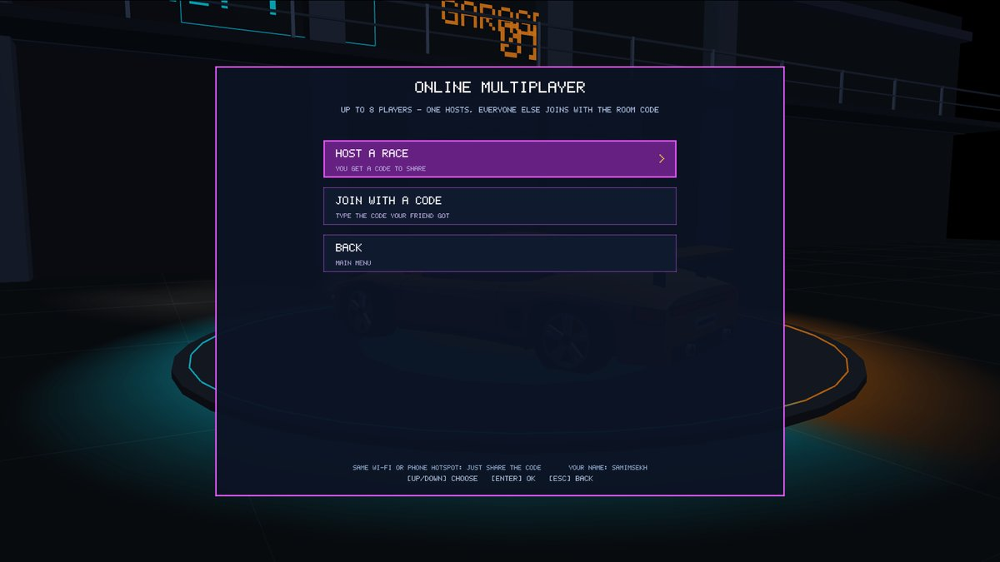
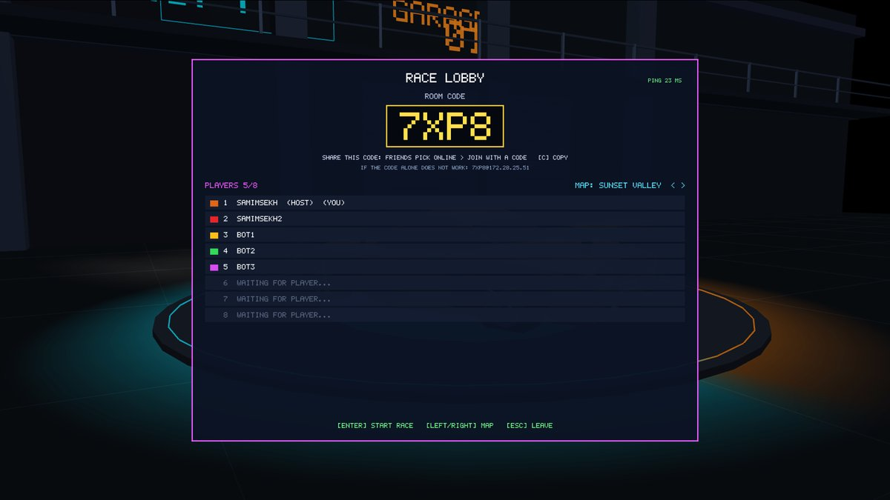
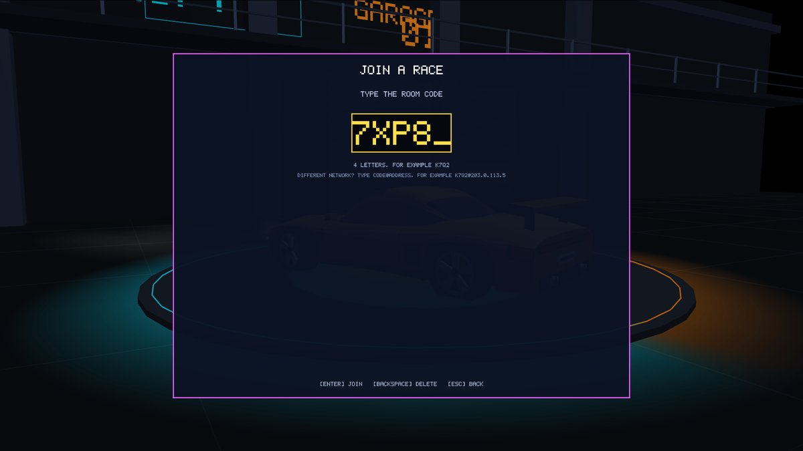
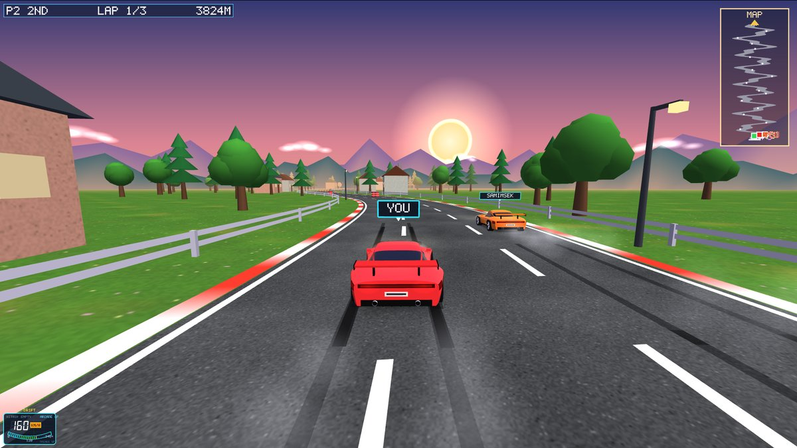
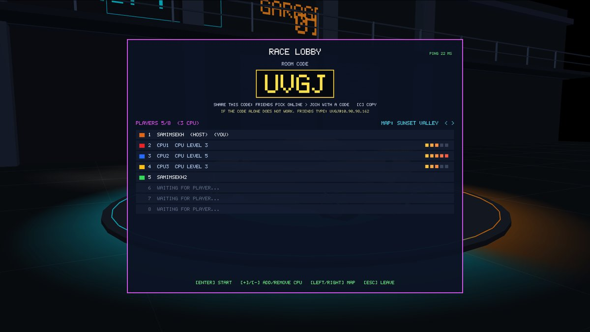
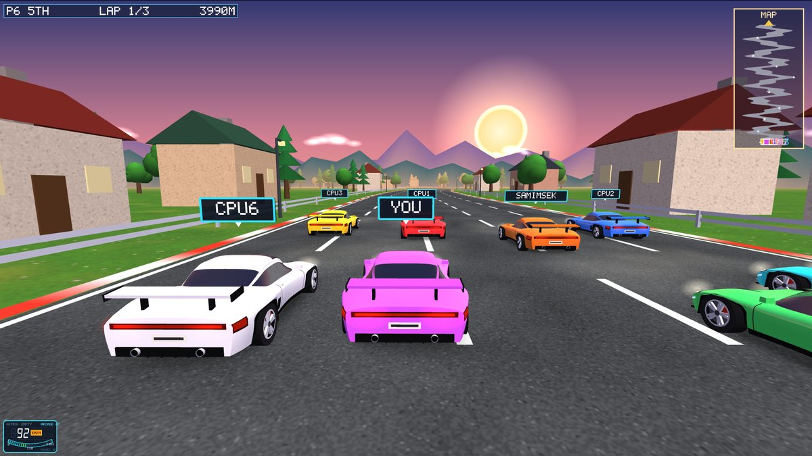
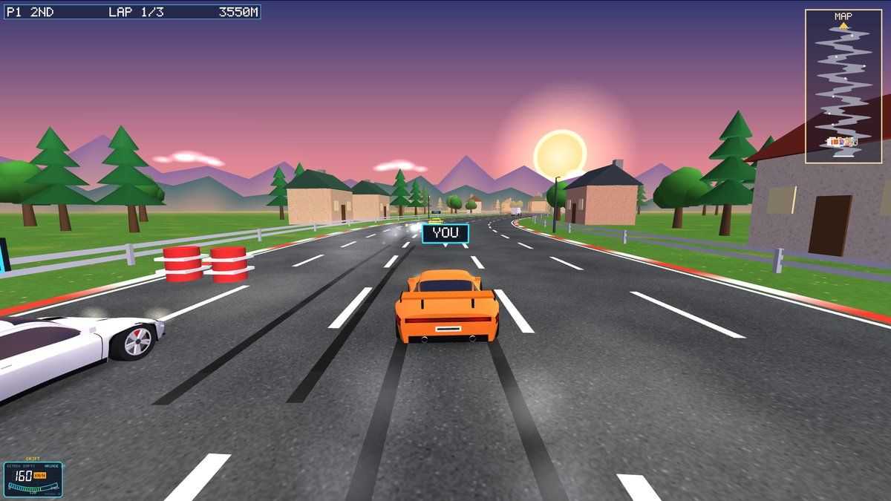
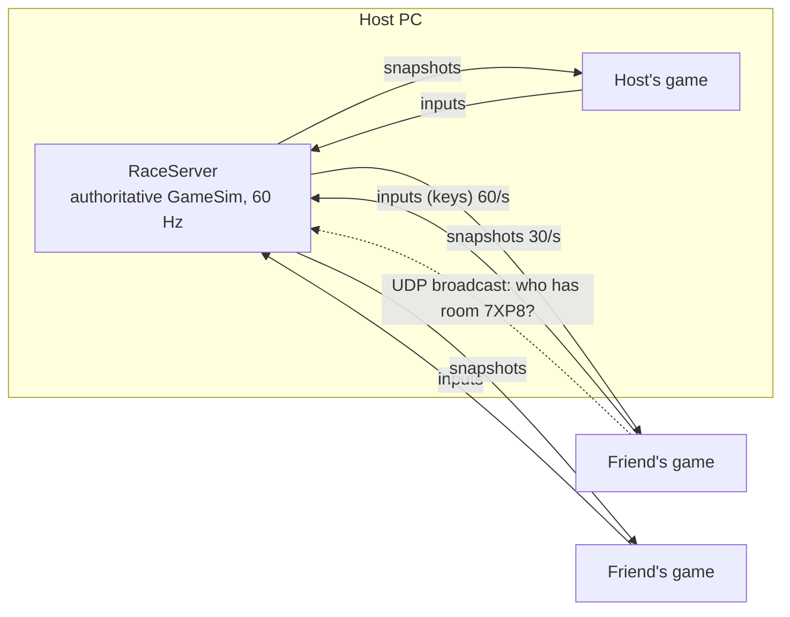

# Online multiplayer: share a code, race up to 8 players

It works like skribbl.io: one player hosts and gets a **4-letter room code**, everyone
else types that code and joins the race from their own computer.

## How to play

**Everyone on the same Wi-Fi or the same phone hotspot (easiest):**
1. Host: main menu → **ONLINE MULTIPLAYER (8P)** → **HOST A RACE**. A room code appears,
   for example `7XP8`. Press **C** to copy it and send it to your friends.
2. Friends: **ONLINE MULTIPLAYER (8P)** → **JOIN WITH A CODE** → type `7XP8` → Enter.
   Their game finds the host on the network by itself; nobody types an IP address.
3. The lobby shows everyone who joined (up to 8). The host can fill empty seats with CPU
   racers (**+** / **-**, see below), picks the map with Left/Right and presses **Enter**
   to start.
4. Drive with arrows **or** WASD, nitro with Enter **or** Space. Esc leaves the race.
   After the finish the results stay on screen, then everyone is back in the lobby.

The first time you host, Windows asks whether to allow the game on the network:
click **Allow** (private networks).

### CPU racers

In the lobby the host presses **+** (or **B**) to add a CPU racer and **-** to remove the
last one. Any number from 0 up to the free seats works: with 4 people in the room the host
can add 0 to 4 CPUs. Each CPU gets a **random level from 1 to 5**, shown as `CPU LEVEL n`
and as pips on its row. The host's computer drives the CPUs, so the friends' games need
nothing extra. If the room is full and another friend joins, a CPU gives up its seat.

| Level | Speed vs a good driver | Catch-up when behind | Nitro | Ahead of the leading person |
|---|---|---|---|---|
| 1 | 10% slower | up to +2% | only to catch up | eases off at once |
| 2 | 5% slower | up to +5% | only to catch up | eases off 20 m ahead |
| 3 | the same | up to +8% | unless clearly ahead | eases off 60 m ahead |
| 4 | 4% faster | up to +11% | whenever the road is clear | never eases off |
| 5 | 8% faster | up to +15% | whenever the road is clear | never eases off |

Measured with `tools/ai_bench.cpp` (25 races of 6 cars on all 5 maps, every level starting
from every grid slot): average finishing place level 1: 6.0, level 2: 4.8, level 3: 3.3,
level 4: 1.9, level 5: 1.2; the reference driver standing in for a good human: 3.8.

Each track also has a few more nitro cans now: about 10 per track instead of 7 or 8.

### Wider road and simpler obstacles online

Single player and split screen keep the 3-lane road. Online races (up to 8 cars) get:
- **A 5-lane road** (23 m wide instead of 14 m), with the guard rails and scenery moved out.
- **A wider starting grid:** rows of 4 cars instead of 2, so the field doesn't pile up at
  the first bend.
- **Simple obstacles only:** three cones in a row along one lane, or two barrels side by
  side in one lane. No barrier walls or cone walls that close most of the road, and about
  60% more room between obstacles. There is always a free lane.
- **Half as much traffic.**

The CPU drivers also got better at passing traffic and other racers: they keep a car or
truck that is right beside them in mind until they are past it, instead of scraping
along its side.

Measured with `tools/ai_bench.cpp`, 15 races of 8 cars (3 reference drivers + levels 1-5):

| | Before | Now |
|---|---|---|
| Cars that reach the line before the race closes | 44 of 120 | 120 of 120 |
| Crashes per car per race (hitting a car, truck, cone, barrel or rail) | 43 | 6 |
| Winner's time | about 86 s | about 57 s |

**If the code alone is not found** (some college/office Wi-Fi blocks device discovery),
the host's lobby shows a line like `7XP8@192.168.1.23`. Type that whole line instead of
the code.

**Different networks / over the internet:** run the dedicated server
`turbo8_server.exe` on a machine everyone can reach (a cloud VM, or a home PC with TCP
port 47800 forwarded on the router). Players join with `CODE@server-address`, and the
host creates the room on it by starting the game with
`CAR_RACING_SERVER=server-address` set.

## If friends cannot join (troubleshooting)

The host lobby shows **JOIN ATTEMPTS FROM OTHER PCS** while you are alone in the room.
Ask a friend to try joining and watch that number:

| What you see | Cause | Fix |
|---|---|---|
| Friend sees "ROOM ... NOT FOUND" and the host's counter stays **0** | Windows Firewall on the host blocks the game. Very common when Windows calls the Wi-Fi a **Public** network (college Wi-Fi such as JU WI-FI): the firewall question only ticks "Private" by default | On the **host** PC: right-click `allow_firewall.bat` → **Run as administrator** (once). Then host again |
| Still **0** after running it | The Wi-Fi blocks devices from talking to each other ("client isolation", normal on campus Wi-Fi) | Turn on a **phone hotspot** and connect both laptops to it, then host again |
| Friend sees "FOUND ... BUT IT DID NOT LET US IN" | The host's firewall drops the connection | `allow_firewall.bat` on the host |
| Friend sees "NO GAME IS HOSTING AT ..." | The host left the lobby or typed address is wrong | Host again, check the CODE@ADDRESS |
| Counter goes up but the friend never appears | Different game versions | Both pull the latest code and rebuild |

`allow_firewall.bat` opens only the game's ports (TCP 47800-47809, UDP 47801) on all
network types and removes "block" rules Windows made if its question was cancelled.
`allow_firewall.bat remove` undoes it. If McAfee (or another antivirus) runs its own
firewall, allow `car_racing.exe` there too.

How a friend's game finds the room: it broadcasts "who has room CODE?" on the Wi-Fi, and
because many routers drop broadcasts it also asks the 1,022 addresses around it directly.
If even that fails, typing `CODE@address` (shown in the host lobby) connects straight away.

## Windows and Mac together

Windows and Mac players can race each other. Things to know:
- **Mac: allow "Local Network".** Recent macOS asks before an app may talk to other
  devices on the Wi-Fi. If the game cannot find a room: System Settings → Privacy &
  Security → **Local Network** → switch on **Qt Creator** (or the game / Terminal, whichever
  started it), then restart the game.
- **Mac hosting:** when macOS asks "accept incoming connections?", click **Allow**
  (`allow_firewall.bat` is only for Windows).
- **Same game version on both.** Every player's game builds the track from the same random
  seed. The track generator now uses its own formula instead of
  `std::uniform_real_distribution`, which gives different numbers on Windows (MinGW) and Mac
  (Clang). The host also sends a **track fingerprint** with the race start; if a player's
  track differs, they see a red "TRACK DIFFERS FROM THE HOST" warning. Different
  online-protocol versions refuse to connect ("Different game version").

## How it works (for the viva)

- **Authoritative server.** The race runs only on the server (inside the host's game, or
  the dedicated server). Games send only their key presses; nobody can cheat by sending
  positions. The simulation is the same `shared/gamesim.cpp` used offline. In the host's
  game the server has a thread of its own, so it keeps a steady 60 ticks a second even
  while the host's game is busy drawing a frame.
- **Room codes and discovery (UDP).** A joiner broadcasts `TURBO8?7XP8` on the local
  network (port 47801). The PC hosting room 7XP8 answers with its game port, and the
  joiner connects to it over TCP (port 47800).
- **Messages (TCP).** Each message is `[length][type][data]`: JOIN, INPUT (sequence
  number + 5 key bits = 6 bytes), START, SET_MAP, PING, ADD_BOT, REMOVE_BOT going to the
  server; WELCOME, LOBBY, RACE_START, SNAPSHOT, PONG, RACE_OVER coming back.
- **CPU racers live on the server.** A CPU seat is a player without a connection. Every
  tick the server asks the same CPU driver used offline (`computeAIInput`) for that car's
  keys, at the seat's level. To everyone else it is just one more car in the snapshots.
- **Snapshots, not the whole world.** The track, scenery and starting traffic are rebuilt
  identically on every PC from the map, the race type (online = 5 lanes) and a random seed.
  A snapshot only carries what changes: up to 8 cars, traffic, knocked-over obstacles that moved, nitro cans, and
  sound/particle events (about 1 KB, 30 times a second).
- **Client-side prediction (your car).** Your game moves your car the moment you press a
  key, using the same physics as the server, and remembers every input it sent. Each
  snapshot says which input the server processed last. The game resets your car to the
  server's position and re-applies the newer inputs. Small differences are blended out
  over a few frames, so the car never jumps.
- **Every input is used exactly once.** The server moves a player's car once for every
  input their game sent, just as their game did when predicting. If an input is late (a
  slow frame on that PC), the car waits a tick; when inputs pile up, it uses two in one
  tick until it has caught up. So the server and the prediction agree, and your car is
  not pulled back.
- **Interpolation (other cars).** Other cars are drawn 80 ms in the past, smoothly
  between the two snapshots around that moment, so they glide instead of stepping
  30 times a second. Snapshots are placed on the server's clock (their tick number), not
  on when they arrived, so a slow frame or a busy network doesn't make the other cars
  stutter.

**Measured** with two game windows on one PC (host + guest + 6 CPU racers, 8 cars):

| | Before the lag fixes | After |
|---|---|---|
| Your car pulled back by more than 0.5 m (host / guest) | 79 / 114 times | 20 / 8 |
| Big jumps (over 6 m) | 8 / 22 | 0 / 0 |
| Longest pause of the server | 536 ms | 9 ms |
| Key presses the server threw away | 121 | 8 |
| Time to draw a frame | 12.5 ms | 2 ms |
| Frames slower than 25 ms (host / guest) | 271 / 140 of 1000 | 71 / 4 |

With 100 ms of simulated delay on the guest (ping 137 ms): 4 small corrections, no big
ones.

What was fixed:
- the host's server ran in the game's own thread and stopped whenever a frame took long;
- the server and the game measured time in whole milliseconds, so the server's race ran
  up to 10% slower than real time while the games sent 60 inputs a second, and inputs
  piled up and were thrown away;
- drawing: headlights and tail lights were worked out from the curved body for every car
  in every frame (now recorded once), as were the wheels and the trees and houses; the
  finish gate and its scenery were drawn even 4 km away.

Two game windows on one laptop share its graphics chip, so they still run a little less
smoothly than two laptops.

## Testing tools
- **Lag simulator:** start the game with `CAR_RACING_LAG_MS=150` to feel a slow
  internet connection (good for showing prediction in the viva).
- **Scripted race with measurements:** `CAR_RACING_AUTOSHOT=<folder>` plus
  `CAR_RACING_NETTEST=host:8:6` in one game and `CAR_RACING_NETTEST=join:CODE` in another
  (the code is written to `<folder>/room.txt`). Each game writes `net_stats.txt`: frame
  times, corrections, gaps between snapshots and, on the host, how the server kept up.
- **Bots:** `net_bots 7XP8 3` adds 3 CPU-driven players to room 7XP8.
  `net_bots NEW@127.0.0.1 8` makes 8 bots create a room, race and print the results
  (needs `turbo8_server.exe` running). `net_bots NEW@127.0.0.1 4 0 4` is 4 players plus
  4 CPU racers on map 0.
- **Dedicated server:** open `server/server.pro` in Qt Creator, or run `turbo8_server.exe [port]`.

## Files
- `net/protocol.h`: ports, message types, framing
- `net/raceserver.cpp/.h`: rooms, codes, lobby, 60 Hz race, snapshots, discovery replies
- `net/raceclient.cpp/.h`: discovery, connection, lobby state, lag simulator
- `glwidget_online.cpp`: online menu, lobby, results, prediction, interpolation
- `shared/netsnapshot.cpp`: writing/reading race snapshots
- `shared/gamesim.cpp`: up to 8 cars, online mode, rank, prediction collisions
- `server/`: dedicated server; `tools/net_bots/`: test bots
