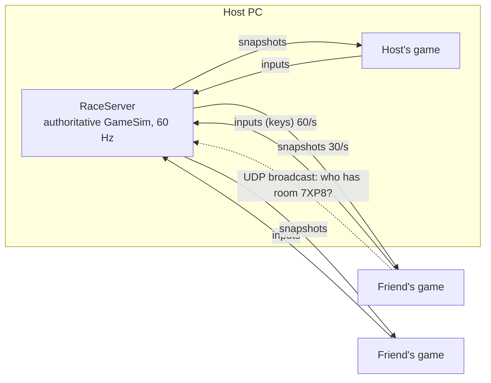

# Online multiplayer: share a code, race up to 8 players

It works like skribbl.io: one player hosts and gets a **4-letter room code**, everyone
else types that code and joins the race from their own computer.

## How to play

**Everyone on the same Wi-Fi or the same phone hotspot (easiest):**
1. Host: main menu → **ONLINE MULTIPLAYER (8P)** → **HOST A RACE**. A room code appears,
   for example `7XP8`. Press **C** to copy it and send it to your friends.
2. Friends: **ONLINE MULTIPLAYER (8P)** → **JOIN WITH A CODE** → type `7XP8` → Enter.
   Their game finds the host on the network by itself; nobody types an IP address.
3. The lobby shows everyone who joined (up to 8). The host picks the map with Left/Right
   and presses **Enter** to start.
4. Drive with arrows **or** WASD, nitro with Enter **or** Space. Esc leaves the race.
   After the finish the results stay on screen, then everyone is back in the lobby.

The first time you host, Windows asks whether to allow the game on the network:
click **Allow** (private networks).

**If the code alone is not found** (some college/office Wi-Fi blocks device discovery),
the host's lobby shows a line like `7XP8@192.168.1.23`. Type that whole line instead of
the code.

**Different networks / over the internet:** run the dedicated server
`turbo8_server.exe` on a machine everyone can reach (a cloud VM, or a home PC with TCP
port 47800 forwarded on the router). Players join with `CODE@server-address`, and the
host creates the room on it by starting the game with
`CAR_RACING_SERVER=server-address` set.

## How it works (for the viva)

- **Authoritative server.** The race runs only on the server (inside the host's game, or
  the dedicated server). Games send only their key presses; nobody can cheat by sending
  positions. The simulation is the same `shared/gamesim.cpp` used offline.
- **Room codes and discovery (UDP).** A joiner broadcasts `TURBO8?7XP8` on the local
  network (port 47801). The PC hosting room 7XP8 answers with its game port, and the
  joiner connects to it over TCP (port 47800).
- **Messages (TCP).** Each message is `[length][type][data]`: JOIN, INPUT (sequence
  number + 5 key bits = 6 bytes), START, SET_MAP, PING going to the server; WELCOME, LOBBY,
  RACE_START, SNAPSHOT, PONG, RACE_OVER coming back.
- **Snapshots, not the whole world.** The track, scenery and starting traffic are rebuilt
  identically on every PC from the map and a random seed. A snapshot only carries what
  changes: up to 8 cars, traffic, knocked-over obstacles that moved, nitro cans, and
  sound/particle events (about 1 KB, 30 times a second).
- **Client-side prediction (your car).** Your game moves your car the moment you press a
  key, using the same physics as the server, and remembers every input it sent. Each
  snapshot says which input the server processed last. The game resets your car to the
  server's position and re-applies the newer inputs. Small differences are blended out
  over a few frames, so the car never jumps.
- **Interpolation (other cars).** Other cars are drawn 80 ms in the past, smoothly
  between the two snapshots around that moment, so they glide instead of stepping
  30 times a second.

**Measured** (this PC: host + guest + 3 bots, guest with 150 ms of simulated lag each
way, ping 217 ms): 16% of snapshots needed a small correction to the guest's car; the
bigger ones come from crashes the server saw first and are blended in smoothly. The
host's car: ping 19 ms, 10% small corrections.

## Testing tools
- **Lag simulator:** start the game with `CAR_RACING_LAG_MS=150` to feel a slow
  internet connection (good for showing prediction in the viva).
- **Bots:** `net_bots 7XP8 3` adds 3 CPU-driven players to room 7XP8.
  `net_bots NEW@127.0.0.1 8` makes 8 bots create a room, race and print the results
  (needs `turbo8_server.exe` running).
- **Dedicated server:** open `server/server.pro` in Qt Creator, or run `turbo8_server.exe [port]`.

## Files
- `net/protocol.h`: ports, message types, framing
- `net/raceserver.cpp/.h`: rooms, codes, lobby, 60 Hz race, snapshots, discovery replies
- `net/raceclient.cpp/.h`: discovery, connection, lobby state, lag simulator
- `glwidget_online.cpp`: online menu, lobby, results, prediction, interpolation
- `shared/netsnapshot.cpp`: writing/reading race snapshots
- `shared/gamesim.cpp`: up to 8 cars, online mode, rank, prediction collisions
- `server/`: dedicated server; `tools/net_bots/`: test bots
