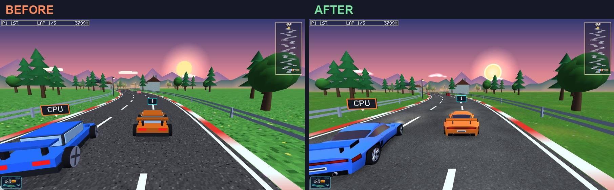
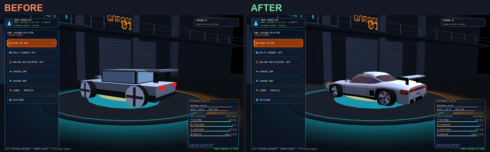
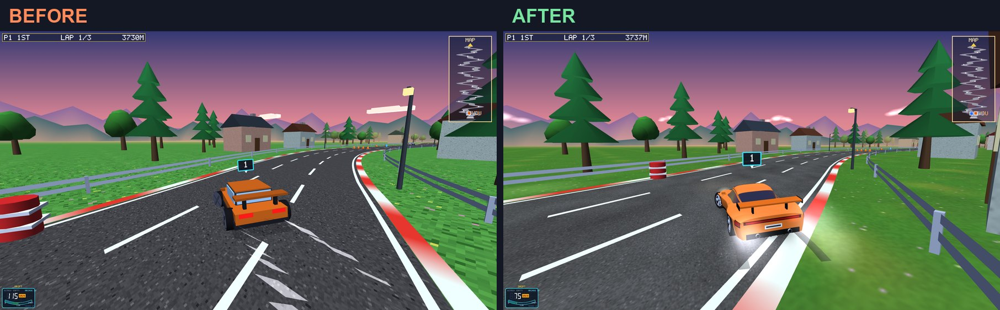
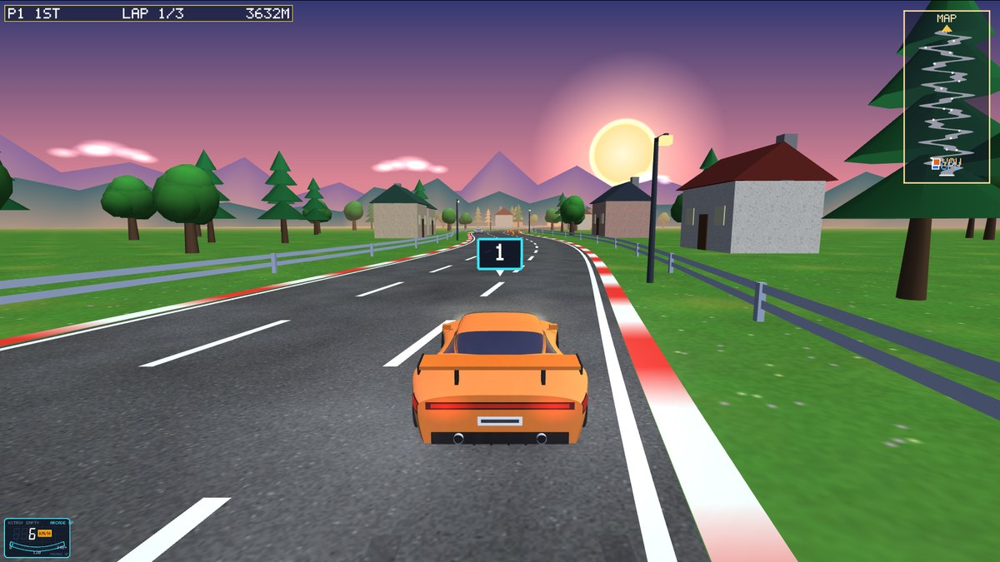
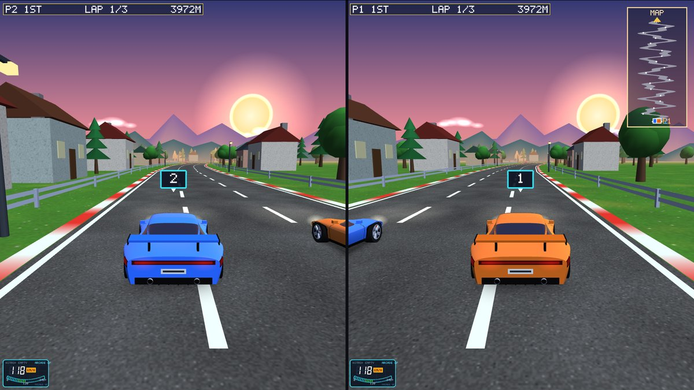

# This week: realistic graphics upgrade

**Goal:** make the Qt/OpenGL racer look like a realistic racing game instead of a block game,
without changing gameplay. The car physics and race rules in `shared/` were not touched, so the
simulation is still deterministic and ready for the online version later.

## What changed

| Area | Before | After |
|---|---|---|
| Car body | ~15 boxes | One smooth sculpted body: rounded nose, raked windscreen, fastback roof, flared fenders, cut-out wheel arches, door mirrors, side intakes, hood vents, diffuser, twin exhausts, number plate |
| Wheels | Cylinder with a "+" | Tyre with sidewalls, polished rim lip, 5 twin-spoke alloys, brake disc, red brake caliper (steers but doesn't spin) |
| Paint and glass | Flat colour | Glossy: specular highlights plus a reflection of the sunset sky (clear-coat look); tinted reflective glass |
| Lights | Coloured boxes | Headlights, LED running lights, full-width tail-light bar; **brake lights glow when a car slows down**; light pools on the road |
| Suspension | Whole car tilted, wheels too | Only the body rolls and pitches; wheels stay on the road |
| Road and grass | 64×64 pixel textures, nearest-pixel sampling | 256×256 asphalt (wear, grain, stones) and 128×128 grass (mottled, dry patches) from fractal noise, smooth trilinear + anisotropic filtering |
| Tyre marks | none | Dark skid marks stay on the asphalt when drifting or braking hard |
| Smoke, dust, sparks | Flat squares | Soft round sprites that always face the camera |
| Sky | Pixel-art sun, box clouds | Smooth sun disc with a soft edge, fluffy layered clouds |
| Shadows | Hard dark rectangle | Soft shadow that fades out at the edges |
| Camera | Fixed distance | Lower chase camera that drops back as speed builds up |
| Tools | none | **F12 saves a screenshot** to `screenshots/` next to the .exe |

## How it works (for the viva)

- **Lofted car body** (`carmodel.cpp`). The body is defined by smooth curves along its length:
  half-width, hood/deck height, shoulder line and sill line. The sill line jumps up into a
  semicircle over each wheel, which cuts the wheel arches. A rounded cross-section (a
  *superellipse*) is swept through 180 stations along the car. Normals for lighting come from
  finite differences of the surface. The cabin glass is a second loft sitting on the body.
- **Display lists.** The ~20,000 vertices are generated once at start-up and compiled into
  OpenGL display lists, so drawing each car per frame is only a few `glCallList` calls.
- **Reflections without shaders.** The renderer is fixed-function OpenGL 2.1. Paint and glass are
  drawn twice: once lit, then again with `GL_SPHERE_MAP` texture generation and additive
  blending, using a small generated "sky" texture (sphere map). The result looks like the sunset
  reflecting in the paint.
- **Procedural textures.** Asphalt and grass are made at start-up from *value noise*: random values
  on a grid, smoothly interpolated. Several octaves are added together (fractal noise). No image
  files are needed.
- **Billboards.** Particles use the camera's right/up vectors, read from the modelview matrix, so
  every puff faces the viewer. Puffs are lifted so the road doesn't cut them with a hard edge.
- **Client-side effects from simulation state.** Brake lights and skid marks are computed by the
  client from each car's speed change and drift flag. The simulation only reports state, as the
  project rules require.

## Files

- `carmodel.h / carmodel.cpp`: **new**, the sculpted car model, lamps, wing, reflection helpers
- `glwidget.cpp / glwidget.h`: new wheels, car drawing, soft shadows, skid marks, brake lights,
  soft particles, new textures, sky, camera, F12 screenshot
- `car_racing.pro`: adds `carmodel.cpp/.h`

## How to test

1. Build and run as usual in Qt Creator.
2. **Play vs CPU**: look at the car from behind and in the garage menu.
3. Hold **Down** while driving fast: the tail lights flare red.
4. Hold **Left/Right** at speed to drift: tyre smoke and black skid marks appear.
5. **C** switches camera (chase / hood / bumper); **F12** saves a screenshot.
6. **Split screen (2P)** still works with both new cars.

